# Chem Illustrator

**Free chemical drawing for the lab, with slides, sheets and documents built in.**

Chem Illustrator draws structures and reaction schemes with the hotkeys and look ChemDraw users already know, and it opens and saves your `.cdxml` files. Around the drawing it builds in the other programs a synthetic chemist spends the day in: slides, spreadsheets, documents and a canvas for posters and figures. Your structures stay editable in all of them, and the formula, masses, stereochemistry and warnings update as you draw.

It is free and open source (GPL v3), and runs on Windows, macOS and Linux.

> **Beta.** Chem Illustrator is under active development: new features arrive every few days and some things may not work as they should yet. Save often, and please [report anything that goes wrong](docs/guide/feedback.md). If you would rather update less often, choose **Stable** updates in **Edit ▸ Settings ▸ Online**: those versions are tried out on a real computer before they are offered.

### [▶ Try it in your browser](https://nathanohare.github.io/Chem-Illustrator/) · [Download the desktop app](https://github.com/nathanohare/Chem-Illustrator/releases/latest)

Nothing to install: the browser version opens straight away. The desktop app adds what a browser can't do: editing drawings inside Word and PowerPoint, AutoSave to your own folders, and automatic updates.

**[User guide](docs/README.md)** · **[Send feedback](docs/guide/feedback.md)**

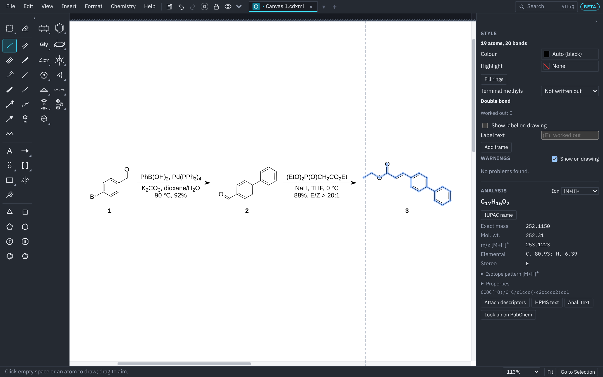

## Smart reaction arrows

Draw an arrow between two structures and a **+** box appears above and below it. Click one and type the reagents: formulas get their subscripts as you type, the text sits just clear of the arrow, and the arrow grows to fit it, pushing the products along so nothing overlaps. **Chemistry ▸ Reactions and Schemes ▸ Scheme Settings** sets the gaps, the text size and alignment, and whether arrows fit their text.

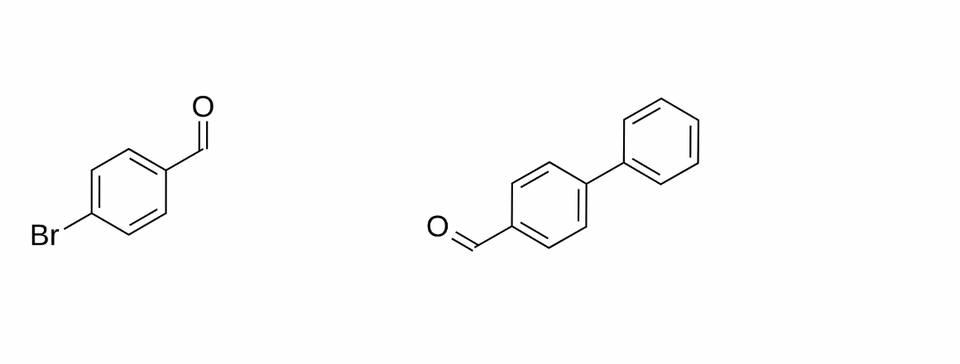

## Schemes that lay themselves out

**Clean Up Reaction** spaces a scheme evenly in one click. **Arrange Scheme** turns a row of steps into rows, a snake, a column down the page, a branching tree or a catalytic cycle, previewing each layout as you click it. A caption on its own goes in the middle of the cycle.

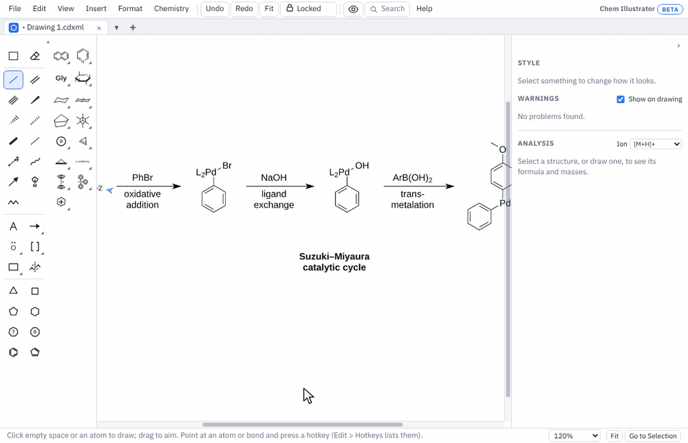

## Reactions that move

**Scheme ▸ Animate Reaction** turns a drawn scheme into an animation: the atoms of each structure move to their places in the next, bonds that break fade out and new ones fade in. An equivalency sign between two drawings of the same molecule turns it in 3-D. Save the clip as a GIF or MP4, or put it on a slide as a looping video that plays in PowerPoint too. Based on [cdxmorph](https://github.com/rshenvi/cdxmorph) by Ryan Shenvi, used with permission.

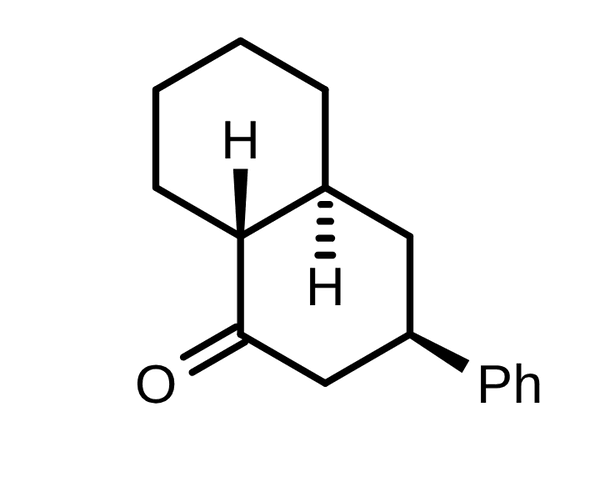

## Labels and frames that follow your structures

| Compound numbers stay with their compounds | Frames fit what they surround |
|---|---|
| 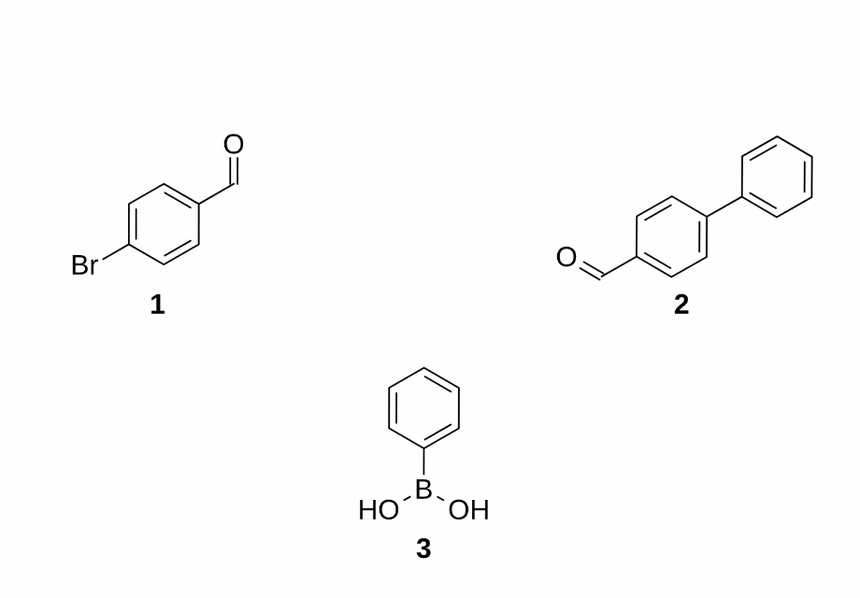 | 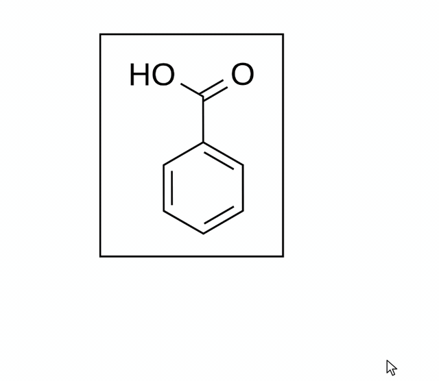 |
| **Number Compounds** ties each ID label to its structure. Move it, rotate it, flip it or add to it, and the number keeps its place underneath. | **Add Frame** draws a box that follows its contents: it grows as the structure grows and moves when it moves. |

## Colour that means something

Fill rings with a colour, a gradient, hatching or dots (patterns can be see-through over a colour), add a drop shadow, and pick out parts of a structure with round or straight highlights, soft-edged, with a shadow, or centred between a double bond's lines. Fills and highlights move with their atoms and come along when you copy a structure.

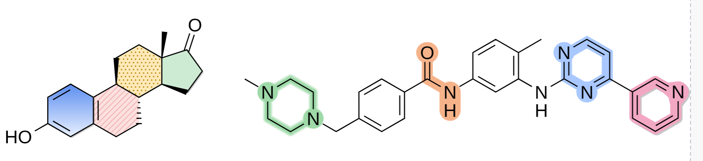

## Metals and mechanisms

| Metal complexes, from templates | Arrow pushing that snaps into place |
|---|---|
| 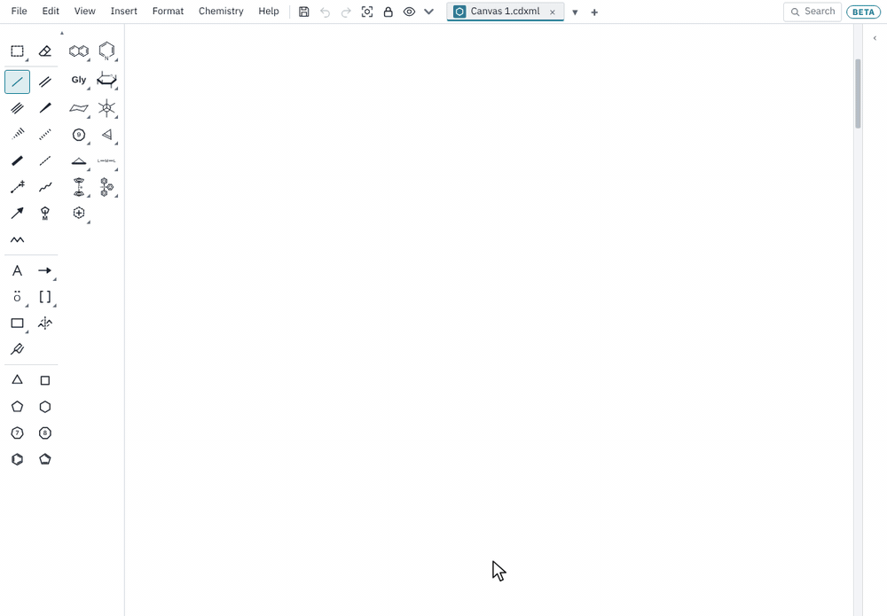 | 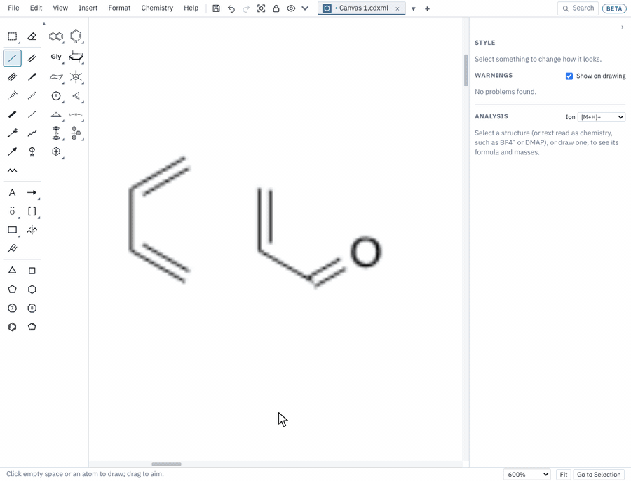 |
| Coordination geometries, metallocenes, piano stools and 26 ligands are a click away. Hapto (η) bonds go to the middle of a ring or π-bond and follow it, and formulas count metal carbonyls, Cp and phosphines the way a chemist would. | Drag from a lone pair, bond or atom to where the electrons go and the arrow snaps on, bending (or turning S-shaped) to stay clear of the structure. Arrows and lone pairs stay stuck to their atoms when you move, turn or flip the structure. |

## It knows the chemistry

| Abbreviations explained on hover | Name to Structure, offline |
|---|---|
| 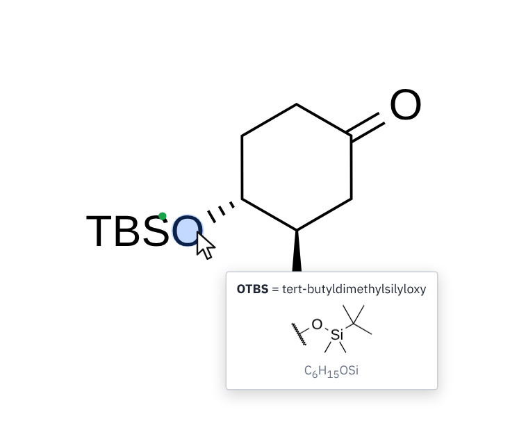 | 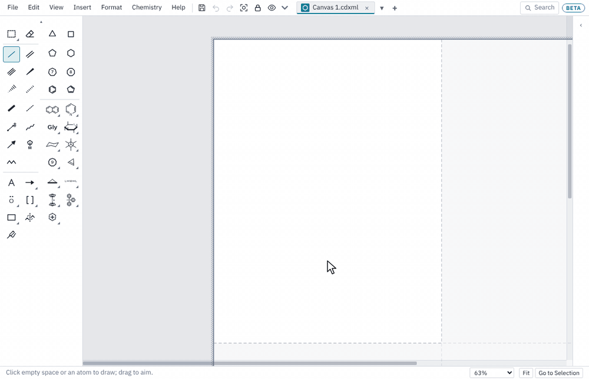 |
| Rest the mouse on OTBS, Boc, CO2Me or any other abbreviation to see what it stands for. | Type a systematic or common name and the structure is drawn. Names are read on your computer; others can be looked up on PubChem. |

Select anything and the side panel shows its formula, exact mass, m/z for the ion you pick, elemental analysis, isotope pattern, cLogP and TPSA. R/S and E/Z come from the IUPAC 2013 rules, including axial chirality, and atoms with impossible valences get a red mark.

## Energy diagrams

**Chemistry ▸ Energy Diagram** draws a reaction coordinate diagram from a table of levels: compare pathways in different colours, mark the barrier, and draw structures right on the levels.

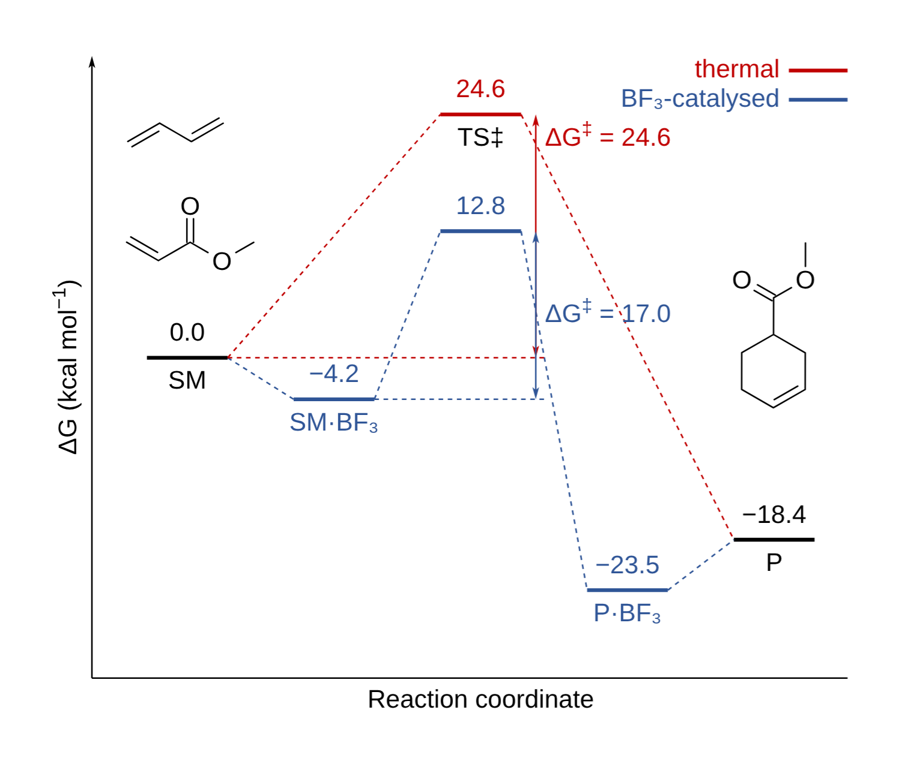

## Spelling and chemistry checked everywhere

Text on drawings, slides and documents is spell-checked, and a second check catches chemistry formatting slips: formulas without subscripts, deuterated solvents, a number glued to its unit (5mL), a hyphen in a range (10-15), and the nucleus before "NMR". Right-click a marked word for the fix. Formulas are also formatted as you type (CH2Cl2 becomes CH₂Cl₂).

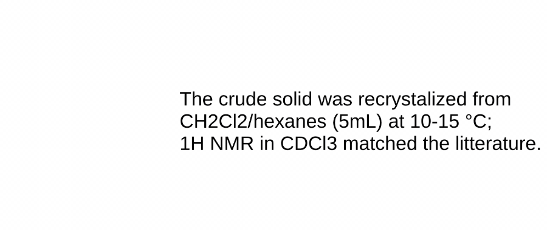

## Dark mode

The eye button shows the page dark on screen, with your structures in light ink. Files, printing and copies keep their white paper. Choose Graphite, Slate or Warm dark, or mix your own in **View ▸ Dark Page Colours**.

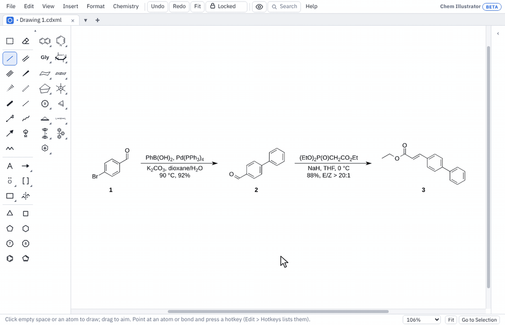

The interface itself follows your system's dark setting in every mode, as in the screenshots on this page.

## Getting round a big drawing

Right-drag or middle-drag to pan, Ctrl+wheel to zoom in on the spot under the pointer, and Shift+wheel to scroll sideways. A small navigator map in the corner shows where you are in the whole drawing.

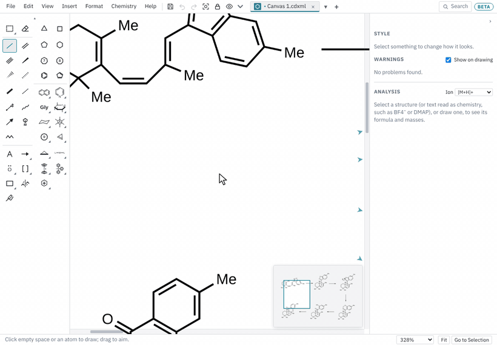

## Make it yours

Every hotkey can be changed (**Edit ▸ Hotkeys**), and the hotkeys can be exported and shared. Toolboxes unlock to dock on any edge or float anywhere, and **Customize Toolboxes** rearranges any of them (or new ones of your own) by dragging icons about, as on a phone's home screen. The dark page colours, each mode's accent colour, the scheme spacing, your own templates, nicknames and drawing styles are all settings, kept in one file you can export and import on another computer.

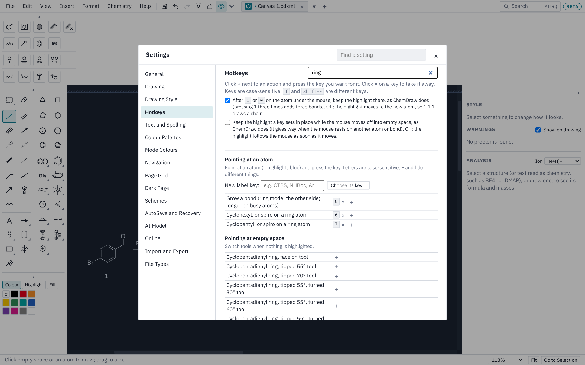

## Slides, sheets, documents and designs

Each mode works like the Office program it is named after, and adds what Office can't do for a chemist.

| Slides | Sheets |
|---|---|
| 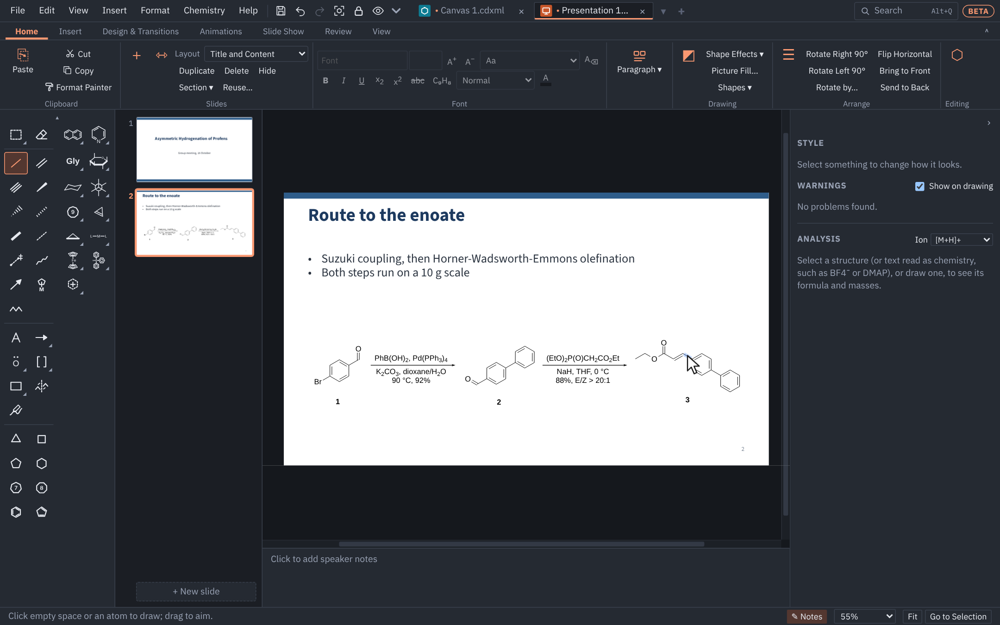 | 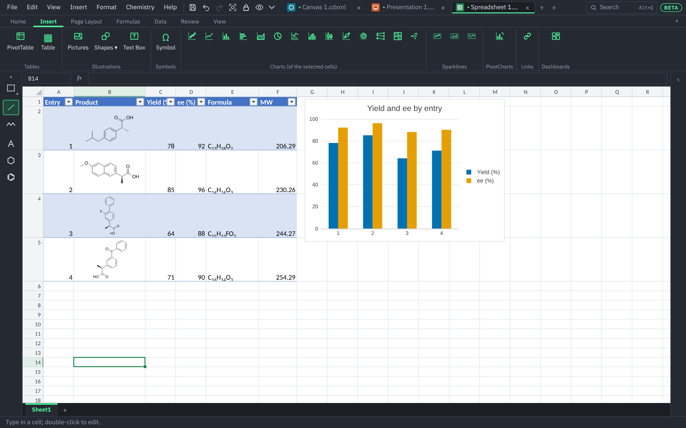 |
| Layouts, about twenty design templates, transitions, animations and presenter view. The structures on a slide are real structures: point at one and edit it with the same tools and hotkeys. Saves as `.pptx` that opens in PowerPoint. | Excel's keys and formulas, structures in cells, columns that work out formula, MW, HRMS m/z and more, charts and dashboards. Saves as `.xlsx`. |

| Documents | Design |
|---|---|
|  |  |
| Word's styles and keys, structures in the text, numbered captions, references, tracked changes, comments and equations. Saves as `.docx`. | Posters, TOC graphics and graphical abstracts at the journals' sizes, with templates and a shape library that includes flowcharts and lab glassware. |

**Split View** puts a drawing beside a document, sheet or slides, so you can draw on one side and insert on the other.

### A reference manager in your documents

Add references by DOI, by hand or from BibTeX and RIS files, cite them as you write, and the bibliography numbers itself in citation order in the ACS, RSC, Nature or another journal's style. The references are saved inside the Word file.

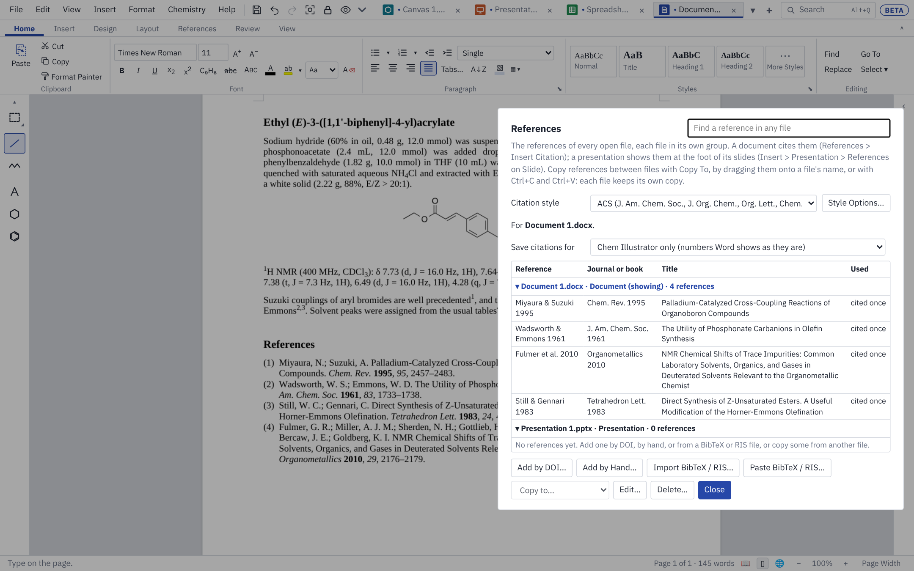

## Your files, in their own formats

Nothing is locked into a format of our own. Each mode saves the file type its program uses, so you can send your files to anyone.

| Mode | Opens | Saves | Works with |
|---|---|---|---|
| Drawing | `.cdxml`, `.cdx` | `.cdxml`, `.cdx` | ChemDraw. A ChemDraw file you open keeps everything you didn't change exactly as ChemDraw wrote it. Copy and paste with ChemDraw on Windows. |
| Slides and Design | `.pptx` | `.pptx` | PowerPoint |
| Documents | `.docx` | `.docx` | Word |
| Sheets | `.xlsx`, `.csv`, `.sdf` | `.xlsx`, `.csv`, `.sdf` | Excel |

In Word, PowerPoint and Excel your structures show as sharp pictures; open the file in Chem Illustrator again and they are editable structures, even after Office has saved it. Drawings also export as PDF, PNG, SVG and Molfile. [Files and sharing](docs/guide/files-and-sharing.md) has the details.

## Install

Download the installer for your computer from the **[latest release](https://github.com/nathanohare/Chem-Illustrator/releases/latest)**:

- **Windows**: the file ending in `x64-setup.exe`. Windows will warn that the installer isn't signed: click **More info**, then **Run anyway**. It installs for you alone, so it doesn't need administrator rights. To run it from a flash drive or a folder without installing anything, take `x64-portable.zip` instead and unzip it ([portable copy](docs/guide/getting-started.md#windows-without-installing-portable-copy)).
- **macOS** (Apple silicon or Intel, macOS 11 or newer): the file ending in `universal.dmg`. Open it and drag **Chem Illustrator** into **Applications**. The app is signed and notarised by Apple, so it opens without a warning.
- **Linux**: the `.AppImage` (any distribution), `.deb` (Ubuntu, Debian) or `.rpm` (Fedora).

Once installed, the program keeps itself up to date: it offers each new version when it starts. [Getting started](docs/guide/getting-started.md) has the details.

## Learn it

The **[user guide](docs/README.md)** covers each mode, every hotkey, and the files it reads and writes. Inside the program, **Help ▸ Hotkeys and Tips** lists the most used keys, and the **Search** box at the top (Alt+Q) finds any command by name.

## Feedback

Ideas, problems and questions are welcome. In the program, use **Help ▸ Send Feedback**: it fills in a new [issue](https://github.com/nathanohare/Chem-Illustrator/issues) on this page for you, or copies the text to send another way. See [Feedback, problems and ideas](docs/guide/feedback.md).

## Try it

**[▶ Try Chem Illustrator in your browser](https://nathanohare.github.io/Chem-Illustrator/)**, or **[download the desktop app](https://github.com/nathanohare/Chem-Illustrator/releases/latest)** for Windows, macOS or Linux.

## For developers

Chem Illustrator is written in TypeScript and runs as a [Tauri](https://tauri.app) desktop app, with [RDKit](https://www.rdkit.org) for the chemistry. [For developers](docs/developers.md) explains how to run it from the source code, how releases are made, and where things are in the code; [TECH-DECISION.md](TECH-DECISION.md) explains why it is built this way.

## Licence

Chem Illustrator is free software: you can use, share and change it under the terms of the [GNU General Public License](LICENSE), version 3 or (at your option) any later version. It comes with no warranty. An [additional permission](APP-STORE-EXCEPTION.md) allows it to be distributed through Apple's App Store and TestFlight.

Everything it uses is free and open source, and keeps its own licence: RDKit (BSD-3-Clause), OPSIN (MIT), cdxmorph (MIT), Tauri (MIT or Apache-2.0), the bundled fonts (SIL Open Font License) and others listed in [THIRD-PARTY-NOTICES.md](THIRD-PARTY-NOTICES.md).

Reaction animation (Chemistry ▸ Animate ▸ Animate Reaction) is based on [cdxmorph](https://github.com/rshenvi/cdxmorph) by Ryan Shenvi (Shenvi Lab), used with permission.

ChemDraw is a trademark of Revvity, Inc. Chem Illustrator is not made by, connected with or endorsed by Revvity; it reads and writes ChemDraw's published CDXML and CDX file formats so that your files work in both.
