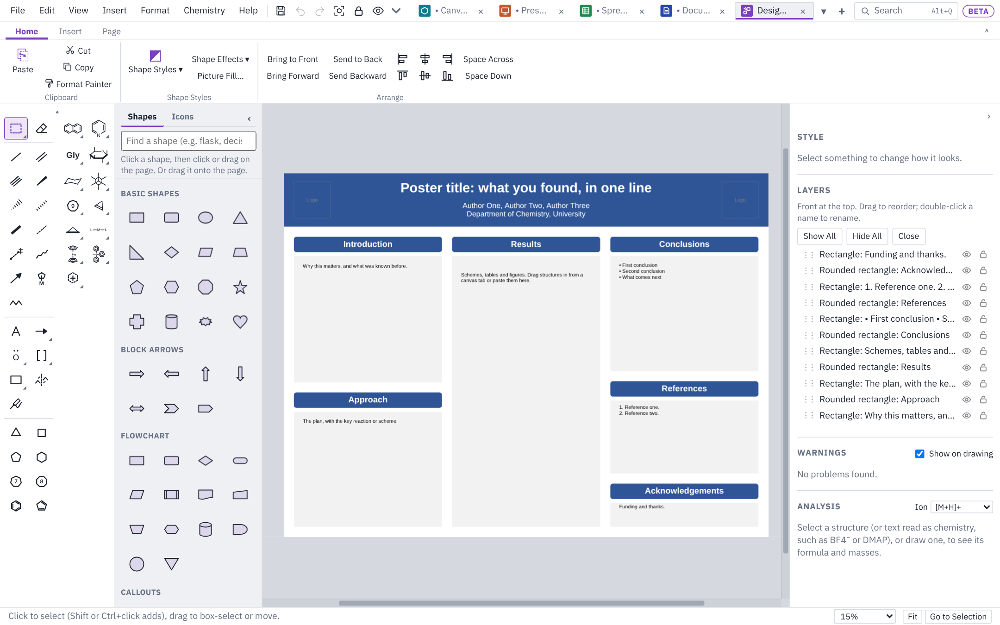

# Design

This page covers Design mode: single-page graphics such as TOC graphics, graphical abstracts, posters, flowcharts and workup schemes, and how to export them for a journal.

## Starting a design

Click **+ Design** at the end of the tab strip, or choose **File ▸ New Design…**. A gallery opens with a **Blank page** and six ready-made layouts.

A design is a single page. For several pages, use [Slides](slides.md) instead.

## Page sizes

Pick **Blank page** and choose a size. **Page Size** on the ribbon changes it later.

| Group | Sizes |
|---|---|
| Journal graphics | TOC graphic, ACS (3.25 × 1.75 in); Graphical abstract, Elsevier (13 × 5 cm); TOC graphic, Wiley (5.5 × 5 cm); Graphical abstract, RSC (8 × 4 cm); Journal figure, one column; Journal figure, two columns |
| Posters | 36 × 48 in portrait; 48 × 36 in landscape; A0 |
| Screens | Slide 16:9 |
| Paper | Letter; Letter, landscape; A4 |

You can also type a custom size in in, cm, mm, pt or px. Journals change their requirements from time to time, so check the size against your journal's author guidelines.

Structures are drawn larger on bigger pages so they stay readable: at their normal size on journal graphics and paper, twice as large on slides and four times as large on posters.

The ribbon's **Page** group also sets the **Background** colour (**Format…** beside it gives the page a gradient, picture or pattern, as in Slides), shows a **Grid** (on screen only, never saved or printed) with its spacing, and turns **Guides** on and off.

## Ready-made layouts

| Layout | What it gives you |
|---|---|
| **TOC graphic** | Starting material, arrow, product and a one-line message, at the ACS size |
| **Graphical abstract** | Three panels: the challenge, your approach and the outcome, at the Elsevier size |
| **Conference poster** | A title banner with room for logos, and three columns of sections (48 × 36 in) |
| **Flowchart** | A reaction run as steps, with a decision and a loop back, joined by connectors |
| **Workup scheme** | Glassware from reaction to pure product, with a label under each step |
| **Timeline** | A project as five milestones on a line |

Everything in a layout is ordinary shapes and text you can change. The dashed boxes show where your structures go.

## Shapes

The shape library on the left has five groups:

- **Basic shapes:** rectangle, rounded rectangle, oval, triangle, diamond, hexagon, star, cylinder, cloud and more.
- **Block arrows.**
- **Flowchart** shapes.
- **Callouts.**
- **Lab equipment:** round-bottom flask, Erlenmeyer flask, beaker, vial, test tube, separatory funnel, condenser, chromatography column, TLC plate, syringe, stirrer hot plate, bath and funnel.

Type in the search box at the top to find one (try "flask" or "decision"). **Shapes** on the ribbon takes you to the library.

To place a shape, click it and then click or drag on the page, or drag it straight from the library onto the page. Double-click a shape to type inside it; the chemistry typing helpers work there, so CH2Cl2 gets its subscripts. The **Style** panel on the right sets fill, outline, line width, transparency and where the text sits.

## Icons

The library's **Icons** tab (or **Icons** on the ribbon, or **Insert ▸ Icons…**) has about 7,000 icons. The list under the search box picks a group; **Lab and science** comes first, with glassware, molecules and atoms, lab equipment, hazard and safety signs (biohazard, radioactive, toxic, flammable, electrical, warning) and medical icons. Typing in the search box looks through all the icons, by name and by other words for them (try "hazard", "rbf" or "pipette"); choose a group from the list first to search only that group.

An icon goes on the page like a shape (click it, then click or drag; or drag it onto the page) at one inch square. It is filled in one colour with no outline: change the colour, add an outline, a gradient or a shadow in the **Style** panel, and drag its corners to size it. Icons save to PowerPoint as shapes PowerPoint can recolour and resize, and come back here as the same icon. They are the Material Design Icons by Pictogrammers (Apache License 2.0); company and product logos are left out.

The ribbon's **Insert** group also adds a **Text Box**, a **Picture** or a **Table**, and **Crop** trims a picture.

The **Chemistry** group adds a **Catalytic Cycle** or an **Energy Diagram** (the same as **Chemistry ▸ Reactions and Schemes**: see [Drawing](drawing.md#reactions-and-schemes)). A new one goes beside what is already on the page.

### Structures

All the drawing tools and hotkeys work on a design page, so you can draw structures, reaction arrows and schemes straight onto it, or paste them from a drawing tab or ChemDraw (Windows app).

### Pictures with a white background

Insert a PNG or JPEG (a logo, say), select it, and click **Remove white…** in the **Style** panel. You can remove only the white joined to the edges, or all white, and set how near to white counts. Undo puts the white back.

**Picture Format** (on the ribbon, in the panel or on right-click) does more: it removes a background of any colour, recolours, corrects and crops pictures to shapes, and keeps the picture itself as it was, so you can change your mind later. See [Slides: Picture Format](slides.md#picture-format).

## Diagrams

**Insert** ▸ **Diagram…** (a **Diagram** button on the Design, Slides and Document ribbons) draws a diagram from lines of text, as PowerPoint's SmartArt does. Type one item per line; press <kbd>Tab</kbd> to move a line a level down (under the line above it) and <kbd>Shift+Tab</kbd> to move it back up. The picture on the right shows how it will look as you type.

There are 23 layouts in seven kinds:

| Kind | Layouts |
|---|---|
| List | Block list, vertical bullet list, horizontal bullet list, honeycomb (hexagons fitted together), icon list |
| Process | Basic process, chevron process, vertical process, staircase, bending process (circles along a band that bends over one and under the next), circles on an arrow, timeline, equation (A + B → C) |
| Cycle | Basic cycle (circles joined by curved arrows), segmented ring, radial |
| Hierarchy | Hierarchy (top down) and horizontal hierarchy (left to right) |
| Relationship | Venn, target |
| Matrix | Matrix (four quarters, with an item in the middle if you indent four under it) |
| Pyramid | Pyramid, funnel |

Lines under an item show as bullets in its shape (or under it, in the list and chevron layouts). Formulas get their subscripts as you type them (CO2, ArB(OH)2), and `_` and `^` make other sub- and superscripts. In the icon list each item gets an icon that matches its words; put an icon's name in square brackets in front to choose it yourself, for example `[flask-round-bottom] Synthesis`.

Each layout takes as many items as you type. In the bending process and circles on an arrow, the lines under an item are its caption, outside its circle. A line of just `[]` is an item with no words, a place for a structure.

Below the text, choose the colours (the accent colour, shades of it, colourful, light, outline only, black and white for journals, or greys), the accent colour itself (from the drawing's colours, your palettes, or **More colours…** for any colour), rounded corners and a shadow. The text is made as big as fits, the same size in every shape; type a size to fix it.

### Structures in a diagram

Draw or drop a structure so its middle is in an item's shape, and it belongs to that item:

- The item keeps room for it, with the item's words underneath, and the whole diagram grows, keeping its shape, until every item's structure fits.
- The structure is centred in its item, and moves with the diagram. It stays an ordinary structure: edit it with the drawing tools and hotkeys, and the diagram makes room as it grows.
- Drag it out of the diagram and the item lets it go.

A diagram resized smaller than its structures need is drawn again just big enough to hold them. The room is saved with the diagram, so it opens the same way in a PowerPoint file.

Once it is placed:

- Double-click a shape to type in it. The diagram's text changes with it.
- Double-click away from the words (or right-click ▸ **Edit Diagram…**, or the **Style** panel) to change the text, layout or colours. In a document, double-click the diagram; **Edit Drawing** opens the drawing tools on it.
- Drag a corner to resize it: it is drawn again to fill the new box.
- Right-click ▸ **Convert Diagram to Shapes** makes it ordinary shapes and connectors, to change one by one.

PowerPoint and Word get a diagram as one group of shapes, so it can be moved, resized and retyped there. Words changed in PowerPoint or Word come back into the diagram's text when the file is opened here again.

## Connectors

**Connector** (a straight line) and **Elbow** (square bends) are in the ribbon's **Connect** group. Drag from one shape's blue dot to another's. When you move either shape, the connector follows. Drag a connector's end away from a dot to unstick it.

## Smart guides

As you drag a shape near another, pink lines show when edges or centres line up, and the shape snaps into line. Page edges count too. Hold **Alt** to drag freely, or untick **Guides** on the ribbon to turn them off.

## Arranging

The ribbon's **Arrange** group has **Bring to Front**, **Bring Forward**, **Send to Back** and **Send Backward**, buttons to line up left edges, centres, right edges, tops, middles and bottoms, and **Space Across** and **Space Down** to space things evenly.

## The Layers panel

The **Layers** panel on the right lists everything on the page, front first.

- Drag the ⋮⋮ grip to change the order.
- Click the eye to hide something, or the lock so clicks pass through it.
- Double-click a name to rename it.

## Saving and exporting

- **Save** (Ctrl+S) writes a one-slide PowerPoint file (.pptx). In PowerPoint the shapes look the same and connectors are PowerPoint connectors. Open it here again and everything is editable, with connectors still attached to their shapes.
- **Export Picture** (ribbon **Share** group, or **File ▸ Export Picture…**) saves a PNG or TIFF at the resolution you type, or an SVG, EMF or EPS. Choose the page colour or a see-through background. Journals usually ask for 300 dpi for colour pictures and 600 to 1200 dpi for line art. A very large page at a very high dpi is reduced to what fits in memory, and a message says which dpi was used.
- **Export PDF** (ribbon **Share** group, or **File ▸ Export PDF…**) saves the page at its exact size.
- **File ▸ Print…** (Ctrl+P) prints the page at its own size.

Next: [Getting started](getting-started.md) · [Drawing](drawing.md) · [Keyboard and mouse](keyboard-and-mouse.md) · [Slides](slides.md) · [Documents](documents.md) · [Sheets](sheets.md) · [Files and sharing](files-and-sharing.md) · [Feedback](feedback.md)
