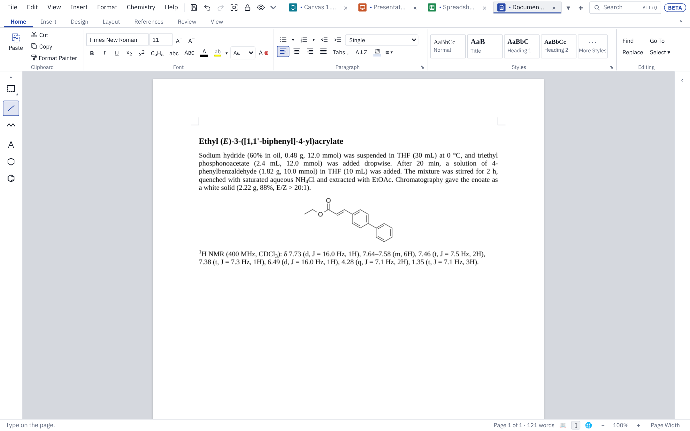

# Documents

This page covers Document mode: writing and formatting text, putting structures, tables and equations in it, captions, compound numbers, references, page layout, tracked changes, and saving as Word or PDF.

## Starting a document

Click **+ Document** at the end of the tab strip, or choose **File ▸ New Document**. While a document is showing, Ctrl+N starts another one.

**File ▸ New from Template…** starts from one of our own templates: a **Lab report** (aim, scheme, reagent table, procedure, observations, results, safety), **Supporting Information** (title block, contents, general information, procedures with a characterization line to fill in, spectra) or a **Thesis chapter** (numbered sections, a wide binding margin and 1.5 line spacing). Text in [brackets] says what goes there; type over it. The headings are in the Heading styles, so the Navigation pane and Table of Contents pick them up.

The ribbon has Word's tabs: **Home**, **Insert**, **Layout**, **References** and **Review**, plus a **Table** tab that appears while the caret is in a table. Text flows on to the next page by itself. The status bar at the bottom shows the page and word count; Ctrl+mouse wheel or the − and + buttons zoom, and **Page Width** fits the page to the window.

## The chemistry toolbox

The drawing toolbox shows on the left in Document mode too. Pick a drawing tool there and the selected structure opens for editing with that tool; if no structure is selected, a new drawing starts at the caret. Press **Done** above the drawing to put it back in the text.

When the pointer turns into a pointing hand over a structure, it is a drawing you can open: double-click it (or pick it and use **Insert** tab ▸ **Edit Drawing**).

## Formatting text

- **Home** tab: font, size, colour, bold (Ctrl+B), italic (Ctrl+I), underline (Ctrl+U), subscript (Ctrl+=), superscript (Ctrl+Shift+=), bigger and smaller (Ctrl+] and Ctrl+[).
- **C₉H₈** sets the selection in formula style: numbers lowered, charges raised.
- **Format Painter** (beside **Copy**) copies the look of the selected text, or of the paragraph the caret is in, to the next text you click or drag over; double-click it to keep painting until Esc. See [Getting started](getting-started.md#format-painter-every-mode).
- **Insert** tab ▸ **Symbol** types Greek letters, arrows, °, Å and other signs, found by name; see [Insert ▸ Symbol](getting-started.md#insert--symbol-every-mode).
- **Highlight:** the **ab** button highlights the selected text; the arrow beside it picks the colour.
- The chemistry typing helpers work as in the other modes: type CH2Cl2 or CDCl3 and the numbers drop down once you type a space or punctuation after it.
- Misspelt words get a red line, and right-click offers corrections. Chemistry words are in the dictionary; add your own with right-click ▸ **Add to Dictionary**. **Edit ▸ Typing and Spelling…** has the settings.

## Paragraphs and lists

- Alignment: Ctrl+L, Ctrl+E, Ctrl+R and Ctrl+J, or the **Home** tab buttons.
- Line spacing: the **Home** tab list, or Ctrl+1 (single), Ctrl+5 (1.5) and Ctrl+2 (double). **Line Spacing Options…** offers **Exactly** or **At least** a number of points.
- Indents and space before and after: **Layout** tab ▸ **Paragraph** group. Lengths are in inches; type `cm`, `mm` or `pt` after a number to use those instead.
- **Bullets** and **Numbering** on the **Home** tab make lists. Tab and Shift+Tab change the level.
- The small ⬊ in the corner of a ribbon group opens all of that group's settings. Its pin button docks the box in the right-hand panel so it stays open while you work.
- **Borders** (the ▦ ▾ button on the **Home** tab) puts lines above, below, beside or round the selected paragraphs, as Word's Borders menu. Choosing a side again takes it off. **Borders and Shading…** sets the kind of line, its width and colour, and a shading colour; the shading button beside it shades paragraphs quickly. Paragraphs one after another with the same borders share one box.
- **Sort** (A↓Z) puts the selected paragraphs in order (as text, numbers or dates, by the whole paragraph or by a field cut at tabs or commas), or, with the caret in a table, the table's rows by a column. A heading row stays at the top; rows with cells merged down can't be sorted.

## Styles

The **Home** tab has **Normal**, **Title**, **Heading 1–3** and **Caption**. Shortcuts: Ctrl+Alt+1, 2 and 3 for headings, Ctrl+Shift+N for Normal.

To change a style, open the ⬊ in the corner of **Styles** (or the **Format** panel on the right). Change the font, size, bold, spacing and so on, and every paragraph in that style follows, apart from anything you formatted by hand.

- **Match This Paragraph** makes the style look like the paragraph the caret is in.
- **Reset Style** puts the style back as it first was.

## Themes and style sets

The **Design** tab changes the look of the whole document at once, as Word's Document Formatting does:

- **Theme** sets the fonts and colours together: Journal (Times New Roman, black), Report, Technical, Clean, Classic, Field Notes and Poster. All of them use free fonts that come with the app.
- **Style Set** changes the styles' layout: Journal (justified 11 pt text, bold headings), Simple, Centered, Compact, Open and Thesis (double-spaced, for a thesis or dissertation).
- **Colors** and **Fonts** change one half of the theme on its own: the heading colour and the accents in the colour boxes, or the heading and body fonts.
- **Paragraph Spacing** sets the space between paragraphs and lines for every style: No Paragraph Space, Compact, Tight, Open, Relaxed or Double.
- **Set as Default** makes the current theme, style set and spacing the start of every new document.

Formatting you set by hand stays as it is. The theme and style set are saved in the Word file, and its styles are Word's own, so Word shows the same look.

## Structures and pictures in the text

- **Insert** tab ▸ **Structure** opens the drawing tools. Draw, press **Done**, and the structure sits in the text at the caret.
- **Insert** tab ▸ **From Name** draws a structure from a name or SMILES.
- Paste a structure copied from a drawing tab, or from ChemDraw (Windows app).
- **Insert** tab ▸ **Picture** adds a picture from a file; you can also paste or drop one.
- **Insert** tab ▸ **Shapes** puts a shape from the library (basic shapes, block arrows, flowchart shapes, callouts, lab glassware) in the text at the caret. It is a drawing like a structure: double-click it to change its size, colours or text with the drawing tools, and use the wrapping settings below to let text flow round it.
- **Insert** tab ▸ **Diagram** puts a SmartArt-style diagram (lists, processes, cycles, hierarchies and more) in the text at the caret, drawn from lines of text. Double-click it to change its text or look. Word gets it as a group of shapes. See [Design: Diagrams](design.md#diagrams).
- **Insert** tab ▸ **Icons** puts an icon in the text the same way: about 7,000, lab and science ones (glassware, molecules, hazard and safety signs) first. See [Design: Icons](design.md#icons).

Click a structure or picture to pick it. Drag its corner handle, or type a **Size (%)** in the panel; **Own Size** puts it back to 100%. Right-click it for **Add Frame** and **Add Shadow**; the panel sets the frame's width and colour and a soft or sharp shadow.

For a picture, **Picture Format** (**Insert** tab, the panel, or right-click) changes its brightness, contrast and sharpness, recolours it (greyscale, sepia, washout, black and white, two colours), makes a colour or the whole picture see-through, removes its background, and crops it to a shape or to proportions (1:1, 4:3, 16:9…). It works as in [Slides: Picture Format](slides.md#picture-format), and is saved as Word's own picture settings.

### Wrapping and text boxes

Pick a structure, picture or text box, then use **Layout** tab ▸ **Wrap Text** (or the right-click menu):

| Choice | Effect |
|---|---|
| **In Line with Text** | Sits in the line, like a letter |
| **Square** | Text flows down the wider side |
| **Top and Bottom** | Text only above and below |
| **Behind Text** / **In Front of Text** | Floats over or under the text |

A floating item can be dragged anywhere and moves with the paragraph it is dropped beside. One in line with the text is dragged to another place in the text, as in Word: the caret shows where it will land (Ctrl+Z puts it back).

**Insert** tab ▸ **Text Box** (also on the **Layout** tab) puts a box at the left margin with the text wrapping round it. Type in it, then press Esc to pick the box. Drag its edge to move it and its corner to make it wider. Fill colour, frame and wrapping are in the panel.

### Position, order, rotate and group

On the **Layout** tab, **Arrange** (folded into one **Arrange ▾** button when the window is narrow):

- **Position ▾** puts the figure picked at one of nine places on the page (top, middle or bottom; left, centre or right) with **Square** wrapping. **In Line with Text** puts it back in the line.
- **Bring Forward ▾** and **Send Backward ▾** put one floating figure over or under another, a step at a time or to the front or back of all.
- **Rotate ▾** turns a picture 90° right or left, flips it, or turns it by any angle (**More Rotation Options…**).
- **Selection Pane** lists every floating figure, front first. Click a name to pick it, Ctrl+click to pick more, double-click to rename it. The eye hides a figure from its page (it stays in the document); **Show All** and **Hide All** do every one; ▲ and ▼ change the order.
- **Group ▾** joins the figures picked in the Selection Pane so they move together; **Ungroup** parts them.

Word gets the position, order, rotation, names and hidden figures as its own; groups come back as groups when the file opens here again.

## Tables

**Insert** tab ▸ **Table** asks for the number of rows and columns and a style:

- **Plain table** (grid lines, as in Word);
- **ACS table in the text** (rules above, under the headings and at the bottom);
- **No lines**;
- **ACS table as a drawing** (edited in the drawing tools, then placed as a figure).

The first three go straight into the text with the caret in the first cell. Type, press Tab for the next cell (Tab in the last cell adds a row) and Shift+Tab to go back. CH2Cl2 typed in a cell becomes a formula when you move on.

While you are in a table, the **Table** tab offers:

- **Insert Above**, **Below**, **Left**, **Right**; **Delete Row**, **Delete Column**, **Delete Table**;
- **Merge Right**, **Merge Down**, **Split Cell**, **Table in Cell**, **Select Table**;
- **Lines** (grid, ACS rules or none) and **Heading rows**;
- **Shading** and **No Shading**;
- alignment **Across** (Left, Centre, Right, for the column) and **Down** (Top, Middle, Bottom, for the cell);
- **Column width**, **Fit to Contents**, **Fit to Page** and **Even Columns**.

The same commands are on the right-click menu. Esc picks the whole table, and Delete then removes it.

### Merged cells and tables in cells

**Merge Right** joins a cell with the one beside it; **Merge Down** joins it with the one below, so one cell runs down a column (a catalyst used for several entries, say). Merge again to take in more cells. Cells only merge when they line up: a cell two columns wide merges down into another cell two columns wide. The text of the cell taken in goes after the first cell's as a new paragraph. **Split Cell** puts a merged cell back into single cells, its text staying in the first. Inserting or deleting a row inside a merged cell makes it longer or shorter, and Tab and the arrow keys skip the cells it covers.

**Table in Cell** (or **Insert** ▸ **Table** while you are typing in a cell) puts a table inside the cell, as wide as the cell, for conditions or results that need their own small grid. Click into its cells to type in them; the arrow keys take you out of it, back into the cell holding it. Its own Table tab commands (rows, merging, lines) work as for any table.

Word files keep both: merged cells are saved and opened as Word's merged cells, and a table in a cell as Word's nested table.

### Structures in table cells

For a substrate-scope or screening table, put the caret in a cell and use **Insert** tab ▸ **Structure**, **From Name** or **Picture**, or paste a structure. It goes into that cell, shrinks to fit the column if needed, and the row grows to hold it.

- Set the column to **Centre** to line the structures up.
- Set the other cells in the row to **Middle** so their text sits level with the structure.
- **Fit to Contents** widens the columns so structures show at full size.

## Charts

**Insert** ▸ **Chart** puts a chart in the text at the caret, as Word's Insert Chart does. The chart window shows the chart's own data in a grid: type over the sample numbers or paste from Excel or a sheet, pick the kind of chart along the top, and change titles, axes, colours, error bars and fitted lines in the panel on the right. Double-click the chart to change it again. Charts sit in the text like pictures (wrap, frame, captions), and are saved in Word files as Word charts with their data inside, so **Edit Data** works in Word. Charts made in Word open here as charts.

## Objects from other programs

**Insert** ▸ **Object** puts another program's file in the document whole, as Word's Insert Object does: an Excel workbook, a PDF, a Word file or a presentation, or any other file. It shows what it holds where it can (a workbook's cells as Excel shows them, a PDF's first page, a picture), or an icon with the file's name: tick **Display as icon** for that. Right-click it to switch between the two.

Double-click the object (or right-click ▸ **Open Object**) to open the file in its own program. Each time you save it there, the document takes the changes and a new picture of them, so a table of results can be kept up to date in Excel. This needs the desktop app; in a browser the file is downloaded instead.

To embed cells from Excel, copy them in Excel and choose **Edit** ▸ **Paste as Object** (or right-click ▸ Paste as Object) in the Windows app, as Word's Paste Special does.

Objects are saved in Word files as Word's own embedded objects, so double-clicking one in Word opens it in its program too (Office files as Word keeps them; other files as Windows packages). Objects in Word files you open here are kept as they are and saved back unchanged. ChemDraw objects are kept the same way, with the look they had in Word, until you double-click one (or right-click ▸ **Edit Drawing**): then it becomes a structure here that you can change. To have every ChemDraw object redrawn here as the file opens instead, turn on **Settings ▸ General ▸ Redraw ChemDraw objects in Word files as they open**. Objects stay in line with the text.

## Captions and cross-references

On the **References** tab:

- **Insert Caption** adds a numbered caption: Figure, Scheme, Table, Chart or Equation. Choose **S** under "Before the number" for Supporting Information numbering (Scheme S1). **Position** puts it above or below the selected item; left as it is, schemes and tables get their caption above and figures below, as journals set them.
- **Cross-reference** puts "Scheme S1" in the text.

Add, delete or move captions and every number and reference follows.

## Compound numbers

**References** tab ▸ **Compound Number** (Alt+Shift+N) puts a bold compound number in the text. Choose **A new compound** for the next number, or pick one already numbered to mention it again. Numbers follow the order compounds are first mentioned, so adding one earlier in the text renumbers the rest. Type a letter after a number for a series (2a, 2b).

## References and bibliography

1. **References** tab ▸ **Manage References…** holds the document's references. Add them with **Add by DOI…** (looked up on Crossref; needs the internet), **Add by Hand…**, **Import BibTeX / RIS…** or **Paste BibTeX / RIS…**. **Edit…** and **Delete…** change them.
2. Put the caret where a citation belongs and click **Insert Citation**. Citations are numbered in order of first citation.
3. Click **Bibliography** to add a References heading and the numbered list.

### Citation styles

Pick the **Citation style** in **Manage References…**. Every citation and the bibliography change at once, and Ctrl+Z undoes it.

| Style | Used by, for example |
|---|---|
| ACS | J. Am. Chem. Soc., J. Org. Chem., Org. Lett. |
| RSC | Chem. Sci., Chem. Commun., Org. Biomol. Chem. |
| Wiley-VCH (Angewandte) | Angew. Chem., Chem. Eur. J. |
| Chemistry Europe | Eur. J. Org. Chem., ChemBioChem |
| Elsevier | Tetrahedron, Bioorg. Med. Chem. |
| Nature | Nature, Nat. Chem., Nat. Commun. |
| Science | Science, Sci. Adv. |
| Thieme | Synthesis, Synlett |
| Beilstein | Beilstein J. Org. Chem. |
| MDPI | Molecules, Catalysts |

**Style Options…** opens every detail of the style, with a preview: how citation numbers look, whether 1,2,3 becomes 1–3, how the list is numbered, how author names are written and when "et al." is used, the journal title, year, volume, pages and DOI. A changed detail is marked with a dot, and **Reset to …** puts the style's own details back. Tick **Use for new documents** to start every new document with your choice.

Journal requirements change, so check the result against a recent issue of your target journal.

### Zotero, Mendeley and EndNote

A Word file with citations made by Zotero, Mendeley (Desktop or Cite) or EndNote opens with them live: their references go into **Manage References…** and the citations and bibliography are numbered and styled here like any others. A Zotero file also keeps its citation style when it is one of the styles above.

Saving writes the citations back as that program's own, with its item ids, so in Word its **Refresh** (Zotero, Mendeley) or **Update Citations and Bibliography** (EndNote) still works on them. References added here go out with their details: Zotero and Mendeley keep them as items in the document, EndNote adds them to the document's travelling library.

To choose the program for a document made here, use **Save citations for** in **Manage References…**. **Chem Illustrator only** saves the numbers as text that Word shows as they are.

## Pages, columns, headers and footers

On the **Layout** tab:

- **Margins**, **Paper** (Letter, A4 or your own size), **Orientation**.
- **Breaks**: **Page** (Ctrl+Enter), **Column** (Ctrl+Shift+Enter) and the section breaks (below).
- **Columns**: One, Two, Three or Four; **More Columns…** sets the gap.
- **Page numbers**: top or bottom, left, centre or right. **S1, S2… numbering** numbers the pages as Supporting Information is numbered. **Number Format…** writes them 1, 2, 3 or i, ii, iii (or I, II; a, b; A, B) and sets where the numbering starts.
- **Header…** and **Footer…** set the text at the top and bottom of every page. The ⬊ in the corner of the group sets where they sit, the first page number and whether the first page is numbered.
- **Line Numbers**: numbers down the left margin, as journals ask for in manuscripts under review: **Continuous**, **Restart Each Page** or **Restart Each Section**. **Suppress for Current Paragraph** leaves the selected paragraphs out (a title, say). **Line Numbering Options…** sets the first number, shows only every 5th (or any nth) number, and sets how far they sit from the text.
- **Hyphenation**: **Automatic** breaks long words at the ends of lines, with a hyphen, where English allows (US English patterns). **Don't Hyphenate This Paragraph** keeps the selected paragraphs whole. **Hyphenation Options…** sets the hyphenation zone (a word is broken only if leaving it whole would leave more room than this at the end of the line), a limit on hyphens in a row, and whether words in capitals are broken. Words with digits and formulas are never broken.
- **Insert ▸ Cover Page** puts a first page in front: the title, subtitle, author, institution and date in one of five looks (Plain, Banded, Ruled, Lab Report, Supporting Information). They are fields, so they follow **Document Properties** (Insert ▸ Quick Parts). The cover page has no page number; **Remove Cover Page** on the same menu takes it out. **Blank Page** puts an empty page at the caret.

### Headers and footers on odd, even and first pages

In the Header and Footer settings (the ⬊ in the corner of the group, or **Header…**):

- **Different first page** gives the first page of the section its own header and footer (or none), as a title page has.
- **Different odd and even pages** gives even pages their own header and footer, and puts the page number on the outside edge, as a bound thesis has.
- **Picture…** puts a picture (a logo or a crest) at the left, centre or right of the header or footer, on every page, the first page or even pages, at the height you give.
- Headers and footers from Word with pictures, tables or formatting are shown and saved as they are. The settings say which ones; **Plain Text** turns them back into plain text you can type in the boxes.

### Sections

A section break starts a new section, which can have its own paper size, orientation, margins, columns, header and footer, page numbering and line numbers. Choose one from **Layout** ▸ **Breaks** (or **Insert ▸ Section Break**):

- **Next Page**: the new section starts on a new page. Use it for a landscape page with a wide table, or to number the front matter i, ii, iii and the text 1, 2, 3.
- **Continuous**: the new section starts on the same page. Use it for a title and abstract across the page with two columns of text under them. Columns before a continuous break are evened up, as in Word.
- **Even Page** and **Odd Page**: the new section starts on the next even or odd page (a blank page is left when needed), as chapters of a thesis do.

The margins, paper, orientation, columns, page numbers and line numbers on the ribbon and in the ⬊ settings are for the section the caret is in (the status bar says which). In the Page Setup settings, **Apply to: Whole document** changes every section at once. A new section's header and footer are **Same as previous section** (Word's Link to Previous) until you type a header or footer of its own or untick it; its page numbers carry on from the section before unless you untick **Continue from previous section** and give a first page number.

To remove a section break, put the caret at the start of the paragraph after it and press **Backspace** (the text joins the section before). **Draft** view shows section breaks as double dotted lines, labelled with their kind. Sections, their headers and footers, page numbering and line numbers are saved in Word files as Word's own and open again here as they were.

## Fields, dates and Quick Parts

- **Insert ▸ Date & Time** (Alt+Shift+D) puts in today's date or the time in one of Word's formats, as text or as a field that updates.
- **Insert ▸ Quick Parts** saves the selected text (an affiliation, a standard experimental paragraph) to use again in any document; Quick Parts are kept with your settings. The same menu inserts **Fields** (dates, the author, title, file name, page number, number of pages, a bookmark's text or page, or "above"/"below" it) and **Document Properties**, and sets the document's title, subject, author, company and keywords.
- **References ▸ Cross-reference** also points at headings and bookmarks: their text, their page, or "above"/"below".
- Fields are saved as Word's own fields, so Word updates them too; Word's come back as fields.

## Table of contents

Give your headings **Heading 1**, **2** or **3**, put the caret where the contents should go, and choose **References** tab ▸ **Table of Contents** (also **Insert ▸ Table of Contents…**). Pick how many heading levels to show.

The contents keep themselves up to date: page numbers change as text moves, and renamed headings change as you type. There is no Update button. Double-click the contents to change the number of levels. With S1, S2 page numbering, the contents use the same numbers.

## Table of figures

**References** tab ▸ **Table of Figures** (also **Insert ▸ Table of Figures…**) lists the captions made with Insert Caption, each with its page number after a line of dots. Choose Figure, Scheme, Table or Chart captions, or all of them. Like the contents, it keeps itself up to date; double-click it to list other captions. In Word it is Word's own table of figures.

## Index

1. Select a word or phrase (or just click in a word) and choose **References** tab ▸ **Mark Entry** (Alt+Shift+X, also **Insert ▸ Mark Index Entry…**).
2. Check the **Main entry**, and type a **Subentry** to list it under the main one (Aldol reaction ▸ asymmetric).
3. Leave **Current page** for its page number (in bold or italic if you tick them), or choose **Cross-reference** and type "See Enolates" to send readers elsewhere instead.
4. Tick **Mark All** to mark every paragraph where the text comes up, once each, as Word does.

Each entry is kept on its paragraph, so it moves with the text. Open Mark Entry in a marked paragraph to see its entries, and tick **Take this paragraph's entries off** to remove them.

**References** tab ▸ **Insert Index** (also **Insert ▸ Index…**) puts an Index heading and the index after the caret's paragraph: the entries A to Z, ignoring case and accents, with the subentries indented under them and each page once. It is set in two columns unless you choose another number (it gets a section of its own, with continuous section breaks before and after, as Word does). **Right align page numbers** puts them at the right after dots, and **A letter over each letter's entries** adds A, B, C headings. Like the contents, it keeps itself up to date; double-click it to change it. In Word, entries are Word's XE fields and the index is Word's own INDEX field.

## Table of authorities

For legal writing (cases, statutes, rules and other authorities), as Word does it:

1. Select a citation and choose **References** tab ▸ **Mark Citation** (Alt+Shift+I).
2. Check the **Long citation** (as the table lists it) and the **Short citation** (later mentions are marked by it), and pick the **Category**: Cases, Statutes, Other Authorities, Rules, Treatises, Regulations or Constitutional Provisions.
3. **Mark All** marks every paragraph where the short citation comes up. Mark a later mention by itself by picking its short form from the list.

**References** tab ▸ **Table of Authorities** lists the citations marked, each category under its heading, A to Z, with its pages after dots. Choose one category or **All**; **Use passim** prints "passim" in place of the pages for a citation on five pages or more. Double-click it to change it. In Word, citations are Word's TA fields and the table is Word's TOA field (one for each category).

## Footnotes and endnotes

- **References** tab ▸ **Insert Footnote** (Ctrl+Alt+F) puts the next number in the text and the caret in the note at the foot of the page. Type the note, then press **Escape** to go back to the text.
- **Insert Endnote** (Ctrl+Alt+D) does the same with a note after the end of the text.
- Click a note to change it; double-click a number in the text to go to its note. Delete a note by deleting its number.
- **Note Options…** chooses how footnotes and endnotes are numbered (1, 2, 3; i, ii, iii; a, b, c; *, †, ‡) and turns all footnotes into endnotes or back. Right-click a number to convert just that one.
- A line and its footnote stay on the same page. In Draft, Web Layout and Outline the footnotes show after the text.
- Word files keep them as Word's own footnotes and endnotes, both ways.

## Links and bookmarks

- **Insert ▸ Link…** (Ctrl+K, also on the **Insert** tab and the right-click menu) links the selected text. Pick what it goes to: a **web page or DOI** (type `10.1021/…` or `doi:10.1021/…` and it links through doi.org, so the link finds the paper wherever the journal moves it), a **place in this document** (the top, a heading or a bookmark), a **file** (**Browse…** picks one), or an **e-mail address**. With nothing selected, the link goes in at the caret, showing its address or the text you type.
- Links show blue and underlined. **Ctrl+click** a link to follow it; pointing at one shows where it goes. In Reading view a plain click follows it.
- Right-click a link for **Edit Link…**, **Open Link**, **Copy Link** and **Remove Link**. Ctrl+K on a link edits it.
- Web addresses, `doi:10.…` and e-mail addresses become links as you type them, once a space or a new line ends them. Ctrl+Z straight after keeps one as plain text. **Edit ▸ Typing and Spelling…** turns this off, and can make a plain click follow links in drawings, slides and sheets.
- **Insert ▸ Bookmark…** (Ctrl+Shift+F5) names the paragraph the caret is in, so links can go to it; the same window goes to or deletes bookmarks. A link to a heading keeps finding the heading after its words change.
- Word files keep links and bookmarks as Word's own, both ways, including links in footnotes. Copying text to Word or a web page carries its web links with it.

## Tracked changes

1. **Review** tab ▸ **Track Changes** (Ctrl+Shift+E). The first time, it asks for the name to put on your changes; change it later with **Your Name…** or in **Edit ▸ Settings…**.
2. Text you type is underlined in your colour; text you delete stays, struck through.
3. **◀ Previous** and **Next ▶** step through the changes; the bar at the bottom says who made each one and when.
4. **Accept** or **Reject** decides the change at the caret (or every change in a selection) and moves to the next. **Accept All** and **Reject All** do the whole document. Right-click a change for Accept and Reject too.

Changes made by other people in Word open here as changes, in a different colour for each person.

### Markup views and reviewers

**Review** tab ▸ **Tracking** chooses how changes show:

- **All Markup**: insertions and deletions in each reviewer's colour, a grey bar in the margin beside every changed line.
- **Simple Markup**: the text as it will read once the changes are accepted, with a red bar in the margin where something changed.
- **No Markup**: the text with the changes accepted (nothing is accepted until you say so).
- **Original**: the text as it was before the changes.

**Show Markup ▾** shows or hides **Insertions and Deletions** and **Formatting**, and the changes of each reviewer (or **All Reviewers**). **Track Formatting Changes** (on by default) marks bold, italic, font, size, colour and the like changed while tracking: they show with a bar in the margin, the bar at the bottom says what changed, and **Accept** keeps the new look while **Reject** puts the old one back. Formatting changes are Word's own, so Word shows and decides them too.

### Compare and Combine

- **Review** tab ▸ **Compare…** takes an original and a revised version (open tabs, or **Choose a Word file…**) and opens a new document: the revised version with what changed marked as tracked changes, under the name you give in **Label changes with**. Both versions are compared with their own tracked changes accepted.
- **Combine…** puts two reviewers' copies of the same document together in a new document. Each reviewer's tracked changes keep their name; anything changed in the revised copy without tracking is marked with the label you give.
- **Show changes at** compares whole words (as Word does by default) or letter by letter.

A structure, picture, table or equation counts as one word: if it changed, the old one shows deleted and the new one inserted. Changes of formatting alone are not marked; the revised version's formatting is kept. Headers, footers and the text inside tables and text boxes come from the revised version (Compare) or the original (Combine) and are not compared.

## Restrict Editing and form fields

**Review** tab ▸ **Restrict Editing** protects a document so others can read it but change it only one way:

- **No changes (Read only)**: nothing can be changed.
- **Comments**: only comments can be added (and replied to).
- **Tracked changes**: everything typed or deleted is tracked; changes can't be accepted or rejected and formatting can't be changed, so the author decides later.
- **Filling in forms**: only the document's form fields can be filled in.

Give a password if you want one: it is needed to stop the protection. Click **Restrict Editing** again to stop it. The protection and password are saved in the .docx the way Word keeps them, so the document is protected in Word too, with the same password, and a document protected in Word opens protected here. As in Word, this stops changes made by mistake; it does not encrypt the file, and the text can still be read.

**Form fields** (Word's legacy form fields) go in from the same group, or from **Insert**: **Text Field** (a shaded box to type into), **Check Box** and **Drop-Down** (one of a list of items). Each has a name, a default and an optional line of help. Double-click a field to change its settings. In a document protected for filling in forms, click a field to fill it in (a check box ticks at once), press **Tab** to go to the next field and **Space** or **Enter** to fill in the one picked.

## Comments

1. Select some words (or just click in a word) and choose **Review** tab ▸ **New Comment** (Ctrl+Alt+M, or right-click ▸ **New Comment**). The first time, it asks for the name to put on your comments.
2. Type the comment in the card that opens beside the page and press Enter (Shift+Enter starts a new line). Escape on an empty card takes it away again.
3. The words a comment is on are shaded. Click in them, or click the card, to see that comment; the cards line up beside their words.

On a card:

- **Reply** adds an answer under the comment, with your name and the time.
- **Resolve** marks it as dealt with: it stays, greyed, until you delete it. **Reopen** brings it back.
- **Edit** changes the text, and **Delete** removes the comment with its replies. Replies have their own Edit and Delete.

The Review tab also has **◀ Previous** and **Next ▶** to step through the comments, **Delete All**, and **Show Comments** to hide or show the cards. Undo works for every change. If you delete all the words a comment is on, the comment goes with them (and comes back with Undo).

Comments are saved in the .docx as Word's own, with their replies and Resolved marks, so they show in Word's comment pane; comments added in Word open here the same way.

## Equations

**Insert** tab ▸ **Equation** (or **Insert ▸ Equation…**, or Alt+=) opens the equation window.

- Type LaTeX in the box, for example `\Delta G = \Delta H - T\Delta S`. The preview updates as you type.
- Or use the buttons above the box (fraction, scripts, root, brackets, sum, integral, arrow with conditions, Greek letters and signs). Select text first and the piece goes round it.
- Or pick a common one from **Start from**: Gibbs, Arrhenius, Eyring, Beer–Lambert, ee, Henderson–Hasselbalch and others.
- **On a line of its own, centred** is ticked for you on an empty line. Untick it to put the equation in the line of text.

Letters are set in italic as variables. Use `\mathrm{…}` for element symbols, `\text{…}` for words and units, and `{-}` for a dash that is a bond rather than a minus sign. Double-click an equation (or right-click ▸ **Edit Equation…**) to change it.

## Find and replace

**Home** tab ▸ **Find** (Ctrl+F) opens a box at the top right of the pages. Every match is lit up; Enter and Shift+Enter step through them, and **Match case** and **Whole words** narrow the search. **Replace** (Ctrl+H) adds the replace part, with **Replace** for one at a time and **All** for every match.

The **Make it** buttons change how the replacement looks: formula, bold, italic, underline, subscript, superscript, or plain. Leave "Replace with" empty to change only the look: for example, find `CH2Cl2`, choose the formula look, then **All**, and every CH2Cl2 in the text becomes CH₂Cl₂. Each Replace All is one step to undo. Finding goes by the letters alone, so CH2Cl2 is found however it is formatted.

**Go To** (Ctrl+G or F5) goes to a page, section, line, bookmark, comment, footnote, endnote, field, table, figure, equation or heading: type its number, `+` or `-` with a number to go on or back from the caret, or a bookmark's name. **Select ▾** selects everything, the figures, or all the text formatted like the text at the caret (then change its look in one go).

## Spelling, grammar and word count

On the **Review** tab:

- **Spelling & Grammar** (F7) goes through the document from the caret: misspelled words, chemistry formatting slips (formulas without subscripts, solvents, units, ranges) and a few grammar slips (a word written twice, two spaces, a space before a comma or full stop, "a" or "an" before the wrong sound, a sentence starting with a small letter). For each: **Ignore Once**, **Ignore All**, **Add to Dictionary**, **Change** or **Change All**. Untick **Check grammar as well** to look at spelling only.
- **Thesaurus** (Shift+F7) gives words with the same meaning as the word at the caret, and related words; click one to put it in. It looks the word up online (Datamuse), sending only that word.
- **Word Count** (Ctrl+Shift+G) shows pages, words, characters with and without spaces, paragraphs and lines, of the document or the selection, with or without text boxes, footnotes and endnotes. The status bar shows the word count all the time.

## Views and windows

The **View** tab has Word's ways of looking at a document. The text is the same in every view; only how it is shown changes. The three main views are also the small buttons beside the zoom, under the pages.

- **Print Layout** shows the pages as they print. This is the usual view.
- **Read Mode** fills the window with two pages at a time and nothing else. The arrow keys, Page Up and Page Down, Space or the mouse wheel turn the pages. Text can be picked and copied but not changed. **Edit Document** at the top, or Esc, goes back.
- **Web Layout** wraps the text to the width of the window, with no pages, the way a web page shows it.
- **Outline** shows the headings indented by level, each with the text under it. A **⊕** beside a heading means there is something under it, **⊖** means there is nothing, and a dot marks body text. Click a **⊕** to pick the heading with everything under it. Double-click it to fold or unfold the heading; a folded heading is underlined in grey. The **Outlining** tab that appears has Promote (Alt+Shift+←) and Demote (Alt+Shift+→), the level of the paragraph, Move Up (Alt+Shift+↑) and Move Down (Alt+Shift+↓), Expand (Alt+Shift++) and Collapse (Alt+Shift+−), **Show Level** (Alt+Shift+1 to 3, or Alt+Shift+A for all), **Show Text Formatting** and **Show First Line Only**. A folded heading moves, promotes and demotes together with everything under it. Headings are paragraphs in the Heading 1, 2 and 3 styles.
- **Draft** (Ctrl+Alt+N) shows the text on one long page at its printed width, without headers and footers. Page and column breaks show as dotted lines.

**Page Movement** sets how the pages sit in Print Layout: **Vertical**, one under another, or **Side to Side**, two at a time in a row that the mouse wheel scrolls across. Under **Zoom**, **One Page** fits a whole page in the window, **Multiple Pages** puts two pages in each row, and **Page Width** fits the page across the window.

**Split** (Ctrl+Alt+S) divides the window into two panes on the same document, one above the other, each scrolled and zoomed on its own. Drag the bar between them to move it. Double-click the bar, or click Split again, to go back to one pane. You can type in either pane.

**New Window** opens the document in a second tab, named as Word names windows: Report.docx:1 and Report.docx:2. Each tab keeps its own view and place, so one can be in Outline while the other shows the pages. Typing in either shows in both, and Save in either saves the one file. Closing one leaves the document open in the other.

Saving, printing and PDFs always use the pages of Print Layout, whatever view is showing. These views are also under **View ▸ Document Views** in the menu bar.

## Saving as Word, RTF, OpenDocument and PDF

- **Save** (Ctrl+S) writes a Word file (.docx). In Word, styles are Word's own, lists are Word lists, and captions, cross-references, compound numbers, page numbers, the table of contents, the table of figures, index entries, the index, marked citations and the table of authorities are Word fields, form fields are Word's legacy form fields, Restrict Editing is Word's own protection, and footnotes and endnotes are Word's own. Tracked changes and equations are Word's own too, so they keep working there.
- Structures show as pictures in Word. Open the file here again and they are editable drawings, even after Word has saved it.
- The free fonts that come with the app are saved inside the file when you use them.
- Opening a Word file made in Word brings in its text, styles, lists, tables, pictures, captions and cross-references. ChemDraw drawings embedded in it keep their look and become editable structures when you double-click them. Anything left out is listed in a note.
- **File ▸ Save As…** can also write **Rich Text (.rtf)**, which every word processor opens, or **OpenDocument Text (.odt)** for LibreOffice and Google Docs. Both keep the text and its look, headings, lists, tables, pictures, footnotes and the page size. Structures go as pictures. Live fields, citations, comments and tracked changes are kept only as their text (the save note says so); save as .docx to keep everything.
- **File ▸ Open** opens .rtf, .odt and old Word files (.doc, Word 97–2003) too. An old .doc brings in its text, formatting, headings, tables, links and footnotes; its pictures are left out (a note says so; open and save it in Word as .docx to keep them). Saving it again writes a .docx.
- **File ▸ Export PDF…** saves the pages exactly as they look on screen, with sharp structures, text and equations.
- **File ▸ Print…** (Ctrl+P) prints every page as laid out.

Next: [Getting started](getting-started.md) · [Drawing](drawing.md) · [Keyboard and mouse](keyboard-and-mouse.md) · [Slides](slides.md) · [Sheets](sheets.md) · [Design](design.md) · [Files and sharing](files-and-sharing.md) · [Feedback](feedback.md)
