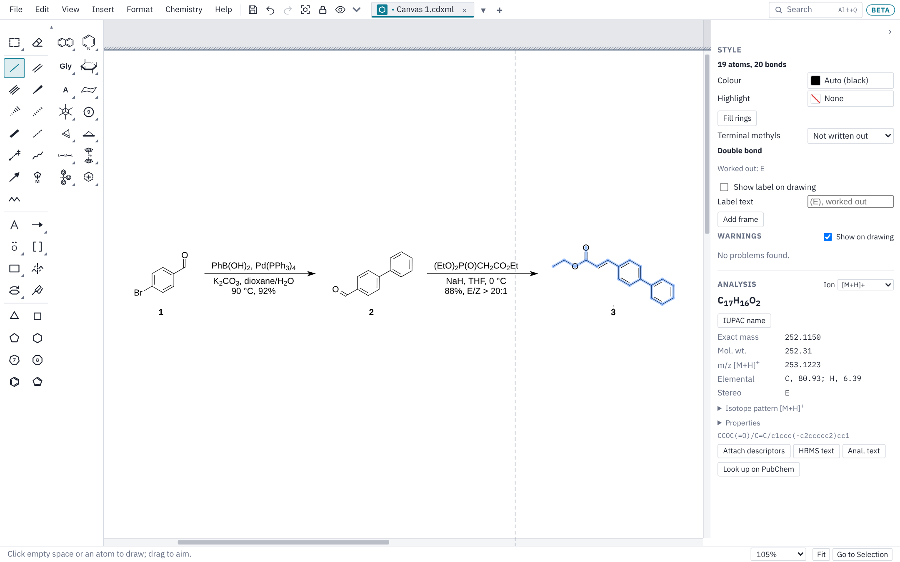
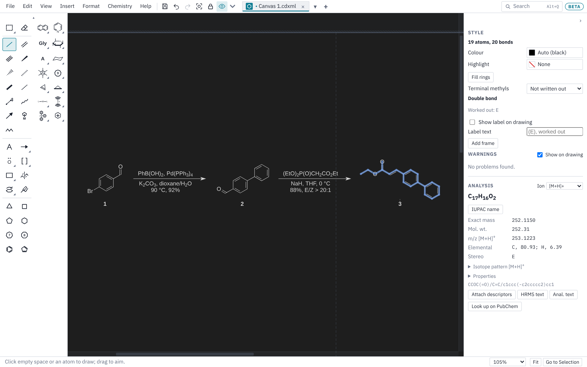

# Canvas (chemistry)

This page covers Canvas mode in depth: the tools, hotkeys on atoms and bonds, text, arrows and shapes, the Chemistry and Format menus, drawing styles, Reading Mode, the Analysis panel and the other chemistry tools.

If you use ChemDraw, most of this will feel familiar: the hotkeys are ChemDraw's, new canvases use the ACS Document 1996 style, and files are saved as `.cdxml` or `.cdx`. Mac users: read Cmd for Ctrl and Option for Alt.

## The toolbox

The drawing tools run down the left side, in groups. A button with a small arrow in its corner holds a set of tools; click the corner, click the button again once it is in use, right-click it, or press and hold it to open the set. The button then shows the tool you used last. Text, arrows and the mechanism symbols sit just under the bonds so they show without scrolling; the toolbox is always two columns wide (one if you choose **One Column Outside Canvas**), in every mode, and on a short window it scrolls inside itself, with a scroll bar. Rest the mouse on any tool to see its name and hotkey, and watch the status bar at the bottom of the window for how to use it.

### Select and eraser

- **Select and move**: click to select, drag a box around things to select them, drag a selection to move it. Double-click an atom or bond to select its whole structure. Delete removes the selection.
- **Lasso select** (click the Select button again while it is in use, right-click it, or press and hold, then pick the loop): drag a loop around what to select, to pick a few pieces out of a crowded scheme without catching their neighbors. Shift adds to the selection.
- **Eraser**: click an atom, bond, caption, arrow or shape to remove it.

### Bonds and chains

Single, double and triple bonds (a quadruple bond is off the toolbox: find it with Search); wedge, hashed wedge, hashed, bold, dashed and wavy bonds; a partial bond; a dative bond; a hapto (η) bond; and the chain tool.

- Click empty space or an atom to draw a bond; drag to aim it. New bonds point in 15° steps and are a standard length. Hold Alt while drawing to draw at any angle, or turn off **Chemistry ▸ Fixed Bond Lengths** (Ctrl+L) and **Fixed Angles** (Ctrl+E).
- Bonds, rings and chains added to a structure match that structure's own bond length, line widths and colors, so a structure pasted from ChemDraw or drawn in another style stays consistent as you add to it. To always use the document's drawing settings instead, turn off **Settings ▸ General ▸ New bonds match the structure they're added to**.
- Alkyne, nitrile and allene carbons are drawn linear, as the IUPAC recommendations for structure diagrams (2008) ask: a triple bond drawn off a chain end, a bond drawn on from an alkyne carbon, and an allene's second double bond all carry straight on (a drag within about 35° of straight snaps to it). When you make an existing bond triple (or give a carbon a second double bond), the smaller side swings around so the sp carbon's two bonds line up; rings are left as they are. To leave atoms where they are, turn off **Settings ▸ General ▸ Straighten alkynes and allenes when a bond becomes triple**.
- Click an existing bond with the single bond tool to step it through single, double and triple. Click a double bond again with the double bond tool to move its second line. Click a wedge or dative bond again to reverse it.
- Draw a dative bond from the donor atom to the acceptor (H3N→BF3). Neither atom loses a hydrogen for it.
- **Partial bond**: a bond forming or breaking in a transition state, drawn dashed (press `P` over any bond to make it one). Like a dative bond it leaves both atoms' hydrogens as they were, it gets no valence warning, and the formula and SMILES leave it out. It saves to CDXML as a half bond (Order 0.5). **Chemistry ▸ Reactions and Schemes ▸ Transition State Brackets ‡** then puts square brackets around the selected transition state with ‡ at the upper right.
- **Hapto (η) bond**: drag from a metal into a ring, or onto a C=C, to bond the metal to its middle (η⁵-Cp, η⁶-arene, η³-allyl, η²-alkene; the η number is how many atoms it holds). Drag the other way, from the ring to empty space, for a new metal M. Click inside a ring or on a bond for a new metal there. The bond stays in the middle when you move or reshape the ring. Click a hapto bond to draw it as a line to each atom instead (some draw ferrocene that way). An η⁵ or η⁶ ring is drawn delocalized, with a circle inside, and an η³-allyl or η⁴-diene (butadiene, a cyclohexadiene) with one arc along its atoms; **Chemistry ▸ Structure ▸ Kekulé Form for η Ligand** draws one with its double bonds again (the choice is saved in CDXML), and **Edit ▸ Settings ▸ Drawing** turns the delocalized look off everywhere. Only the look changes: the bonds stay as drawn, so SMILES, formula and files are the same either way. In ChemDraw the bond opens as a multicenter attachment.
- **Chain**: drag from empty space or an atom; a number shows how many bonds you have. Or click and type how many atoms you want. Alt+click draws the same number again.

### Rings

Cyclopropane to cyclooctane, benzene and cyclopentadiene.

- Click empty space to place a ring, a bond to fuse it on, or an atom to make a spiro ring. Alt+click an atom to attach the ring by a new bond instead. Drag to turn it.
- With benzene, Shift+click swaps the double bonds around; Ctrl+click draws it with a circle inside. Ctrl+click with cyclopentadiene also draws a circle.

#### Flat, chair, flipped chair and boat

A cyclohexane (or any six-membered ring of single bonds, such as a tetrahydropyran) can be drawn four ways, and it stays the same molecule in each: every group keeps its face of the ring, so its stereochemistry never changes, and the SMILES, the formula and the R/S labels stay the same.

- Select the ring (or its whole structure) with the pointer over the drawing and press **Tab**: flat, then chair, then the flipped chair, then boat, then flat again. A wedge on the flat ring becomes an axial or equatorial bond on the same face of the chair.
- On a chair with groups on it, **Tab** (or **]**) walks the ring around one place clockwise and **[** walks it back. The picture turns; the conformer doesn't, so axial groups stay axial.
- **Shift+Tab** flips the chair: axial and equatorial swap.
- **\\** goes straight between the flat drawing and the chair, from any shape, keeping the stereochemistry.
- The same commands are on the right-click menu under **Ring Shape**.
- A structure picked with Tab (Edit ▸ Select Next Structure) isn't changed: Tab goes on to the next one.
- A ring fused or bridged to another keeps its shape.

A chair or boat drawn without wedges still has its stereochemistry read from its shape, so it keeps it when saved and opened again.

### Templates

Ready-made structures in palettes on the tool bar, plus **My templates**:

- **Ring systems**, **Heterocycles**, **Amino acids** and **Sugars**: Haworth projections of both anomers of glucose, galactose, mannose, GlcNAc and GalNAc, plus glucuronic acid, xylose, L-fucose, L-rhamnose, ribose, 2-deoxyribose, L-arabinose and fructose, and the pyranoses as ⁴C₁ chairs. Each Haworth is checked, stereocenter by stereocenter, against its name.
- **Nucleic acids**: the bases (A, G, C, T, U, joined by a new bond from N9 or N1 when you click a sugar's C1′), the eight ribo- and deoxyribonucleosides, their 5′-monophosphates, ADP and ATP, drawn on Haworth rings.
- **Conformers and fused rings in 3-D**: the cyclohexane chair (both ring flips, bare and with every axial and equatorial bond) and boat; trans- and cis-decalin, trans-hydrindane, cis-hydrindane, perhydrophenanthrene and perhydroanthracene, the 5α and 5β steroid skeletons, adamantane and cubane.
- **Crossing bonds in 3-D drawings**: in anything placed from these palettes (and rings fused onto them), the bond that is further back gets the small white gap where a nearer bond crosses it.
- **Projections and stereocenters**: Newman, sawhorse and Fischer projections; tetrahedral centers drawn several ways; trigonal bipyramidal, octahedral, square pyramidal and square planar centers; zig-zag chains with wedges.
- **Large rings**: 9- to 20-membered rings, as polygons and folded.
- **Aromatics**: from the cyclopropenylium ion to coronene and porphine, plus corannulene, triptycene and C₆₀.
- **Rings in perspective**: 3- to 6-membered rings seen at an angle, with and without bold front bonds.
- **Metal complexes**: coordination geometries around a metal M (linear to octahedral, with wedges for the bonds toward you), η³-allyl and η²-alkene complexes, a chloride-bridged dimer, an M≣M quadruple bond and a β-agostic alkyl.
- **Metallocenes and half-sandwich complexes**: ferrocene staggered and eclipsed, Cp₂M both ways, decamethylferrocene, ferrocenium, cobaltocenium, bis(benzene)chromium and uranocene; a ferrocenyl group (click an atom and it joins it by a bond, kept upright and flipped to face the way the bond goes), 1,1′- and 1,2-disubstituted ferrocenes; bent metallocenes (Cp₂MX₂, Cp₂TiCl₂, Cp₂ZrCl₂, the Schwartz, Petasis and Tebbe reagents, Cp₂TiCl, Cp*₂MX₂); ansa-metallocenes with an SiMe₂ or CH₂CH₂ bridge, rac-(EBI)ZrCl₂ and the constrained-geometry catalyst; piano stools CpML₃, Cp*ML₃, (η⁶-arene)ML₃, CpML₂, (benzene)Cr(CO)₃, CpMn(CO)₃ and Fp–R; and the [Cp*RhCl₂]₂ and [(p-cymene)RuCl₂]₂ dimers. They are built from the real shapes (ring tilts and metal–ring distances from crystal structures) and drawn the textbook way, the rings seen from a little above, with a hapto bond from the metal to each ring's middle, so the Analysis panel's electron count works on them (Cp₂ZrCl₂ is Zr(IV), d⁰, 16 electrons).
- **Ligands**: PPh₃, PCy₃, P(t-Bu)₃, XPhos, SPhos, t-BuXPhos, RuPhos, BrettPhos, dppe, dppp, dppf, BINAP, Xantphos, IMes, IPr, SIMes, SIPr, CO, MeCN, pyridine, bipy, dtbbpy, phen, TMEDA, en, acac, Ph-BOX, Jacobsen's salen, ppy, the t-Bu-PNP pincer, Cp, Cp*, benzene, p-cymene, indenyl, allyl, ethylene and COD. Click a metal and the ligand goes on it, on its most open side; a chelate's donors both bond to it. The palette's first button opens the Ligand Library, with several hundred more.

The conformers are drawn from real 3-D models (MMFF94 geometries), so their bond angles and ring shapes are true to life.

- Click empty space to place a template (drag while placing to turn it).
- Click a bond to fuse it on: pyridine on a benzene bond gives quinoline.
- Click an atom to join it there. Hold Alt to join it the other way (by a new bond, or sharing the atom).

#### Fusing conformers

When you fuse a conformer onto a ring that is itself drawn in 3-D (a chair, envelope, half-chair, decalin and so on), Chem Illustrator works out the ways the two rings can really share the bond and offers only those. A chair on a chair, for example, can join trans (both new bonds equatorial, as in trans-decalin) or cis (one axial, one equatorial, either way around).

- **Press and hold** on the bond: the blue outline shows the best way (trans first, then cis), with its name beside it ("trans-fused · 1 of 3").
- **Move the pointer** toward where you want the new ring: the outline swaps to the fusion lying nearest the pointer.
- **Tab** and **Shift+Tab**, with the mouse still held, step through the ways one at a time.
- **Release** to place it.
- Or **right-click the bond** and pick **Fuse a Ring Here**: each conformer that fits, and the ways it can join (Trans-fused, Cis-fused 1, Cis-fused 2).
- The `9` and `0` keys on a bond of a chair fuse another chair trans and cis.

This is enough to build decalins, hydrindanes, steroids (5α and 5β), triterpenes such as oleanane, and the hydroazulenes of the guaianes ring by ring.

#### Metal complexes

Metals know they are metals: a metal gets no hydrogens and no valence warning however many ligands it holds, and a phosphine, amine, pyridine, bridging chloride or carbonyl on a metal keeps the hydrogens and charges it had (PPh₃ stays P, not PH; M–C≡O needs no charges). Ligand labels work too: type PPh3, dppe, BINAP, XPhos, bpy, IMes, Cp*, COD, acac, THF and so on as labels on a metal. The formula and masses in the Analysis panel count them all, ferrocene included.

- Right-click a metal: **Add Ligand** puts a ligand from the list on it, or opens the Ligand Library for the rest.
- **Chemistry ▸ Metals ▸ Ligand Library…** (or the first button on the **Ligands** palette): 291 ligands in 17 families, among them monophosphines, Buchwald biaryl phosphines, bis- and chiral bisphosphines (DuPhos, Josiphos, SEGPHOS), phosphoramidites, NHCs and CAACs, pyridines and bipyridines, amines and aza-macrocycles, BOX and PyBOX, salens, porphyrins, pincers, β-diketonates and carboxylates, solvents and crown ethers, and π-ligands. Search by abbreviation (dppf), part of a name (bipyridine), PubChem number, or how it bonds (LX, L2X2), or pick a family on the left. Each ligand is drawn on a metal M the usual way around (the metal on the left of a chelate's donors, macrocycles around it), with groups such as PPh2, PCy2 and P(t-Bu)2 kept as labels. The panel on the right gives its names, how it bonds (L₂, LX, η⁵…), its PubChem record and the SMILES its abbreviation stands for (click it to copy). **Use Template** (or double-click, or Enter) picks its drawing as the tool: click a metal to put it on. The window stays open beside the drawing until you close it.
- Every abbreviation in the Ligand Library also works typed as a label (dppf, dtbbpy, IPr*, Cp′, 18-crown-6, PhPyBOX), inside a longer label too (Pd(dppf)Cl2). Rest the mouse on one to see its drawing on a metal with its name, and **Expand Label** draws it out from that drawing. The electron count knows how each one bonds (Ni(dtbbpy)Cl₂ is Ni(II), 16 electrons; Co(salen) is Co(II), 15).
- **Chemistry ▸ Metals ▸ Add Hapto Bond (η)**: select a metal and the ring or π-bond atoms; their bonds become one hapto bond to the middle. **Split Hapto Bond** goes back to a bond to each atom.
- **Chemistry ▸ Expand Label**: draws a label out as atoms. A ligand on a metal comes from its template (dppe gives both P atoms bonded to the metal); a ligand's name on its own, as a label or a text box (BINAP, dppf, salen), gives the free ligand drawn the usual way around, BINAP with its two PPh2 groups side by side on the left. Groups such as PPh2 stay labels. Other abbreviations (OMe, Boc, CO₂Et) are laid out along the bond they hung from.
- **Chemistry ▸ Expand Label Fully** (also on the right-click menu): the same, drawn out down to every atom. A library ligand uses its own drawing in full, the same way around as its usual one (BINAP with all four phenyls); any labels still left (dppf's PPh2, a PPh2 you typed in a chain) are drawn out where they are, each group turned into the room around its atom. It is one step to undo. In a crowded complex the phenyls can land on the metal's other ligands: move those after.

**Insert ▸ Structure from Sequence…** draws a peptide in full from its sequence: one-letter codes (GLYPHS; small letters are D-amino acids, which can be turned off), or three-letter codes (Boc-Ala-D-Phe-Gly-OMe). Spaces, numbers and a FASTA header line are skipped. Pick the N-terminus (H, Ac, Boc, Fmoc, Cbz, Bz) and C-terminus (acid, amide, OMe, OEt, OtBu, OBn), or write them into a three-letter sequence. The backbone is a zig-zag with the side chains in turn up and down; the chain bends at each proline, whose ring is fused to the backbone.

To make your own template, select a structure and click the first button on the **My templates** palette, or use **Chemistry ▸ Abbreviations and Templates ▸ Save as Template…**. Give it a name and it appears in the palette. **Chemistry ▸ Abbreviations and Templates ▸ Delete Template…** removes one.

### Text, periodic table and fragmentation

- **Text**: click an atom to type a label, or empty space for a caption. See [Text and captions](#text-and-captions).
- **Periodic table**: pick an element, then click atoms to change them, or empty space to add a lone atom. Atoms already selected change at once. You can type a symbol in its box and press Enter. Open it from **Chemistry ▸ Look Up ▸ Periodic Table…** or Search (it is no longer a toolbox button).
- **Mass fragmentation**: see [Mass fragmentation](#mass-fragmentation).
- **Perspective** and **3-D Perspective** (one button, two tools): see [Rotating a structure in perspective](#rotating-a-structure-in-perspective).

### Arrows, mechanism symbols, shapes and brackets

- **Arrows**: reaction, dashed, hollow-headed, resonance (heads at both ends), equilibrium, retrosynthetic and crossed-out (reaction does not go). Drag to draw one, or click for a standard length. Drag an end to move it and drag the middle to bend the arrow into an arc. With the arrow tool, Shift+drag from an arrow's end or middle to branch a second arrow off it (one starting material, two products).
- **Curved arrows** (electron pair) and **fishhook arrows** (one electron): drag from a lone pair, radical dot, circled charge, atom or bond to an atom or bond, and the arrow snaps into place as in a mechanism. If you have drawn lone pairs on the atom, the arrow starts from the one facing where it goes. A bond's arrow starts from the middle of the bond. Let go between two atoms that are not bonded (the C and C that will join in an aldol or Diels–Alder) and the head points at the new bond's place. The arrow picks the side and curl that keep it clear of the other atoms and bonds, and switches to an S shape when no single bend gets around the structure; swing out to one side as you drag to bend it that way instead. Drag the middle dot to change the curve. Hold Alt to draw freely.
- **S-shaped arrows**: the **S-shaped curved arrow** and **S-shaped half-headed arrow** tools (in the curved arrow set) always draw two bends, for an arrow that has to go around something or come in from behind. Drag the two diamond handles to shape it. **Chemistry ▸ Mechanism Arrows ▸ Make S-Shaped Arrow** turns a selected curved arrow into an S, and **Chemistry ▸ Mechanism Arrows ▸ Make Single-Curve Arrow** turns it back. **Chemistry ▸ Mechanism Arrows ▸ Flip Arrow Bend** bends a curved arrow the other way around, half head and all.
- **Drawing through points:** with a curved arrow tool, click where the arrow starts (a lone pair, atom or bond, or anywhere), click each point it should pass through, then click the atom or bond it points at. Or double-click, or press **Enter**, to end it at the last point. The curve runs smoothly through every point. Press and drag at a point to set the direction the arrow runs through it. **Backspace** takes back the last point and **Esc** stops. The ends stick to the structure and sit at the gap set in Settings, as for a dragged arrow. A double-click on empty space still puts down a curved arrow of the usual size.
- **Drawing freehand:** with a curved arrow tool, hold **Ctrl** (**Cmd** on a Mac) while you drag, or draw with a pen or Apple Pencil, and the arrow follows your stroke. When you let go it becomes a few smooth curves with round join handles you can drag. The ends still snap to the lone pair, atom or bond they start and end on, and stick there.
- **Reshaping by the line:** with a curved arrow tool, drag the line of a selected S-shaped (or longer) arrow and that stretch of the curve follows the pointer; its ends and joins stay put and smooth joins stay smooth. (With the select tool, dragging the line moves the whole arrow.)
- **Longer paths:** any curved arrow can be grown into a longer path with more bends. Double-click a selected curved arrow's line to add a join there (a round handle); the shape doesn't change until you drag it. Drag a join to move that part of the path (its two diamond handles go with it), or drag a diamond handle to bend the curve. At a smooth join the handle across the join turns with the one you drag, so the curve stays smooth; hold **Alt** while dragging to move just the one handle and make a sharp corner. Hold **Shift** to turn a handle in 15° steps around its join, or to slide a join along the line of its handles. Click a handle or join and the arrow keys nudge it (Shift for bigger steps); **Delete** takes out a join that was clicked, and so does double-clicking it. Right-click the arrow for **Add Bend Here**, and right-click a join for **Remove Bend**, **Smooth Join** (handles in line, each keeping its length) and **Symmetric Join** (in line and the same length). These are also in **Chemistry ▸ Mechanism Arrows**. A single-curve arrow becomes the same arc as a path when you add a bend to it.
- **Shapes and path commands:** the Style panel's **Shape** list (and right-click ▸ **Mechanism Arrow ▸ Shape**) gives a selected curved arrow a ready-made shape between the same two ends: **Single curve**, **S**, **U-turn** (out to one side and back in) or **Loop** (curls around on itself). An arrow you have shaped yourself shows as **Own path**. **Reverse Direction** turns an arrow round on the same line so the head is where the tail was (stuck ends swap too). **Smooth Path** turns every sharp corner into a smooth bend, and **Simplify Path** redraws the arrow with as few bends as keep its shape. All are also in **Chemistry ▸ Mechanism Arrows**, next to **Flip Arrow Bend** (a mirror image about the line between the ends).
- **Moving an arrow:** with the select tool, the pointer turns into a hand over an arrow's line: drag there to move the whole arrow. Over a handle it shows what that handle does instead (a bend pointer for the diamonds, the four-way pointer for ends and joins).
- **Gap at the ends:** **Settings ▸ Drawing** sets the space between a mechanism arrow's start and its atom or lone pair, and between its head and its atom, in points. Leave them blank for the usual gap, which grows with the bond length. New arrows use it, as do arrows stuck to a structure when they are next redrawn; **Clean Up Arrow** redraws selected arrows with it at once.
- **Arrows stay on the structure:** a curved arrow drawn onto a lone pair, atom, bond or new bond's place is stuck there. Move, turn, flip or clean up the structure and the arrow goes with it, stretching if the atoms move apart; undo puts both back. Lone pairs, radical dots and circled charges stay on their atoms the same way. Drag an arrow's end a little and it stays stuck at the new place; drag it right off and it comes loose. **Chemistry ▸ Mechanism Arrows ▸ Detach from Structure** (or **Unstick from structure** in the Style panel) frees a selected arrow, and **Chemistry ▸ Mechanism Arrows ▸ Attach Arrows to Structure** sticks it to whatever its ends are on.
- **Homolysis**: select one or more bonds and choose **Chemistry ▸ Mechanism Arrows ▸ Homolysis Arrows** (or right-click the bond) for the two fishhooks that split each bond, one to each atom, on the open side.
- **Moving an arrow's end:** drag the end of a curved arrow onto a lone pair, atom or bond and it snaps there, keeping the side it bends to. Hold Alt to put the end anywhere.
- **Clean Up Arrow** (**Chemistry ▸ Mechanism Arrows ▸ Clean Up Arrow**, or right-click a curved arrow): redraws the selected curved arrows from the lone pair, bond or atom their tail is on to what their head points at, starting and ending at a sensible angle and clear of the structure. S-shaped arrows stay S-shaped. Undo puts them back. It has no key to start with; give it one in **Edit ▸ Keyboard Shortcuts…**. Right-click a curved arrow for the **Mechanism Arrow** menu with all of these.
- **Draw Next Intermediate** (**Chemistry ▸ Mechanism Arrows ▸ Draw Next Intermediate**, or right-click a curved arrow): draws what the curved arrows make, after a reaction arrow, as one undo step. A full head moves a pair of electrons and a fishhook one: from a lone pair (or negative charge or radical) or a bond, to an atom (a new bond to it, or a lone pair on it when the arrow starts on one of its bonds), a bond (made double) or the gap where a new bond forms. Bonds are made and broken, charges and radicals move, hydrogens stay as they were, and lone pairs, radical dots and circled charges are drawn as the starting structure showed them. A structure that gains a bond to another is brought alongside and cleaned up; one that comes away is moved off a little. With more than one step drawn, select an arrow or structure of the step you want.
- **Check Arrows** (same menu): checks that the arrows make sense before anything is drawn (Draw Next Intermediate does this too, and draws nothing while there is a problem). Each arrow must start at electrons that are there (an arrow from a carbon with no lone pair is caught, with a hint when it looks drawn the wrong way around), end on an atom, bond or new bond it can reach, and leave no atom past an octet (a five-bond carbon: a nucleophile added to C=O without the π bond moving onto O) and no bond with one electron (a fishhook needs a partner). Choose it again for the next problem; each is selected as it is shown. Aromatic rings drawn with a circle need alternating double bonds for arrows to be read.
- Curved arrows find their own way: a new arrow keeps clear of atoms, labels, bonds and other arrows (where neither a single curve nor an S gets past, it takes a longer way around, through a point or two off to the side), and never puts its head on another arrow's head or under a label. When you move or change a structure so that an arrow stuck to it would run into something, the arrow finds a clear way around again. An arrow you have bent by hand (by its middle handle, which shows a bend pointer) keeps its bend; Clean Up Arrow lets it find its own way again. **Edit ▸ Settings** turns the re-routing off.
- **Files:** S-shaped arrows are saved in .cdxml and .cdx as ChemDraw curves with arrowheads, so ChemDraw shows them. What an arrow is stuck to is saved too, for Chem Illustrator; ChemDraw ignores it.
- **Mechanism symbols**: lone pair, radical dot, circled plus and minus, δ+ and δ−, ‡ (click where it goes), and a single orbital lobe (see Orbitals below). Click an atom and the symbol goes in the most open space around it. To put a lone pair (or radical dot or circled charge) somewhere else, press on the atom and drag: the symbol goes around the atom after the pointer, and lands where you let go. Hold Alt (or Shift) while dragging to turn it in 15° steps, as when turning a structure. A radical dot makes the atom a radical (one H fewer); a circled charge sets the atom's charge.
- **Moving a charge:** with the selection tool, drag the + or − beside an atom (a carbocation, tropylium's +, or the sign in a label) to wherever you want it. It becomes a sign of its own that stays with its atom, even in the middle of its ring, as ChemDraw's charges do.
- **Charges by labels** sit raised after the label (N⁺). A bond that runs under the sign stops short of it, as in ChemDraw; if that would leave almost nothing of a short bond, the charge moves to a free spot around the label instead.
- **Frames**: rectangles (plain, rounded, with a shadow, dashed), ovals, circles drawn from the center, a filled circle, and plain, dashed and bold lines. Drag to draw; Shift while drawing an oval makes a circle. Drag the corner squares to resize.
- **Brackets**: square, round and curly, transition-state brackets (square, with ‡ at the upper right), and a single left or right bracket. Drag a box to put brackets around it, or click a structure to bracket it.

Select any arrow, shape or bracket to change its line width, color, dashes, fill, corners and shadow in the **Style** panel.

## Hotkeys on atoms and bonds

As in ChemDraw, point at an atom or bond (it highlights blue) and press a key. Some favorites:

- On an atom: `1` adds a bond, `2` a C=O, `6` cyclohexyl, `a` phenyl, `o` makes it O, Shift+O makes it OMe, `+` and `-` charge it.
- On a bond: `2` makes it double, `w` a wedge, `h` a hashed wedge, `a` fuses benzene, `6` fuses cyclohexane, `9` and `0` fuse a chair.

A key that grows something moves the highlight to the new atom, so you can keep typing: `8` then `1` gives an E double bond. Pressing `1` or `0` with the mouse on an atom keeps the highlight there, so `1` three times adds three bonds to it.

[Keyboard and mouse](keyboard-and-mouse.md) has the complete lists. **Edit ▸ Keyboard Shortcuts…** shows every key and lets you change any of them.

## Text and captions

Pick the text tool (`t` over empty space) and:

- **click an atom** to type a label such as OMe, CO2Et or NHBoc;
- **click empty space** for a one-line caption;
- **drag across empty space** to make a text box that wraps its lines. Drag the small handle on its right side to make it wider or narrower.

Double-click a caption to edit it again. Press Esc to finish. If you'd rather finish with Enter, set **Edit ▸ Settings ▸ Preferences ▸ Finish typing text from the Text tool with** to **Enter**: Enter then finishes the text, and Alt+Enter (Option+Enter on a Mac) starts a new line. This works wherever you draw: Canvas, structures in documents and spreadsheets, and text boxes on slides.

### Typing an atom label

The label box opens right on the atom: its first letter sits where the atom is, in the label font, and the box grows as you type. Counts drop and charges rise as you type them (CH₂CO₂Me, NH₃⁺), just as the label will show. Press Enter or click away to finish.

- To raise or lower other characters, select them in the box and press **Ctrl+Shift+=** (raise) or **Ctrl+=** (lower). Press it again to put them back. The marks are saved in the .cdxml file, so ChemDraw shows them too.
- **Repeat label:** after typing a label (say NHAc), right-click another atom and choose **Repeat “NHAc” Label** to give it the same label, raised and lowered characters included. Right-click one of several selected atoms and it labels them all (the menu says how many). It is also in **Edit ▸ Keyboard Shortcuts…** as **Repeat Last Label**, with no key to start: give it one and it labels the selected atoms, or the atom under the pointer.
- A label that is just R and a number (R1, R12) shows the number raised: R¹, R¹². Longer labels such as OR1 or CO2R1 keep their numbers lowered, and labels from files keep the look they were saved with. **Edit ▸ Settings** turns raised R numbers off.
- **Settings ▸ Preferences ▸ Alkyl groups written as** picks how the n-, i-, s- and t- of alkyl groups are written: as typed (the standard), tBu, *t*Bu with the prefix in italics, t-Bu, or *t*-Bu. Atom labels and text boxes take the look as you finish typing them, wherever the group sits (OtBu becomes O*t*-Bu, N(iPr)2 becomes N(*i*-Pr)2, KOtBu in a text box becomes KO*t*-Bu). When you pick a new look you are asked whether to change the labels and text already in the drawing too (one undo step). Only the look changes: a label still means the same group, and CDXML, pictures and Office files keep it. A dash is never put in or taken out where the letters would read as an element, so PtBu3 stays as it is.

While you type, a bar along the top of the drawing has bold, italic and underline, subscript and superscript, **formula style**, **(R)** (stereodescriptors in italics), font, size and color, alignment, bullets and numbering, indents, line and paragraph spacing, and a set of Greek letters and symbols (**αΩ**). It sits along the top so it never covers what you have drawn; **View ▸ Window and Colors ▸ Text Formatting Bar** can float it just above the text instead, or hide it (the keys below still work).

Useful keys while typing:

| Key | Does |
|---|---|
| Ctrl+B, Ctrl+I, Ctrl+U | Bold, italic, underline |
| Ctrl+= or F9 | Subscript |
| Ctrl+Shift+= or F10 | Superscript |
| Ctrl+F | Formula style |
| Tab, Shift+Tab | Change the level of a list item |
| Ctrl+Shift+V | Paste as plain text |

Formula style writes CH3CO2H with its numbers lowered and raises a charge (NH4+, TfO-), as ChemDraw does. A hyphen in a name stays on the line (Red-Al). To raise a charge's number (Fe3+), select it and use superscript.

As you type, common chemistry is tidied for you: CH2Cl2 gets its subscripts, `0 oC` becomes 0 °C, `1H NMR` gets its superscript, and the letters of a stereodescriptor go italic as the name goes on ((*S*)-proline, (2*E*,4*Z*)-). Compound numbers can go bold as you type them, (**4**) or compound **4a**: check that in **Edit ▸ Typing and Spelling…** (it is off at first, so list items such as (1) stay plain). Press Ctrl+Z straight away to undo just that change. Misspelled words get a red underline and formatting slips (a hyphen in a range, a number run into its unit) a blue one; right-click for suggestions. **Edit ▸ Typing and Spelling…** turns these helpers off, adds your own replacements (`rxn` → reaction) and edits your dictionary.

You can paste formatted text from Word into a text box; bold, italic, subscripts, colors and lists come across.

### Text read as chemistry

A caption or text box whose whole text is a formula (CH2Cl2, Cs2CO3, NaBF4), an ion (BF4⁻, PF6⁻, OTf⁻, NBu4⁺, Na⁺) or a reagent, solvent or ligand abbreviation (DMAP, THF, mCPBA, PPh3, dppe, COD) is read as that chemical by itself. A faint dotted line under it shows this on screen (it is never printed or saved). Select it, alone or with structures, and the Analysis panel, **Copy as SMILES**, **Copy as Molfile Text** and molfile export count it; **Chemistry ▸ Expand Label** (right-click ▸ **Expand to Structure**) draws it as its structure. Ordinary text ("Step 2", "rt, 12 h", "1a") stays text, and so does the text above and below reaction arrows (it keeps its automatic subscripts).

- A counterion typed without its charge (BF4) is still read as that ion, and is flagged in Warnings until the charge is added. Turn on **Settings ▸ Drawing ▸ Add charges to common counterions** to have the charge added as you finish typing.
- Turn on **Settings ▸ Drawing ▸ Group a counterion … as one salt** to have an ion typed next to a structure or ion of opposite charge grouped with it. Grouped, the two count as one salt: one formula and mass, and SMILES with both parts. You can also group them yourself with **Format ▸ Group**.
- Right-click ▸ **Read Text As** (or **Read as** in the Style panel) sets a text box to **Chemical** or **Plain text** by hand, or back to **Automatically**. The Style panel says what the text is read as. A group or atom on its own (OH, CH3, NO2, CO2H, Cl) is left as text when read automatically, since it is usually a label; set to **Chemical**, it is read as the radical or atom it stands for (OH is the hydroxyl radical, HO•, 17.01 g/mol).
- Formulas that spell out their hydrogens atom by atom get their double and triple bonds worked out (CH2CH2 is ethylene, HCCH acetylene), and a nitro group inside a formula (CH3NO2, PhNO2) is read as one.
- Saved as CDXML, text read as chemistry is marked for ChemDraw to interpret chemically.

### Links in text

While typing a caption or text box, **Ctrl+K** (or the link button on the text bar) links the selected words to a web page, a DOI, a file or an e-mail address. With the text selected but not being typed, **Insert ▸ Link…** or right-click ▸ **Link…** links the whole caption. **Ctrl+click** a link to follow it. Right-click a link for **Edit Link…**, **Open Link**, **Copy Link** and **Remove Link**. ChemDraw shows linked text as plain text; open the file here again and the links are back.

### Linking text to a structure

Select a caption and a structure and choose **Format ▸ Link Text to Structure** (also on the right-click menu). The text then moves, turns and copies with its structure. With only text selected, it links to the nearest structure. While either one is selected, a dotted gray line shows the link. **Format ▸ Unlink Text** lets it go again. **Edit ▸ Settings** chooses where linked text goes: where it already is, or below, above, left or right of the structure.

### Rotating text

Select a caption or text box on its own with the select tool, and a round handle appears above it. Drag the handle to turn the text; hold Shift or Alt to turn in 15° steps. When you turn a structure that has captions with it, the captions move around with the structure but stay upright. Labels attached to a structure (ID labels, descriptors) also stay upright.

## Rotating a structure in perspective

Two tools turn a structure in 3-D as you drag it. Press on a structure (or on the selection, to turn everything selected together) and drag: across turns it about the up–down axis, up or down about the left–right axis, and the near side follows the pointer. Hold **Shift** to turn one way only, in 15° steps. Dragging on empty space draws a selection box. Each drag is one undoable step.

- **Perspective** turns the drawing as a flat sheet, the way ChemDraw does: the structure is foreshortened as it tips, and once you turn it past edge-on (seeing it from behind) its wedges and hashed wedges swap so every stereocenter keeps its R or S. A structure that already has depth (a conformer template, or one turned before) turns with that depth.
- **3-D Perspective** turns the structure's **real shape**. The first time, it builds the shape from your drawing (OpenChemLib conformers, the chosen one relaxed with MMFF94s+), which takes a second or a few for a large molecule; the status bar says "Building the 3-D shape…" and the turn starts as soon as it is ready. A molecule that isn't flat, such as BINAP with its two naphthalenes at right angles, then shows its true shape from every side, where the flat tool would treat it as a flat picture.
  - Which shape is meant comes from the drawing. Every stereocenter drawn with a wedge keeps its configuration. Other wedges, **bold bonds** (nearer you) and **hashed bonds** (further away) pick between shapes the bonds alone can't tell apart, such as a biaryl's two twists: bold one ring of a naphthalene and that ring is the one turned toward you.
  - While you turn, wedges move to whichever bond shows each stereocenter best from that angle, and where two bonds cross the one further back gets a small gap. If from some angle a stereocenter can't be drawn so it reads right (a bond points straight at you), the status bar says so, and letting go there puts the structure back at the last angle that worked.
  - The structure stays live in 3-D: drag it again and it turns on from where it is. Once you change an atom or bond of it, the next turn builds the shape again from the drawing as it is then.
  - If no 3-D shape can be built (R groups, labels that can't be read), or none matches the drawing (the bold bonds and wedges contradict each other), the structure is turned flat instead and a message says why.

**Format ▸ Rotate and Flip ▸ 3-D Rotation…** (and **Perspective** on a structure's right-click menu) turns the selected structures by angles you type: about X (left–right; positive tips the top toward you), then Y (up–down; positive brings the left side toward you), then Z (in the page, clockwise), as the real 3-D shape or as a flat sheet. **Flatten** makes turned structures ordinary flat drawings again: they keep how they look but forget their depth.

A turned structure keeps its 3-D positions in the CDXML file (ChemDraw's `xyz`), as **Place on Page** in the [3-D model](#3-d-model) window does.

### Depth shading

**Format ▸ Rotate and Flip ▸ Depth Shading** (also under **Perspective** on a structure's right-click menu) shades every structure drawn in 3-D by depth: the atoms and bonds nearest you are black, fading to gray the further back they lie. That covers structures turned with the Perspective tools, placed from the 3-D Model window, and drawn from the conformer templates. Each structure is shaded over its own depth, front to back; flat drawings are left as they are, and anything you have colored yourself keeps its color. **Depth Shading Settings…** sets the nearest and furthest colors (black and 60% gray, #999999, to start with), whether the fade is even or eased (slow at the front and back, quicker in the middle), and whether lines also thin with depth, and to what width at the back. It is a setting of the app, like the ends of bond lines: pictures you copy or export, and prints, keep the shading, but a CDXML file saves the structure's usual colors. The 3-D Model window has a **Depth** box that fades the back of its model in the same way.

## Moving, rotating and the Format menu

Select something and:

- drag it to move it (with any tool: the pointer turns into a hand over a selection);
- drag the round handle above the selection to turn it;
- use the arrow keys to nudge it 1 pt, or Shift+arrow for 10 pt;
- press Alt+← or Alt+→ to turn it 1°, Alt+↑ or Alt+↓ for 15°.

The **Format** menu has:

- **Align Left**, **Align Center**, **Align Right**, **Align Top**, **Align Middle**, **Align Bottom**;
- **Distribute Horizontally** and **Distribute Vertically** (three or more things);
- **Arrange in a Row**, **Arrange in a Column** and **Arrange in a Grid…** (two or more things): sets them out in reading order (left to right, then down) with the same space between each, each centered in its place. **Arrange in a Grid…** opens a small window that says how many items are selected, with **Rows** and **Columns** (they stay in step: 10 items in 3 columns need 4 rows; it starts as near square as can be), **Row spacing** and **Column spacing**, and a live preview beside them. Compound numbers under structures move with them, picked or not. Structures that share a ring (a set of pyridines, say) line up on that ring rather than on their outlines, so a substituent sticking up doesn't knock one out of line;
- **Flip Horizontal (Left-Right)** (Ctrl+Shift+H), **Flip Vertical (Top-Bottom)** (Ctrl+Shift+V). A flip makes the mirror image: wedged stereocenters turn over (S becomes R). When that happens a note says so, with an **Undo** button;
- **Flip Horizontal, Preserve Stereochemistry** and **Flip Vertical, Preserve Stereochemistry**: the structure is turned over and its wedges and hashes swap, so every stereocenter keeps its R or S;
- **Rotate 90° Clockwise**, **Rotate 90° Counterclockwise**, **Rotate 180°** and **Rotate…** (Ctrl+R, any angle);
- **Scale…** (Ctrl+K): by a percentage, or to a bond length in points;
- **Join** (Ctrl+J): joins two selected atoms, or two selected bonds, into one. You can also drag an atom onto another one: it snaps on, the atom it will join lights up, and the two become one when you let go. Drag a chain's end onto its start to close a ring. Hold Alt to drop it without joining;
- **Group** (Ctrl+G) and **Ungroup** (Ctrl+Shift+G): grouped structures, text, arrows and shapes select and move as one. Clicking any part selects the whole group, and a gray dashed box shows it; **Edit ▸ Settings** can make a click pick just the one thing instead. Groups are kept in CDXML files, so ChemDraw opens them as groups too;
- **Bring to Front** and **Send to Back** for shapes and pictures;
- **Bring to Front**, **Bring Forward**, **Send Backward** and **Send to Back** (Arrange > Order, the ribbon and the right-click menu) work on every object, as in PowerPoint: whole structures, text, arrows, shapes and pictures can go in front of or behind one another. Until you reorder something, shapes sit behind structures and text sits on top. A structure's ring fills stay just behind it and its lone pairs on it. The order is saved in CDXML as ChemDraw's drawing order. They also work on selected bonds: where two bonds cross, the one behind gets a small gap. Select an axial bond in a chair and choose Send to Back, for example, and the ring bond it crosses is drawn whole in front of it.

**View ▸ Toolboxes ▸ Toolbox: Guides** puts your own guides on the drawing, in blue, with ruler ticks along them: a **crosshair** (dragged by its middle), a line **across**, a line **up and down**, or a **grid** of lines every major tick over the whole drawing. Set the **Major** and **Minor** tick spacing (1" and 0.25" to start). Each box shows its unit, and you can type any unit: 1" or 1 in, 2.5 cm, 30 mm or 12 pt (a bare number is in the rulers' unit). **Toggle object snapping** turns snapping onto the guides on or off, and **Snap** picks what the guides snap to: major ticks, minor ticks, or both. The **i** beside the toolbox's title has the tip on moving guides. **Look** picks their color (blue to start, or teal, magenta, red, green, orange, gray, or any color from the last box) and **Transparency** fades them, from 0% to 90%, so they stay out of the way of the drawing. With snapping on, the atom or bond end you grab, or a caption's corner, snaps onto a guide and slides along it from tick to tick. Drag a guide with the Select tool, and drop it off the drawing to take it away. Each canvas has its own guides. Guides are saved in CDXML files (ChemDraw passes over them) but never show in pictures, exports or prints. Hold Alt while dragging to move freely.

Undo (Ctrl+Z) and Redo (Ctrl+Y) select what they changed, so you can see what came back and move it straight away.

To start a reaction quickly, select a structure and press Ctrl+→ (or Ctrl+←, Ctrl+↑, Ctrl+↓): you get a reaction arrow and a copy of the structure to edit into the product.

## The Chemistry menu

### Tidying and checking

- **Clean Up Structure** (Ctrl+Shift+K): evens out bond lengths and angles of the selected structures (or all of them) while keeping their shape, stereocenters and cis/trans double bonds. Undo puts it back.
  - **Tangled cages** (a bridged alkaloid pasted from SMILES with bonds crossing, say) are untangled: the rings are laid down as regular polygons and whatever bridges are left are drawn across, with as few crossing bonds as possible. The chemistry engine's own layouts are tried too, and the tidiest wins. Wedges are turned over where needed so every stereocenter stays as it was.
  - The first Clean Up keeps the structure where it was. Press it again straight away (with the structure selected) to step through other layouts, then the best one turned 30° either way and flipped.
  - **Clean Up Options…** (Structure toolbox, or right-click a structure) shows every layout side by side. Turn or flip them all with the buttons underneath, then pick one.
  - Clean Up tidies what the structures sit in too, in the same undo step. Structures in a reaction scheme get **Clean Up Reaction** (below). Three or more structures that are clearly in rows already (two rows of five, say), in one row or in one column, are evened out into that grid, row or column, keeping about the spacing they mostly have; their compound numbers move with them. When it isn't clear (rows of different lengths, things scattered about), they stay where they are: use **Format ▸ Align ▸ Arrange in a Grid…** instead.
- **Check Structure (next warning)**: goes to the next problem; see [Warnings](#warnings).
- **Aromatic Rings: Circle or Kekulé** (Alt+K): switches selected rings (or all) between a circle and alternating double bonds.
- **Show/Hide Explicit Hydrogens**: hides hydrogens that add nothing (not ones on wedges, charged ones, or ones on N or O); with nothing to hide, it draws the selected atoms' hydrogens.
- **Show/Hide Terminal Methyls**: writes chain ends out as CH3 or Me, or takes them away again. Choose Me or CH3 in **Edit ▸ Settings**. With one structure selected, the Style panel's **Terminal methyls** box sets it for that structure.

### Labels and groups

- **Contract Label…**: turns a selected group into one label (such as PMP) that keeps its chemistry. ChemDraw opens it as a contracted label.
- **Expand Label**: the other way around: the selected labels drawn out as atoms and bonds (ligands on a metal from their templates). **Expand Label Fully** draws out the labels that brings in too (PPh2 down to its phenyls). See [Metal complexes](#metal-complexes).
- **Define Abbreviation…**: select a group that hangs off a structure by one bond and give it a name. Typing that name as a label anywhere then counts as the full group for formula and mass. **Delete Abbreviation…** removes one.
- **Insert ▸ Structure from Name or SMILES…** (Ctrl+Shift+N; its window is called Name to Structure): type a systematic, CAS-style or common name and the structure is drawn. Select a caption holding a name first to turn the caption into the structure. Names are read on your computer, so this works offline; names it can't read (DMAP, DIPEA) are looked up on PubChem unless you turn that off in **Settings ▸ Online**. You can type a CAS RN (50-78-2) too; see [CAS RNs](#cas-rns). When a name can't be read, the window says so, underlines the part the name reader stopped at, and keeps the reader's own explanation under **Details**.

### Frames, highlights and fills

- **Add Frame**: draws a box around the selection that grows, shrinks and moves with what is inside. Click the frame to set the gap across and up and down in the Style panel, clear **Fit around its contents** to stop it following, or click **Fit now**. Dragging a corner by hand also stops it following.
- **Highlight**: a soft band of color (yellow to start) behind the selected atoms and bonds. With highlighted atoms selected, the Style panel sets the color, **Highlight shape** (round or straight), **Smooth outline** (round) or **Highlight ends** (straight), **Center on double bonds**, **Highlight size (%)**, **Grow around atom labels**, a shadow and soft edges. **Remove Highlight** takes it off.
  - Round highlights put a disc on each atom unless **Smooth outline** is on (or **Chemistry > Highlight and Fill > Smooth Highlight**, also on the right-click menu), which makes them one even band with round corners. Straight highlights are one even band with sharp corners where bonds meet, round, square or pointed ends, and a disc around each atom label. An atom with no highlighted bond gets a disc. Files with the older square or diamond highlights open as straight ones with square or pointed ends.
  - **Center on double bonds** (or **Chemistry > Highlight and Fill > Center Highlight on Double Bonds**) runs the highlight midway between a double bond's two lines. A ring drawn with its double bonds inside is highlighted midway between the ring and those inner lines, all the way around, so the highlight doesn't have to be made huge to cover both lines. Single bonds between double bonds (a chain such as a hexatriene) keep the highlight on their own line, so its corners follow the bonds' angles.
  - The Style panel keeps the everyday settings (color, **Look**, shape, smoothing, size) at the top and the rest in groups that fold open: **Placement**, **Fill and texture**, **Outline**, **Soft edges**, **Shadow** and **Glow**. Each closed group shows what it is set to.
  - **Soft edges**: **How much fades (%)** sets how much of the highlight fades (25 % fades a quarter of it), and **Fades** picks where: the outer part, the inner part (next to the bonds), or half at each side.
  - **Fill and texture**: **Transparency**; one color, a **Gradient across** (two colors at an angle), a **Gradient out from the bonds**, or no fill; and a **Texture** (lines, cross-hatch, grid or dots) with its own color and spacing.
  - **Outline**: a solid, dashed or dotted line around the highlight, with its color and width. **Outline-Only Highlight** (Chemistry ▸ Highlight and Fill, the right-click menu, or **Outline only** on the Highlight toolbox) switches between an outline with no fill and a filled highlight.
  - **Shadow**: color, opacity, direction, distance and blur. **Glow**: a soft halo around the highlight, with its color, size and transparency.
  - **Looks**: **Look** picks a ready-made look (Classic, Soft marker, Hollow, Neon, Lifted, Gradient across and more) or one of your own. **Save look…** keeps the selected highlight's settings under a name, with or without its color; **Chemistry > Highlight and Fill > Delete Highlight Style…** removes one. Your looks are kept with your settings.
- **Fill Rings**: colors in the selected rings. The fills move with the structure. In the Style panel, a fill can be solid, faded, shaded or a two-color **Gradient**, and can have a **Pattern** (diagonal lines, cross-hatch, horizontal or vertical lines, grid, dots), with its own color and spacing. **Pattern see-through** lets what is behind show through the lines or dots, and **Pattern under double bonds** decides whether the pattern runs under the inner line of a double bond. The **Shadow** group gives a filled ring a drop shadow (with or without a highlight), with its color, opacity, direction, distance and blur (design shapes have the same group); right-click a structure and choose **Highlight and Fill > Ring Fill Shadow** to turn it on or off. Copies of a structure (Ctrl+drag, or copy and paste) keep their ring fills. Boxes and ovals take the same fills and patterns.

### Labeling a structure

- **Add ID Label**: puts the next compound number under the structure, ready to type over.
- **Add Caption**: an empty caption under the structure, ready to type.
- **Attach Descriptors (Formula, Mass)**: the formula and masses under the structure. They follow it when you move it and update when you change it. Select them to choose the side and gap, which values are shown (formula, exact mass, MW, m/z, elemental analysis, HRMS) and the ion, or clear **Update when the structure changes** to keep text you typed yourself.

These follow the structure when it moves. Several stack up: ID label first, then caption, then descriptors.

### Stereochemistry

R/S and E/Z are worked out for every structure as you draw.

- **View ▸ Show R/S Preview** shows every label in red, on screen only.
- **Chemistry ▸ Stereo ▸ Show Stereo Labels (R/S, E/Z)** adds them to the selected structures (or all) as part of the drawing; they update themselves after edits. Select a stereocenter to hide its label or type your own, such as (R*).
- Plain bold bonds count as wedges and plain hashed bonds as hashed wedges, as in ChemDraw. Where R or S would depend on what an R or Ar group is, no label is given.
- **Axial chirality** (biaryls, allenes, alkylidenecycloalkanes) is labeled Ra or Sa by IUPAC rule P-93.5.1. Draw the groups on one end of the axis with a wedge and a hash (or one wedge) to show which way around it is. Without that, or when one end has two of the same group, no label is shown. **Edit ▸ Settings** writes them as P/M instead (Ra = M, Sa = P).
- **Stereo Group (abs, &, or)…**: marks selected stereocenters as abs (known as drawn), &1 (a mixture of both forms) or or1 (one form, not known which).
- **Chiral Flag (Abs, Rel, Rac)…**: puts the boxed flag under the selected structure, or removes it.

### Polymers and R-groups

- **Polymer or Repeat Brackets (n, ×3)…**: put square brackets around a repeat unit with the bracket tool, select both brackets, and type `n` for a polymer or a number for a group repeated that many times. The Analysis panel then shows the formula as end groups plus the repeat unit.
- **R-Group Table…**: draw a core with R1, R2 (or R, X, Ar) as labels, select it and choose this. Type one compound per line, its groups separated by commas (`Me, H`), or paste cells from Excel. You can set a compound number (2 gives 2a, 2b, 2c…), choose whether formula and MW are worked out, and add columns to fill in yourself (`Yield (%), ee (%)`). The table goes under the structure; double-click a cell to change it.

### Structure to Name

**Chemistry ▸ Look Up ▸ Structure to Name** (also on the right-click menu of a structure) puts the systematic (IUPAC) name of each selected structure under it, as a caption tied to the structure. The name is worked out on your computer by OpenClatura, a free rule-based namer that follows the IUPAC 2013 recommendations, so it works offline. Every name is then read back with the name reader (OPSIN), and it is given only if it reads back as exactly the structure you drew, stereochemistry and charges included; if not, you are told there is no confirmed name rather than given a wrong one. Stereodescriptors, *N*-locants, indicated hydrogen and fusion letters are set in italics, and brackets are nested the IUPAC way, ( ) inside [ ] inside { }.

The namer loads the first time you ask (about 14 MB, a few seconds). After that, the **Analysis panel** shows the name of every structure you select by itself, with a **Name caption** button; before then, its **IUPAC name** button starts it. Structures with R groups or unreadable labels have no name. On a set of 270 everyday and drug-like structures, 267 got a confirmed name.

### 3-D model

**Chemistry ▸ Look Up ▸ 3-D Model…** (also on the right-click menu of a structure) builds the selected structure in 3-D in a window of its own. The conformers come from OpenChemLib's torsion library and each is relaxed with the MMFF94s+ force field, lowest energy first; **‹** and **›** step through them, with each one's energy above the lowest. The model starts turned to look like your drawing.

- Drag to turn it, Shift+drag (or the right button) to move it, the wheel to zoom, the arrow keys to turn it in steps, and double-click to go back to the drawing's view. **Spin** turns it slowly.
- Draw it as **Ball and stick**, **Sticks**, **Wire** or **Space filling**, with or without hydrogens and element labels.
- **Place on Page** turns the drawn structure to match the view (one undoable step): bonds nearer you go in front where two cross, and each stereocenter gets a wedge or hashed wedge that reads right from that angle (in a crowded ring fusion, on a drawn H). The structure also keeps its 3-D positions in the CDXML file, so two placed views of one molecule with an arrow between them turn into each other in a reaction animation. From most angles some atoms would land on top of each other, or on a bond, once the structure is flat on the page, so the model is first turned the least it takes to keep them apart (usually 10–20°, at most 45°; the window says by how much), or to its cleanest view when no view that near will do. If a bond points almost straight at you, so a stereocenter can't be shown clearly, the step is taken back and the window says so: turn the model a little and place it again.
- **Best View** turns the model to the view that draws most cleanly: no atoms on top of each other, then the fewest crossing bonds, then the flattest, turned in the page to lie like your drawing.
- **Copy Picture** copies the view as a PNG (three times the window's size); **Copy MOL** copies the conformer as a 3-D molfile with hydrogens, for Chem3D, Avogadro, PyMOL or a calculation.
- The conformers come from one of three methods, chosen on the switch under the model, from fastest to most reliable. A note under the switch says what the chosen method does and what it found, and each result is kept, so you can switch back. The list below it ranks the conformers: **ΔE** is each one's energy above the lowest (kcal/mol), and **Population** its Boltzmann population at 25 °C among those listed. Click a row, or use the arrow keys, to show that conformer. The window opens with **Quick**: about a dozen likely conformers, each relaxed with the MMFF94s+ force field.
  - **Full Search** runs a wider search: 200 starting conformers to begin with (you can choose 10 to 2000), each relaxed with MMFF94s+. Two that come out the same shape (heavy-atom RMSD under 0.5 Å after fitting one onto the other, within 0.1 kcal/mol) are kept once, and so are copies that differ only by a mirror or by swapping equivalent atoms (the two methyls of an isopropyl, a phenyl ring flipped over): those are counted in the conformer's population instead. Anything more than 10 kcal/mol above the lowest is left out. It runs in the background with its progress shown, and **Stop** ends it. A drug-sized molecule takes from a few seconds to about a minute.
  - **xTB Refine** (desktop app) re-optimizes the lowest conformers from the force field (5 to begin with) with GFN2-xTB, in the gas phase or an ALPB solvent, and ranks them again by xTB energy. It runs the **xtb** program installed on your computer: install it from conda-forge (`conda install -c conda-forge xtb`) or the xtb project's GitHub releases, then type `xtb` if it is on your PATH, or the full path to the program. xtb is free software (LGPL 3.0) from the Grimme group, and nothing leaves your computer.
  - **Run again…** in the note runs Full Search or xTB Refine again with other settings.
- **Export** saves **Gaussian/ORCA Input…**: input files for a DFT calculation: ORCA (.inp) or Gaussian (.gjf). Choose the method (B3LYP-D3(BJ)/def2-SVP and r²SCAN-3c are among those offered), the job (optimize and frequencies, optimize, single point or frequencies), an SMD solvent, the charge and multiplicity (worked out for you), cores and memory, and either this conformer or every conformer shown (one file each, in a zip). It also saves every conformer listed as one **XYZ file** or **SD file**, with each one's ΔE.

Structures with R groups or labels that can't be read have no 3-D shape. Metals mostly have no MMFF parameters, so their models are the generator's geometry, not relaxed.

### Newman and sawhorse projections

Right-click a single bond ▸ **Newman Projection…** (also **Chemistry ▸ Look Up ▸ Newman Projection…**), or pick the **Newman** tool (an eye with a dotted arrow coming out of it, beside the Perspective tools) and click a bond: the end you click nearer is in front. The window searches the structure's conformers (MMFF94s+), turns the bond to its other staggered rotamers too, and lists each picture down the bond, most stable first, with its torsion, energy and share at 25 °C. **Tab** and **Shift+Tab** in the preview step through them; the **Turn** dial turns the back atom (double-click it for 0°); **Looking from** or **⇄** looks from the other end; **Draw as** gives a Newman or a sawhorse projection; **Conformation ▸ As drawn** uses the shape your wedges and bold bonds draw instead. With the xtb program installed, the desktop app can rank the conformers with GFN2-xTB.

The projection goes beside the structure, with a blue eye and dotted arrow on the structure showing which way you are looking (turn this off in the window). The eye is drawn side on, its lids opening toward the bond. It stays linked: change the structure (an atom, a label, a bond or a wedge) and it is worked out again, in the same undo step; move the structure and the eye follows. Right-click the projection ▸ **Unlink from Structure** keeps it as it is; double-click it to open the window again. Projections keep their link through CDXML, Word, PowerPoint and Excel files, and through copy and paste.

The groups on each atom are ranked by size (their A-value, the cyclohexane axial–equatorial free energy difference) as largest, middle and smallest. **Settings ▸ Newman Projections** sets the color, bold, italic and bond color of each rank (largest red to start with), the circle's size, how far the bonds reach, how far an eclipsed back group is turned so both show, a dot on the front atom, the ring arc, the eye's style and color, and the defaults for torsion energy charts. Looking down a ring bond, the two ring bonds are joined by an arc for the rest of the ring rather than ranked: gray and dashed to start with, or solid, in any color, with the ring bonds in its color too if you like. The eye comes with a pupil to start with, or plain, with an inner curve, almond-shaped or with lashes.

#### Torsional energy charts

The window's **Energy Chart** tab (or right-click a single bond ▸ **Torsional Energy Chart…**) turns the bond through 360° in steps of 5°, 10°, 15° or 30°: at each angle the torsion is held and the rest of the molecule relaxed (MMFF94s+), and a cosine series is fitted through the energies. The chart shows the energy against the torsion φ between two groups (**Torsion between**: the biggest pair first), a Newman projection at each minimum and maximum (or only the minima, or none), their names (textbook: synperiplanar, eclipsed, gauche, antiperiplanar; or Klyne–Prelog: synclinal, anticlinal…), blue dotted arrows with each barrier's height, and a boxed sawhorse of the most stable conformation with the eye looking down the bond. Energies can be in kcal/mol or kJ/mol; with xtb installed, the desktop app can give GFN2-xTB energies at the scan's shapes. **Copy Data** puts each angle and its energy on the clipboard, tab-separated, to paste into a spreadsheet (also on the chart's right-click menu). The projections on a chart are drawn at ideal staggered and eclipsed angles (a gauche minimum at 65° is drawn at 60°, its bottom bond straight down). To move a barrier arrow and its number to the side, click the chart, click the arrow (or the number) and drag: the pair moves together, and once the arrow is past the end of its level a dashed gray line joins its top to the level. Double-click a chart to change its projections, names, units, barriers or sawhorse; to scan again, open the window from the bond. Charts are drawn as ordinary lines and text, so they open in ChemDraw, Word, PowerPoint and Excel as drawn, and in Chem Illustrator with their numbers.

### PubChem

**Chemistry ▸ Look Up ▸ Look Up on PubChem** (also in the Analysis panel and the right-click menu) sends the selected structure to PubChem and shows its names, CAS number, a link to its PubChem page, GHS hazards, and measured melting point, boiling point and density where known. See [The Analysis panel](#the-analysis-panel).

### CAS RNs

CAS Registry Numbers are arbitrary numbers given out by CAS, so they can't be worked out from a structure; the program looks them up, both ways.

- **CAS RN to structure.** Type or paste a CAS RN wherever a name goes: Insert ▸ Structure from Name or SMILES, a caption turned into a structure, a document, a sheet cell, or Add by Name in the Compound Library (the compound keeps the number). It may be written 50-78-2, CAS 50-78-2, CAS RN: 50-78-2 or [50-78-2]. The last digit is a check digit, so a mistyped number is caught before anything is looked up, and you are told what the check digit should be.
- **Structure to CAS RN.** Select a structure: the Analysis panel's **CAS RN** line shows its number straight away if it is in your Compound Library or was found before, or a **Find** button. **Chemistry ▸ Look Up ▸ Find CAS RN** (also on the right-click menu) does the same. Hover over the number to see any other CAS RNs PubChem lists for it (old or replaced numbers, mixtures). **CAS caption** puts the number under the structure, tied to it.

Where the numbers come from, in order: your Compound Library, numbers found before (kept on your computer, so they work offline), then PubChem. A CAS RN PubChem doesn't know is tried on NCI CACTUS, the US National Cancer Institute's free resolver, which sometimes leaves out stereochemistry. Only the number typed, or the structure as SMILES, is sent; **Settings ▸ Online** turns these lookups off. No list of CAS RNs comes with the program (CAS asks for a license to publish them), so a number that isn't in your library needs the internet the first time. Always check that the structure found is the compound you meant: PubChem sometimes files a salt, a mixture or a related compound under the same number, and says so when it does.

### Knowledge Base

**Chemistry ▸ Look Up ▸ Knowledge Base…** (in every mode) opens reference tables to look things up while you work. The search box searches every table at once, and the list on the left shows how many rows of each table match:

- **A name or any word** (chloroform, CD3): rows containing every word.
- **A CAS number** (865-49-6): that compound exactly.
- **SMILES** (ClC([2H])(Cl)Cl): the same compound however it is written, under **This compound**, then every compound containing it (a substructure search) under **Containing it**. **Draw…** beside the search box opens a window to draw the structure instead, or just the part you are looking for: it has its own bond, ring and atom buttons, and the toolbox and the usual keys (point at an atom and type N, O, Cl) work in it too. **Search** (Ctrl+Enter) finds that compound, then every compound containing it; **Use Selected** starts from the structure selected in the drawing, to trim it down to the part you want; **Clear** starts again; **Cancel** (Esc) closes it without searching. The drawing is kept, so Draw… opens it again to change it. The first structure search after the window opens takes a few seconds; later ones are immediate.
- **A number** (7.26, 2.17 ppm): the peaks near it, within 0.05 ppm in 1H and 0.5 ppm in 13C, nearest first. Use this to identify a stray NMR peak.

Click a column heading to sort by it; some tables have a filter list (Kind, Solvent). **Copy Table** copies the rows shown, to paste into a sheet, a Word table or Excel. Rest the mouse on an underlined abbreviation (IDLH, LD50, quint) to see what it means; the **Abbreviations** table lists them all. A column that rates something (ICH Q3C class, hazard tier, polarity, the Hammett constants) has an **i** by its heading: rest the mouse on it to read what the rating means and where it comes from, or click it to keep the tip open. Formulas are shown with subscripts (CDCl₃, H₂O) and nuclei with superscripts (¹H, ¹³C); you can still type them plainly (CDCl3, 1H) in the search box, and **Copy Table** copies plain text.

**NMR taken in**: in an impurity table you import that has a Solvent column, pick the solvent your spectrum was run in. The window remembers it, and picks the same solvent in the next such table you open, whatever name that table uses for it (CDCl3 or chloroform-d).

Built in:

- **Reagent Safety**: several thousand reagents, solvents and gases with a bench hazard tier and the numbers behind it. Tier 1 (extraordinary) covers an IDLH at or below 10 ppm for something that readily fills the air, fatal through the skin or by breathing it (harmonized EU H310, H330), or named cases such as HF, cyanides, phosgene and dimethylmercury. Tier 2 (high) covers an IDLH up to 100 ppm, an oral LD50 at or below 50 mg/kg, a volatile category 1A/1B carcinogen, pyrophorics and explosives. Tier 3 is standard handling; Tier 4 is low. Each row shows the IDLH, the LD50 or LC50 for each route reported (with species), the vapor pressure and how many times the IDLH the saturated vapor is. It also shows badges (Skin, No warning, Peroxide former, Pyrophoric, Water-reactive, Explosive, Oxidizer, Carcinogen), what to **Have ready** (calcium gluconate gel for HF, a Class D extinguisher for pyrophorics…), a rough skin permeability estimate (**Skin Kp**, from the Potts–Guy equation: high, moderate or low; not a replacement for glove data), incompatibilities, documented fatal **Incidents** with their reports, and links to PubChem, NIOSH and EROS. Only the official EU classification is used, never the merged supplier labels that call dichloromethane a carcinogen. A compound no open source has data for says **Not rated**, never Tier 3. If the compound you want isn't listed, click **Rate from PubChem** under the empty table: the program reads its PubChem record and rates it with the same rules (it needs the internet, and the row stays until the program closes). The big table carries no CAS numbers (CAS's terms require a license to publish them in bulk), but typing a CAS number still finds the compound: the program asks PubChem which one it is. It is a guide: read the SDS and follow your institution's rules.
- **Solvents**: the 64 solvents of Table 1 in Murov's *Properties of Solvents Used in Organic Chemistry* (murov.info): boiling and melting points, density, solubility in water (g/100 g, or Miscible), relative polarity (Reichardt's ETN), eluant strength on silica (ε°), TLV, vapor pressure, dipole moment, dielectric constant and viscosity, plus each solvent's ICH Q3C residual-solvent class (filter by it). Click any heading to sort: Miscible sorts above every number. Rest the mouse on a solvent's name to see its structure. Other names find a solvent too (DMF, methylene chloride, glyme).
- **Miscibility**: which of 31 common solvents mix. A dark square means the two form two layers in some proportions (the light diagonal is each solvent with itself); rest the mouse on a square to name the pair, and type a solvent in the search box to pick out its row and column. **Copy Table** copies each solvent with the ones it forms two layers with.
- **Acids and Bases**: concentrated acids and ammonia (% by weight, approximate molarity, mL that make 1 L of a 1 M solution, specific gravity), and the pH of 0.1 M solutions of common acids, bases and salts.
- **Physical Constants**: molar mass, melting and boiling points, density, flash point and vapor pressure, each with its source.
- **pKa in Water**: measured values as the Hazardous Substances Data Bank records them.
- **pKa Values**: over 2,000 values from two compilations hosted by the ACS Division of Organic Chemistry: equilibrium acidities in DMSO, most measured by F. G. Bordwell's group (H. J. Reich's table), and values in water and water mixtures from the literature to 1960 (R. Williams' compilation), the most acidic first. Each compound is drawn in the first column, and the **Original source** column names the paper or book each value comes from, as the compilation cites it; the links at the end of a row open it (where it has a DOI) and the compound's PubChem page. Values a compilation lists without a source are left out. Filter by **Solvent** (DMSO, water, or a water mixture such as 50% ethanol), by **Acidic H** (the hydrogen that comes off: C–H for a carbon acid, the N–H of a protonated amine or heterocycle, O–H, S–H…) or by **Class** (carboxylic acids, phenols, ammonium salts, amino acids…). Several values in one row are the compound's successive pKa values, lowest first. ~ marks an approximate value. **Notes** gives conditions worth knowing: a temperature other than 25 °C, **Thermodynamic** (corrected to zero ionic strength), **Conjugate acid** (the value belongs to the protonated compound), and how the compilation printed a name or value where the table writes it differently. Compare values in the same solvent: for neutral acids, DMSO values run well above water's (acetic acid is 12.6 in DMSO and 4.76 in water). Search by name, or type a SMILES to find the compound and every compound containing it (all the phenols with `Oc1ccccc1`).
- **Hammett Constants**: σm, σp, σp⁺, σp⁻ and the field (F) and resonance (R) parameters of every substituent in Hansch, Leo and Taft (Chem. Rev. 1991): the 530 groups of Table I (whose row numbers are shown) and the σp⁺ and σp⁻ of Table V, the most used groups first. Each group is drawn in the first column, with a wavy line where it joins the ring. The **Original source** column names the paper each value was first reported in, as Tables I and V cite it (F and R were worked out by Hansch, Leo and Taft from σm and σp). Values in brackets are ones the paper marks as less certain. Filter by the atom that joins the ring (**Joined by**), or search by group (NO2, OMe), name, or the SMILES of the substituted benzene. In a sheet, `HAMMETT()` gives the same values, "sp+" and "sp-" included.
- **Abbreviations**: typing one (THF, DCM) in the search box also finds the rows that spell it out. **Import Table…** adds a table of your own: paste it, or pick a CSV or tab-separated file whose first line names the columns. Columns named 1H, 13C, shift or ppm are searched as shifts, and a column called Solvent, Nucleus, Kind, Type, Class or Group gets a filter list. Use this for the trace-impurity tables from your own copy of a paper. Imported tables are kept on this computer only; **Remove Table…** deletes one.

## Reactions and schemes

- **Clean Up Reaction** (Ctrl+Shift+R): lines up the structures on the arrow, centers the reagents over and under it, and spaces everything evenly. Steps that follow on from one another go on one line, each structure centered on it, and every arrow is made as long as the longest one (the text above and below each stays centered on its arrow). A scheme wrapped onto more rows keeps its rows: each row is tidied on its own line, and later rows start under the first. Press it again straight away on the same steps and each arrow shrinks to fit its own text instead, the structures moving up to keep the spacing even; once more and the arrows match again.
- **Clean Up Reaction, Orienting Like the Start** does the same, first turning each structure so the part it shares with the starting material lies the same way around (see Orient Like First).
- **Orient Like First**: select two or more structures. Each is turned so the part it shares with the first one (top left, as a scheme is read) lies the same way around. The shared part is the largest common substructure, with whole rings only. A structure that has to be turned over to match has its wedges and hashes swapped, so its configuration is kept. Structures that share less than a third of their atoms with the first are left alone.
- **Arrange Scheme…**: lays out a multi-step scheme. Click the layouts to try each one: **Line**, **Rows**, **Snake**, **Down the page**, **Catalytic cycle** (select a caption such as the catalyst's name too, and it goes in the middle) and **Branching**. **Done** keeps it; **Cancel** puts it back.
- **Stoichiometry Table…**: opens a new spreadsheet with the amounts for a reaction step (select its arrow first when the drawing has more than one): each starting material, reagent and product with its formula and molecular weight. Type the equivalents, the millimoles of the first starting material and, for liquids, the density; the millimoles, masses (mg) and volumes (µL) follow by formulas and change as you type. Text that isn't a compound (a solvent and temperature) is listed as the conditions. Under the table, type the isolated mass of the product to get the **yield**, **E-factor** and **process mass intensity**, all as formulas.
- **Check Balance…**: counts each element and the charge on the two sides of a reaction step and says what the products are short of, with a guess at what it is (water, HCl, CO₂, N₂…). Choose whether the reagents over and under the arrow count, or only the starting materials before it.
- **Map Atoms…** (**Chemistry ▸ Reactions and Schemes**, or right-click a reaction arrow ▸ **Scheme**): numbers each atom of the starting materials and gives the atom it becomes in the products the same number (atom-atom mapping), for the selected step or every step; a product that starts the next step keeps its numbers. Each starting material is laid onto the products along its bonds, element to element, so the fewest bonds are made and broken. The numbers sit in small rounded boxes beside the atoms: ChemDraw's gray outlines, each number in its own light color, or your own format, set with **Map Number Format…** (fill color or pattern, outline color and width, number color, bold, rounded corners, shadow) and used for every box. The look is saved with the drawing, so it opens the same on another computer; the last look you chose is the default for new drawings. They save as atom numbers, which ChemDraw shows without the box. You can also color each atom and its partner the same, and mark bonds made in green and broken in red; atom numbers and highlights you put on yourself are left alone. Where the chemistry allows more than one answer (which oxygen ends up in the water of an esterification), pair the atoms by hand in **Animate Reaction**'s pairing editor and map again. **Copy Reaction as SMILES** and **as RXN** carry the map numbers (`[CH3:1]`), and a mapped reaction SMILES or RXN file pasted in shows its numbers. **Clear Atom Map** takes the map off the selected structures or the whole drawing.
- **Lab Calculator…**: mass, millimoles and volume of a compound (neat, from its density, or as a solution of known molarity), with purity and equivalents; the mass to weigh out for a solution; and dilutions (c₁V₁ = c₂V₂, leave one box empty). Type in any box and the others follow; each box has its own units. The selected structure's molecular weight is filled in, and the Analysis panel's **Calculator** button opens it for that structure.
- **Number Compounds…**: puts numbers under the structures in scheme order. Choose 1, 2, 3; 1a, 1b; a, b; A, B; i, ii or I, II; where to start; text before and after (S for S1, S2); bold; whether copies of one structure share a number (**Same structure, same ID**); whether to renumber or keep existing numbers; whether reagents over arrows get numbers; and whether the numbers in each row of a scheme line up on one line (on unless you turn it off). Each number is an ordinary caption you can retype. If two different structures end up with the same number, the Warnings panel says so.
- **Catalytic Cycle…**: draws a catalytic cycle. Start from a ready-made one (Suzuki, Heck, Buchwald–Hartwig, Wilkinson hydrogenation, olefin metathesis, Monsanto, or two loops: Sonogashira's Pd and Cu cycles, Wacker's Pd and Cu cycles, Ni/Ir metallaphotoredox, neutral and cationic Heck sharing Pd(0), Pd(0)/Pd(II) beside Pd(II)/Pd(IV) C–H activation) or a blank one, and change the table: each species, the step to the next (oxidative addition, transmetalation…), what comes in and what goes out, and what sits in the middle. Two loops can turn together where two steps meet, share one species (drawn once, between them) or sit side by side. Choose clockwise or counterclockwise, short step names (OA, TM, RE), names in full or none, and whether reagents go on small curved arrows or are written outside the loop. Type `_` for a subscript and `^` for a superscript (L_nPd^0, Pd^{II}); formula digits drop by themselves. Select structures first and they become the first loop's species. Everything drawn is ordinary text and arrows, so you can retype it, swap text for a drawn structure, then tidy it again with **Chemistry ▸ Reactions and Schemes ▸ Arrange Scheme…** (Catalytic cycle). The step names are remembered as sitting inside the loop, in CDXML too.
- **Smart Scheme**: a scheme or catalytic cycle kept as one object. Select structures first to make one from them, or start with three species to retype. Selecting it shows a dashed box around each species and **+** buttons between steps (click one to add a species there), and a pane beside it lists the species and each step's conditions: type in it or on the canvas and the other follows. Drag a species in the pane to reorder, **×** to take it out, and pick the layout (line, rows, snake, down, cycle, tree); arrows and conditions follow. A cycle's **+ Second loop…** button opens the Catalytic Cycle window filled with its loop (structures stay as drawn) and a blank second loop: fill it in and choose whether the loops turn together where two steps meet, share a species, or sit side by side, and the scheme is drawn again with both loops, still one Smart Scheme. The window's **+ Add a second loop** button does the same for a new cycle. The pane is compact: the layouts are the small pictures in its title row. Its pin button docks it as a toolbox at the right (or drag its title to any edge of the drawing, or anywhere to leave it floating as a toolbox), where it stays and lists whichever Smart Scheme is selected; the pin again puts it back beside the scheme, and so does hiding its toolbox (View ▸ Toolboxes ▸ Smart Scheme). The pane's rows show the text as it looks on the page, subscripts and superscripts included; the bar above them works on the row you are typing in: **X₂** subscript (Ctrl+=), **X²** superscript (Ctrl+Shift+=), **Chem** for chemical interpretation (numbers in formulas drop as you type; turn it off to keep the text exactly as typed), **‡ ′ ° •**, **Ω** for Greek letters, arrows and other symbols, and the gear for **Scheme Format**: this scheme's own font, the size of its species typed as text and of its conditions, its arrows (line width, head, head length, shortest arrow) and its spacing (arrow to species, arrow to text). Changes show at once and can be undone; a box left empty follows the drawing style (its value shows grayed in it), and **Use Drawing Style** clears them all. Species and conditions added later take the same look, and the look is kept in the file. Under each species, the row marked **T** is the text on the arrow to the next one: above and below it, or for a cycle the step's name, what **joins** the cycle there and what **leaves** it. The small hexagon at the end of a joins or leaves box (or, in a scheme, the text above or below an arrow) makes it a structure: a dashed box takes its place on the page, which you draw in or select and paste into, and pressing the hexagon again brings the text back. **Arrows in and out** draws what joins and leaves, text or structures, on small curved arrows into and out of the loop; without it they are written outside the loop. The **i** beside the pane's title sums up how the pane works. The hexagon button beside a species makes it a structure: a dashed box takes its place in the scheme, which you can draw in (what you draw there becomes the species) or select and paste a structure, SMILES or molfile into with Ctrl+V. Pressing the hexagon again brings the text label back. **Convert to Smart Scheme** turns a scheme you drew into one, **Ungroup** turns it back into ordinary arrows and text. **Catalytic Cycle…** makes one too. It is kept in CDXML, PowerPoint, Word and Excel files, and other programs see an ordinary scheme.
- **Energy Diagram…**: draws a reaction energy diagram from a table: one row per species along the reaction coordinate, and a name and an energy column for each pathway (add pathways to compare routes, each in its own color; leave an energy empty where a pathway has nothing). Choose levels joined by dashed lines or a smooth curve, the axis quantity and unit (ΔG, ΔG°, ΔH, E, ΔE; kcal/mol, kJ/mol, eV), decimal places, the size, whether energies show, the axis, and marking the largest barrier on each pathway (ΔG‡ from the lowest point up to the highest after it). A species two pathways share is drawn once, in black. Double-click the diagram (or **Edit Energy Diagram…** in the Style panel or right-click menu) to change the numbers; the Style panel also switches the style and the extras straight away. Drag a corner to resize it and it is drawn again to fill the box. Structures you draw on it stay when it is redrawn. The window's **Structure** column gives each species a structure of its own: click a cell to draw or edit it in a 6 × 4 in drawing box over the page, with the usual tools, as a spreadsheet cell's structure is drawn (**Bigger** grows the box; Done brings the window back), or use its menu to paste one, look one up by name or SMILES, use the file's geometry or remove it. **Place structures** puts them above each level, below each level, or above peaks and below valleys. The **Position** column places each species along the reaction coordinate: type numbers in any units (only their spacing counts, so 0, 1, 1.5, 3 puts the third species close to the second) and leave a box empty to space that species evenly between its neighbors. **Format** (under the size) sets the diagram's font, the size of the species names, the energies and the axis titles, the width of the levels, the joining lines and the axes, the axes' color, titles of your own for the side and the bottom, and a background color and border; an empty box follows the drawing style, and **Use Drawing Style** clears them all. The **i** beside the window's title sums up how to fill the table in. The window shows a preview that redraws as you type, and its **‡** button adds a double dagger to the species name you were last in. **Import Gaussian/ORCA…** reads output files (.log, .out) into the pathway you were last in, one row per file in file-name order (drag a row's ⋮⋮ handle to move it). It reads the free energy when every file has a frequency job, otherwise the electronic energy, relative to the first file and in the unit chosen (changing the unit converts them). A file with one imaginary frequency is a transition state and its name gets a ‡; a number at the start of the file name (1-SM, 2-TS1) only sets the order. The level of theory is read from the route line or input (B3LYP-D3(BJ)/def2-TZVP, SMD(THF)) and written under the diagram, and the last geometry of each file can be drawn over a transition state or under a minimum (**File geometries**: 3-D as balls and sticks, sticks, space-filling spheres or lines, or 2-D structures laid out flat by the chemistry engine, with double and triple bonds worked out from the bond lengths). **Geometry View…** on a species' Structure menu sets how its own geometry is drawn: its look (any of those, or 2-D for this species alone), the angle it is seen from (drag it around, Shift+drag to turn it in the page, or **Best side**, **↻ 90°** and **⇄ Flip**), which hydrogens show (all, only those on bonds being made or broken, or none), and atoms faded or hidden: pick **Fade**, **Hide** or **Show** and click atoms (check **its whole molecule** to do a whole molecule at once), or **Fade all but the reacting atoms** on a transition state. Hidden atoms stay in the window as ghosts so you can click them back, and the slider sets how pale faded parts are. Check **Use this look and these hydrogens for every species** to match the rest. **Remove Geometry** takes the file's geometry away from that species, so you can draw your own in the Structure column instead (or choose **None** under File geometries to show none at all). On a transition state the bonds being made and broken are dashed, and **Bond distances on transition states** writes their lengths in Å beside them. The files' free energies, enthalpies and electronic energies are all kept: choose ΔG, ΔH or ΔE on the axis to switch between them. **Mark the overall change** adds a double arrow from the first species to the last (ΔG), with a dashed line back to the first. **+ Bracket** adds a double arrow between any two species you pick on a pathway, labeled with the change (ΔG‡ when it climbs to a transition state, a name with ‡, otherwise ΔG); it starts on the pathway's largest climb, and the next one on the first species to the last. Each pathway has a line style beside its color (solid, dashed or dotted) for how its species are joined; a new pathway takes the next color and a line style of its own, and the key shows the styles. ChemDraw has no dotted line, so a dotted line saved to CDXML shows as dashes there and comes back dotted here; PowerPoint keeps the dots.
- **TLC plates and gels** (**Insert ▸ Lab Figures ▸ TLC Plate…** or **Gel…**): a row for each lane with its name and its spots or bands typed as a list with commas: Rf values on a TLC plate (`0.45, 0.2 faint streak`), sizes on a gel (`3, 1.2 faint`). After a number you can add **faint** or **strong**, **big** or **small**, **streak** (TLC), or a color (blue, pink, yellow…). A TLC plate takes its colors from the stain you pick (a notebook sketch with circled spots, UV 254 nm, KMnO₄, p-anisaldehyde, CAM, PMA, vanillin, ninhydrin or iodine), and can show the Rf values, the start and solvent-front lines, the lane names and the eluent; **+ Co-spot lane** adds a lane with the spots of the two lanes before it. A gel runs its bands by size on a log scale, as fragments run, with wells at the top; pick the dye (ethidium bromide, SYBR, inverted, Coomassie or silver), add a marker lane from the list (1 kb or 100 bp DNA ladders, a protein marker) or check **Marker** on any lane, and its sizes are written down the left. Double-click a plate or gel to change it, or drag a corner to resize it and it is drawn again; the Style panel switches the stain and what is written. Everything is ordinary shapes and text, so it opens in ChemDraw too.
- **Orbitals** (**Chemistry ▸ Orbitals**): select atoms and choose **p Orbitals on Selected Atoms** for a p orbital standing on each one, one lobe shaded, as in a picture of a conjugated π system. **Orbital…** picks the kind (s, p, d, dz², sp, sp², sp³ or a single lobe), how the two phases are shown (one shaded gray, two colors, or outlines only), which way it points (Auto: hybrids point away from the atom's bonds, a single lobe into the most open space, and other orbitals up; or type an angle in degrees, clockwise from straight up), the lobe length and whether to swap the phases. A preview at the top of the window shows the orbital on the first selected atom, with its bonds, as you change the settings. With no atoms selected it goes in the middle of the view. The lobes stay on their atoms and turn with them when the structure moves, turns or flips, and can be restyled like any shape (one undo step).
- **Changing an orbital:** double-click an orbital with the selection tool, or right-click it and choose **Edit Orbital…** (also **Chemistry ▸ Orbitals ▸ Edit Orbital…**), for the same window with its settings filled in; **Apply** draws it again on the same atom. Select one and the **Style** panel shows its type, phases, angle, lobe length and Swap phases above its outline and fill, applied as you change them. With several selected, only what you change is applied to each, so each keeps its own angle and size. Turning an orbital by hand is kept: its angle is read from the drawing. Orbitals keep these settings in .cdxml files and in Word, PowerPoint and Excel files; other programs see plain shapes.
- **Single lobe** (the last button in the mechanism symbols): click an atom to put one lobe there, its point on the atom, in the most open space around it; press on the atom and drag around it to aim it (Alt for 15° steps). It uses the phases and lobe length last picked in the Orbital window, and stays on its atom like the lobes above.
- **MO diagrams** (**Chemistry ▸ Orbitals ▸ MO Diagram…**): start from H₂, N₂, O₂, CO, the π orbitals of ethylene or a blank diagram, then change the table: a row for each energy level with its column (left atom, molecule, right atom), name, energy, number of orbitals and electrons, and for a molecular orbital the atomic orbitals it comes from, which are joined to it with dashed lines. Electrons are filled in by Hund's rule (one in each orbital of a level, then pairs). Energies only set the order and spacing. Names take `_` and `^` for sub- and superscripts (`σ*_{2p}`). Titles go under each column, and an energy arrow up the side is optional. Double-click the diagram to change it, or drag a corner to resize it.
- **Crystal structures** (**Insert ▸ Lab Figures ▸ Crystal Structure (CIF)…**, or drop a .cif file on the page): open the CIF file from your X-ray structure and it is shown as thermal ellipsoids (ORTEP, at 30, 50, 70 or 90% probability, with or without principal ellipses) or ball-and-stick. The molecule is completed by the crystal's symmetry, so one sitting on an inversion center is drawn whole. Drag to turn it, Shift+drag (or the right button) to turn it in the page, use the wheel to magnify, and drag a label to move it; **Best** looks along its thinnest direction, and **Along a/b/c** down a cell axis. Hydrogen atoms, color and labels can be switched off, and the **Shown** list hides a molecule or a disorder part. The **Crystal data** tab lists the formula, cell, space group, R factors and the rest, and **Copy Table** copies it for Word or Excel. **Place on Page** draws it as ovals, lines and text; double-click it to turn it again or change how it is drawn. The viewer is the one from Chem SI Assistant.
- **Transition State Brackets ‡**: square brackets around the selection with ‡ at the upper right.
- **Show Reaction Roles**: marks how the program reads the scheme (starting materials, products, above and below the arrow). A scheme that wraps onto a second row is read as one: the first arrow of a row goes on from the last product of the row above, and it is saved to CDXML as one scheme.
- **Scheme Settings…**: your defaults for schemes, kept between sessions. A drawing style can set its own gaps, alignment and fitting (**Drawing Style ▸ Reaction arrows**), and those win. Distances are in points; leave one blank to scale it with the bond length (the gray number shows what that comes to).
  - **Gap between arrow and structures** and **Space either side of +**, used by Clean Up Reaction and Arrange Scheme.
  - **Show + boxes above and below new arrows**.
  - **Text size**, **Text alignment** (left, center or right) and **Gap between arrow and text** for reagents and conditions.
  - **Fit arrow length to its text**: the arrow grows or shrinks to its text, and the products, their + signs and their numbers move with the head. **Arrow before the text starts** and **Space between text and arrowhead** set how much arrow shows on each side of the text. Clear it to keep arrows the length you drew them, with the text centered on them.
  - **Clean Up Reaction makes arrows the same length** (on by default): clear it to let each arrow keep its own length.

### Animating a reaction

**Chemistry ▸ Animate ▸ Animate Reaction…** turns each structure of the scheme into the next as a short animation: atoms move to where they are in the product, bonds that break fade out and bonds that form fade in. It follows the arrows from the first step to the last; with structures selected it keeps to those, and with no arrows it takes the structures from left to right. Right-click a reaction arrow (or pick it and use **Chemistry ▸ Animate ▸ Animate This Step…**) to animate just that step. The animation is based on [cdxmorph](https://github.com/rshenvi/cdxmorph) by Ryan Shenvi (Shenvi Lab), used with permission.

- The window shows a preview with **Play**, a slider to step through the frames, and the timing: seconds of movement, frames per second, how long it holds on the first and last structures and pauses on the ones in between, smooth or steady movement, and **Play back to the start** for a loop that never jumps. These are remembered.
- **Steps** lists what each step does: how many atoms are paired and which bonds break and form, numbered as ChemDraw numbers the atoms.
- **Edit Pairing…** shows the starting structure beside the product. Click an atom on the left, then the atom it becomes on the right; click a paired atom on the left again to unpair it. Red bonds break, green bonds form, and orange numbers are atoms with no partner. Your pairs are kept and the rest is matched automatically, unless you check **Use only my pairs**. **1,2-shifts** (such as `14-17>21`: bond 14–17 keeps its 14 end and swings its 17 end onto 21) and **Moving lines** (`7-8>4-7`: the second line of the 7=8 double bond moves onto 4–7) are typed in the starting structure's numbers. **Save Pairing** keeps it with the arrow, so it is saved in the .cdxml file.
- **Save MP4…** writes a video at the width you set, using the computer's own H.264 encoder (Windows and macOS have one; if yours doesn't, the window says so and you can save a GIF instead). MP4s are smaller and sharper than GIFs and keep the exact frame rate.
- **Save GIF…** writes an animated GIF at the width you set; **Save PNG Frames…** writes every frame as a PNG, in one zip. GIFs store frame times in hundredths of a second, so 24 frames per second plays at 25.
- In Presentation mode, **Put on Slide** places the animation on the current slide as a video (or a GIF where there is no video encoder). It plays on its own, looping, in the slide show and in PowerPoint, and its picture shows the first frame while you edit.
- **Import Pairing…** and **Export Pairing…** read and write cdxmorph's `.mapping.json` files, so a pairing made in either program works in the other.

#### Rotating a structure in 3-D

Put an equivalency sign (two short level lines, =) between two drawings of the same molecule in different orientations, and the animation turns the first into the second in 3-D instead of sliding the atoms flat. The 3-D comes from a structure with 3-D coordinates (for example a .cdxml whose atoms carry `xyz`, as Chem3D writes) placed just above each drawing; without them the step is animated as a flat move. The two 3-D structures are paired by ChemDraw atom numbers when they have them, otherwise by their order, and fitted so the turn is a single rotation. **Steps** shows a turn as "(turn)" with its angle and axis, and warns when the two are mirror images, which no turn can join. Turns and reaction arrows can be mixed in one clip: a scheme like A = A′ → B turns A, then reacts.

### Reagents and conditions on an arrow

When you draw a level reaction arrow, dotted boxes with a **+** appear above and below it for a few seconds. Click one and type the reagents or conditions; formulas such as K2CO3 get their subscripts as you type. When you finish, the text is lined up and (with fitting on) the arrow is sized to it. Afterwards, move the mouse just above or below an arrow that has no text on that side and the box comes back.

With an arrow selected, the **Reaction** section of the Style panel also has **Above arrow** and **Below arrow** boxes. Type and press Enter to set the text (Shift+Enter starts a new line); empty a box to remove that text. You can still click any reagent text to edit it by hand, drag it anywhere, and change its font, size or alignment like any caption.

## Warnings

A thin red box marks atoms with too many or too few bonds, labels that can't be read, and atoms sitting on top of each other. Point at one to see why. The **Warnings** box at the right end of the ribbon's tabs counts them; click it for the list, with **Ignore** to hide one. **Show on drawing** turns the marks off. They are never printed, saved or copied. **Settings ▸ Preferences** offers a soft red disc, a circle, a dashed circle or corner marks instead of the box.

Rest the mouse on an abbreviation or condensed label (OTBS, NHBoc, CO2Me, CH2OH) to see the group written out, with its name and formula. **View ▸ Chemical Abbreviation Tooltips** turns this off.

## Drawing styles

**File ▸ Drawing Style…** sets how structures are drawn in the tab showing: bond length, line, bold and margin widths, hash spacing, double bond spacing, chain angle, the fonts and sizes of atom labels and captions, the font and size of text above and below reaction arrows (**1 pt smaller** sets it a point under the captions), and, under **Reaction arrows**, the arrows' own line width and arrowhead length and width (blank: the bonds' line width, and a head ten line widths long and 2.5 wide). The same section holds how arrows sit in a scheme: how the lines of text line up, the gap between the arrow and its text, whether the arrow fits its text, how much arrow shows before and after the text, the gap to the structures and the space either side of +. Leave a distance blank for the value in **Scheme Settings** (the gray number). These go with the style, so a journal style or one of your own carries them, and they are used when you type text by an arrow and by Clean Up Reaction. The preview beside the window is a small reaction laid out by Clean Up Reaction itself, with the arrow fitted to its text, and a close-up of the arrow under it. It redraws as you type.

- **Start from** picks a built-in style: **ACS Document 1996** (every ACS journal), **RSC**, **Nature journals**, **Thieme (Synthesis, Synlett)**, **Wiley (Angewandte, Chemistry Europe)**, **Elsevier (Tetrahedron and others)**, or **Slides (ACS 1996 × 2)**. The line under it says where the numbers come from. Wiley and Elsevier publish only the text size and font, so their bonds are ACS 1996 scaled to 7 pt text; the note under the style says so.
- Every number can be typed over. With **Change widths and font sizes with it** checked, changing the bond length scales the rest in proportion.
- **Save** (beside the name) keeps your settings as one of your own styles, under that name, in every mode. **Delete** removes one of your own.
- When there are structures already, choose **Redraw the structures already there in the new style** or **Keep their look; only new structures use it**.
- Check **Use this style for new canvases** to make every new canvas start in it.

Press **Apply**. One Undo puts everything back.

## Navigating the page

On a big white drawing it is easy to lose your place, especially zoomed in. These help, and each can be switched off in **Settings ▸ Navigation** (or from **View ▸ Navigation**):

- **Document Map** (on to start with, but out of the way while the whole drawing fits in the window): a small map of the whole drawing in a corner, with a blue box for the part in the window. Click or drag in it to move there; double-click it to fit the whole drawing. Choose its corner and size, and whether it hides while the whole drawing is on screen.
- **Edge arrows** (on to start with): arrows at the edge of the window point to structures scrolled out of sight, with a count where several lie the same way. Click one to glide to the nearest. They can point to text, arrows and shapes too.
- **Dot grid** (off to start with): faint dots behind the drawing, so you can see it move even with nothing in the window. Fine, normal or wide spacing; the dots spread out as you zoom out.
- **Tint outside the drawing** (off to start with): the empty space beyond everything drawn turns faintly gray, so you can tell at a glance which way the drawing is.
- **Fit** and **Go to Selection**: **F6** fits the whole drawing in the window, and **Shift+F6** brings what is selected into the middle (zoomed out if it is too big). Both are also buttons in the status bar, beside the zoom box.

None of these is saved, printed, copied or exported.

## The page

A drawing is laid out on pages, as in ChemDraw, so you can see how it will print and how it maps onto ChemDraw's pages. A new canvas starts with one page. Draw or move something past it and the next page is added that way; take it away again and the page goes. The page boundaries are a faint dashed line, pages with something on them are white, and empty pages are light gray. Beyond the pages, a fainter outline of more pages shows there is room to keep drawing. Page numbers are not shown on the drawing.

**Fixed edges.** An edge can be fixed so the drawing never grows past it: a fixed edge is a bold line hatched on its outside (like the ground in a physics diagram), and the area beyond it is a darker gray with no pages. Nothing can be drawn, dragged or nudged past it. A new drawing has its top and left edges fixed, as ChemDraw's pages grow right and down. Up to three edges can be fixed, so there is always a way to grow. Right-click an empty part of the drawing and use **Page Edges** to fix or free an edge as you go; an edge you fix is fixed where the pages end now.

**Pasting past a fixed edge.** When something you paste would go past a fixed edge, you are asked how to fit it in: **adding pages** moves it inside, as it was pasted, and adds pages the open ways; **wrapping** puts its structures on new rows at the page's edge, like words in a line of text (a reagent over its arrow stays with it). One Undo takes the paste back. **Settings ▸ Page Grid** can make either choice the one used every time. A paste is always kept a quarter of an inch in from a fixed edge (less when the room between two fixed edges is only just big enough), so it never sits right against it.

**File ▸ Page Setup…** picks the paper: Letter, A4, Legal, A3, A5, B5, Tabloid, your own size in inches, or no page (an endless drawing). The page drawn on is half an inch in from each edge of the paper. Choose **Portrait** or **Landscape**, and how the pages work: **Add pages as the drawing grows** (with ticks for the fixed edges), or **Keep it to a set number of pages**, where you give the pages across and down (as in ChemDraw) and can change them whenever you like; nothing can go past its edges, and saving moves anything outside back onto it. Check **Use this for new drawings** to make it the default. The page size and the number of pages are saved in the .cdxml file, so ChemDraw opens it on the same paper and pages (pages added above or to the left of the first are moved to the start when saving, as ChemDraw needs).

**Settings ▸ Page Grid** (also **View ▸ Navigation ▸ Page Grid Settings…**) changes how the pages look: the boundaries dashed, dotted or solid, their thickness, color and strength, how gray empty pages and the space around the pages are, whether the pages beyond are outlined, and the fixed edges: the line's width, and the hatching's gap, reach, stroke width and slant, and whether it continues around a corner where two fixed edges meet or leans the other way on the side edges so the two meet in a chevron. **View ▸ Navigation ▸ Page Grid** switches the pages off for an endless drawing with nothing fixed. None of this is printed.

**Printing** a drawing on pages prints one sheet for each page, at actual size, as ChemDraw does; check **Skip blank pages**, or choose **The whole drawing on one sheet**.

## Reading Mode

**View ▸ Reading Mode**, or the eye button at the top, shows the page dark: black ink as light gray, white paper as dark gray, and pale fills dimmed. It changes the screen only; saved files, printing, copies and exports stay black on white. **View ▸ Window and Colors ▸ Dark Page Colors…** picks **Graphite**, **Slate** or **Warm dark**, or your own paper and ink colors.

## The Analysis panel

Select a structure and the **Analysis** panel shows the list below. In the Canvas it drops down from the **Analysis** box at the right end of the ribbon (see [The Canvas ribbon](#the-canvas-ribbon)); in the other modes it is in the side panel on the right.

- its formula, exact mass and molecular weight;
- its systematic name (see [Structure to Name](#structure-to-name)), with a **Name caption** button. Until the namer has been loaded this session, an **IUPAC name** button loads it;
- the m/z of the ion picked in the **Ion** box at the top of the panel ([M+H]+, [M+Na]+, [M−H]− and so on);
- elemental analysis (percentages);
- **Isotope pattern**: the peaks of that ion, drawn and listed (useful for Cl, Br and metals such as Pd, Ru, Ir and Pt). Every element with a stable isotope is known, so only Tc, Pm and the radioactive heavy elements give no pattern;
- **Electron count**, for a structure with a metal: the metal's oxidation state, its dⁿ count and the complex's electron count (18 for a closed shell), with its covalent bond classification (ML₃X for Wilkinson's catalyst). Each ligand is listed as L (gives two electrons), X (shares one) or Z (takes two), with the electrons it gives counted both ways: **Neutral** (covalent: the metal atom's electrons plus one per X and two per L) and **Ionic** (the metal ion's d electrons plus two per X⁻ and per L). Both give the same total. It reads ligand labels (PPh3, CO, Cl, Cp, COD, dppe, acac…), drawn ligands, hapto (η) bonds (η⁵-Cp is L₂X, η⁶-arene L₃, η³-allyl LX), dative arrows (to the metal: L; from the metal to a Lewis acid such as BF₃: Z), bridging ligands (a μ-Cl is X to one metal and L to the other), metal–metal bonds (one electron to each metal) and charges. A carbene drawn M=C counts as an alkylidene (X₂), so Grubbs' catalyst comes out Ru(IV), 16 electrons; drawn M–C with a lone pair (singlet) on the carbon, or as an NHC, it is L. A metal label with its ligands written in (PdCl2, Pd(PPh3)4) is counted too.
- **Properties**: cLogP, molar refractivity, TPSA, H-bond donors and acceptors, rotatable bonds, heavy atoms, Fsp3, and estimates (treat these as rough guides): boiling and melting points (Joback method), water solubility as logS and mg/mL (Delaney's ESOL), the most acidic pKa and the most basic pKaH with the group each belongs to (Perrin, Dempsey and Serjeant's Hammett and Taft rules, typically within 0.5–1 unit). **Critical point and thermochemistry** opens Joback's critical temperature, pressure and volume, gas-phase ΔHf°, ΔGf° and Cp, ΔHvap and ΔHfus, with vapor pressure and Henry's law constant at 25 °C worked out from them. **All pKa sites** lists every acidic and basic group when there are more than two. In Spreadsheet mode the same estimates are columns: `LOGS`, `PKA`, `PKAH`, `BP` and `MP`;
- the structure's SMILES.

Buttons put text under the structure:

- **Attach descriptors**: the formula and masses, which follow the structure and update with it;
- **HRMS text**: an ACS-style line such as `HRMS (ESI) m/z: [M + H]+ Calcd for C8H11N4O2 195.0877; Found 000.0000.` Type your found value over the zeros;
- **Anal. text**: an ACS-style elemental analysis line.

Everything they insert is ordinary text you can change.

A structure with R groups (R1, R2, X, Ar, also inside labels such as OR1) shows only its core: the formula is written C7H5O·R (core only), with no masses, since R could be anything. **R-Group Table…** works out each compound.

With nothing selected, the panel shows the structure you last drew on. Clearing the selection (clicking empty space, or Undo back to nothing selected) clears the panel until you draw again.

**Look up on PubChem** (needs the internet) sends the structure to PubChem, the free NIH database, and shows its common and IUPAC names, CAS number(s), its CID (click it to open the PubChem page), GHS hazards (signal word, pictograms and H statements) and measured physical data. **Name caption**, **CAS caption** and **Hazards caption** put that information under the structure. A structure is only sent when you click the button; nothing is looked up on its own.

## Mass fragmentation

Pick the mass fragmentation tool (the dashed line through a bond) and drag a line across one or more bonds, or click a single bond. A dashed line is drawn and each piece gets a caption with its formula and exact mass, placed clear of the structure. They are ordinary captions, so you can move or retype them.

## Structures from pictures and hand drawings

**File ▸ Import ▸ Import Structures from Picture…** reads the structures in a picture and places them as real, editable structures: a photo or scan of a hand drawing, a screenshot, or a figure saved from a paper. With a picture selected on the drawing, it reads that picture instead (also on the picture's right-click menu: **Read Structure from Picture…**). **File ▸ Import ▸ Paste Picture as Structure** reads a picture on the clipboard, such as a screenshot of a paper.

A window shows each picture beside the structure read from it and its SMILES. Check each one: the chemistry engine checks every structure, and ones it can't read, ones with groups the app doesn't know, and ones the reader was unsure of are marked ⚠. Type a correction into the SMILES box and press Enter, clear ones you don't want, then **Place**.

Two readers can read pictures:

- **The structure reader on this computer** (desktop app). Nothing is sent anywhere. The first time, it downloads about 140 MB once (the MolScribe model, MIT license). It reads printed structures well (most journal and patent drawings) but few hand drawings.
- **Your own AI model** (Claude, ChatGPT, Gemini or another), linked in **Edit ▸ Settings ▸ AI Model** with your own API key. It reads hand drawings far better. Pictures are sent to it only when it reads them, and the cost goes on your account there. When one is linked, photos and scans go to it first, and each picture has a button to read it with the other reader. In the browser version, only an AI model can read pictures.
  - **Local only** (in the same settings): check it to make sure nothing leaves your computer. Only a model running on this computer (Ollama or LM Studio, chosen under Other with a localhost address) is asked, and a request to any other address is blocked before it is sent, in the app and in the browser alike. Use it for unpublished structures.

**File ▸ Import ▸ Import Structures from PDF…** finds the structures in a paper, SI or thesis and offers them in the same window, each marked with its page. Text, arrows and pictures that turn out not to be structures are put aside (check **Show … pictures that don't look like structures** to see them), and none are checked at first: check the ones you want, then **Place**. A PDF of more than 40 pages is read a part at a time; you choose the pages. PDFs are read by the structure reader on this computer, so nothing is sent anywhere unless you choose your AI model or press a **Read with** button.

## Pictures and tables

**Insert ▸ Picture…** puts a picture on the drawing (or drop a picture file on it). Drag a corner to resize it; it keeps its proportions unless you hold Alt. **Insert ▸ Picture Tools ▸ Crop Picture** crops it. **Insert ▸ Table…** adds an ACS-style table (rules above and below the heading row and under the last row) of the rows and columns you ask for; double-click a cell to type in it, and use the Style panel to change its lines, rows and columns (each column can line up left, centered or right; new tables start centered). Drag a structure into a cell to put it there: the cell grows to fit it, it sits centered at the top of the cell with any text under it, and it moves with the table. Drag it out to take it out of the cell.

## References as text

**Insert ▸ Formatted Reference…** puts references on the canvas as formatted text: check them in any open document or presentation (or look one up with **By DOI…**), pick the citation style, write them in full or short (journal, year, volume, page), and number them if you like. The text is ordinary text afterwards. **Insert ▸ Reference Manager…** shows the references of every open file.

## Colors and palettes

Every color button opens a palette: Automatic, the standard colors, the colors already in the drawing, your own palettes, and **More colors…**. Atoms, bonds and whole structures can be colored from the Style panel.

**Edit ▸ Color Palettes…** makes rows of your own colors, which show in every color menu in every mode. Start a **New palette**, add a ready-made row (color-blind safe, grays, blues or warm), or make one from the drawing's colors.

## The Canvas ribbon

Above the drawing, a compact ribbon holds the chemistry commands that have no toolbox of their own. Its tabs are **Home** (Format Favorites, Schemes, Diagrams, Mechanism, Insert and Look Up), **Insert**, **Chemistry**, **Arrange** and **View**. The bigger commands (Smart Scheme, Catalytic Cycle, Energy Diagram, Animate) carry their names; the rest show their names when you rest the mouse on them. The arrow at the right end of the tabs folds the ribbon away to just its tabs.

- **Tabs for what you're working on**: draw with an arrow tool or select an arrow and an **Arrow** tab comes up and opens, with its shape, path and structure commands. A ring tool or a selected ring brings up a **Ring** tab, and one or two selected bonds a **Bond** tab. When the selection or tool changes, the ribbon goes back to the tab you were on.
- **Warnings**, at the far right of the tabs, counts the problems found in the drawing. Click it to see the list. Warnings and Analysis live only here in the Canvas, so the side panel keeps to Style.
- **Analysis**, at the right end of the buttons, shows the formula and molecular weight of what is selected (or the whole drawing) on one line. Click it to see everything the Analysis panel has, and **Pop Out** to put that in a window of its own, which you can move anywhere or pin at the right.
- **Settings ▸ Toolboxes and Ribbon** offers the **Simplified** ribbon (one row of buttons) instead of the **Classic** two rows. The Canvas ribbon has no group names (rest the mouse on a button for its name); the other modes' ribbons name each group under it.

## Toolboxes

**View ▸ Toolboxes** can show more toolboxes besides the drawing tools:

- **Toolbox: Structure**: Clean Up, Clean Up Options, frames, fills, highlights, terminal methyls, H atoms, aromatic circles, stereo labels, ID labels, captions, descriptors, Number Compounds, Contract Label, Expand Label, Expand Label Fully, Add Hapto Bond (η) and Structure from Name or SMILES.
- **Toolbox: Object**: align, distribute, flip, rotate, and bring to front or send to back.
- **Toolbox: Templates**: every template in one scrolling grid, under the names of their palettes.
- **Toolbox: Colors**: pick **Color**, **Highlight** or **Fill**, then click a swatch to apply it to the selection. Your palettes are there too, and in Highlight mode your highlight styles.
- **Toolbox: Highlight**: Smooth, Center, Soft, Outline only, Shadow and Glow switches for the selected highlight, **Save look…**, and every look, ready to click.
- **Toolbox: Text Formatting**: the same bar that shows while you type, kept in a toolbox you can dock or float (while it shows, the bar above the text stays hidden, so there is only one): bold, italic, underline, sub- and superscript, **CH₃** (a formula in one click: CH2Cl2 becomes CH₂Cl₂, charges go up), **(R)** (stereodescriptors and prefixes in italics in one click: (2R,3S)-, (E)-, cis-, tert-, n-Bu; again puts them back upright), font, size and color, alignment, bullets, numbering and indents, line and paragraph spacing and the box width, links, and the Greek letters and symbols (**αΩ**; Insert ▸ Symbol has every other character). It works on the text being typed, on the whole of each picked caption, and in documents (where the Home tab sets the font, size and spacing).
- **Toolbox: Guides**: your own guides and grid, with ruler ticks and snapping (see [Moving, rotating and the Format menu](#moving-rotating-and-the-format-menu)).
- **Toolbox: My Toolbox**: the tools and commands you choose yourself (see below).

Five more toolboxes stay hidden until you open them, and come out on their own while their kind of object is selected (and go away again after). One you open yourself stays open, and one you close stays closed until you select something else.

- **Toolbox: Smart Schemes**: make, convert, ungroup, lay out and set up Smart Schemes, with the stoichiometry table, Check Balance, Map Atoms and Animate.
- **Toolbox: Diagrams**: energy, MO and torsional energy diagrams, orbitals, transition state brackets, Newman projections and other diagrams, and the commands that edit them.
- **Toolbox: Tables and Charts**: tables, R-group and stoichiometry tables, charts, TLC plates and gels.
- **Toolbox: Biopolymers**: Structure from Sequence and the amino acid, sugar and nucleic acid templates. (It has no object of its own, so it only opens from the menu.)
- **Toolbox: Perspective and 3-D**: 3-D models, 3-D Rotation, Flatten, depth shading, chairs and ring flips, Newman projections, crystal structures, and the perspective, conformer and projection templates. It comes out for atoms with 3-D positions.

### Customize Toolboxes

**View ▸ Toolboxes ▸ Customize Toolboxes…** (or right-click a toolbox ▸ **Customize This Toolbox…**) changes what is in any toolbox, much as you rearrange apps on a phone's home screen. On the left is every drawing tool, fly-out palette and menu command, each with its icon, with a search box. On the right, pick a toolbox from the list: it shows cell by cell, laid out just as it is on screen, its icons jiggling while you work on them.

- **Grid size**: each toolbox is a grid of so many columns by so many rows. Type the numbers next to **Grid**, or pick one of the **Presets** (a tall strip of two columns, a square, a wide strip, one row and so on). A bigger grid keeps every button where it is; a smaller one asks first if it would leave no room for some, and names them.
- **Empty cells** are fine: leave gaps to keep groups of tools apart. Click the small mark at the left of a row to put a thin line above it, as between the groups of the Drawing Tools.
- **Rearrange**: drag an icon to another cell. Dropped on an empty cell it moves there; dropped on another icon, the two swap. With the keyboard, the arrow keys move between cells, and Ctrl+arrow keys move the icon with them.
- **Add**: drag a tool or command in from the left and drop it on the cell you want (an icon already there moves along to the next empty cell), or click its **+** to put it in the first empty cell. When the grid is full, **+** adds a row.
- **Take out**: drag an icon out of the grid, click its **×**, or press Delete. Its cell is left empty.
- **If there isn't room**: when the window is too short for a toolbox docked down a side (or too narrow for one along the top or bottom), it can **Scroll**, or **Wrap into more columns**: the rows that don't fit go beside the others (below them, along the top or bottom), breaking between groups where it can. The Drawing Tools always scroll, so they stay two columns wide (their grid can be one or two columns); the others scroll unless you choose to wrap.
- **Along the top or bottom**, a tall grid turns on its side (the Drawing Tools become two rows), and a wide one turns upright down a side.
- **Fly-outs**: a palette (the buttons with a small corner arrow, such as Arrows or Brackets) has a grid of its own. Click it to lay out its tools the same way, as the fly-out opens; drop a tool on the middle of a palette to put it inside.
- **Your own toolboxes**: **New** makes one (it floats over the drawing; dock it like any other). Type a **Name** to rename any toolbox, clear **Shown** to hide it, use ↑ and ↓ to move it up or down the View menu (and its place in a dock), and **Delete** to delete it. The Drawing Tools and the side panel can't be deleted. **Restore Deleted Toolboxes** brings back the app's own toolboxes and names.
- A tool or command can be in as many toolboxes as you like.
- Every change shows at once in the toolbox itself. **Undo** (or Ctrl+Z) takes changes back one at a time, and **Reset This Toolbox** puts a toolbox back as it came, grid and all. The grids are kept with your settings, so **Edit ▸ Settings File ▸ Export Settings** takes them to another computer.
- Clear **Jiggle icons** to keep them still. They never jiggle when Windows is set to show fewer animations (Settings ▸ Accessibility ▸ Visual effects ▸ Animation effects off), or the same setting on a Mac.

The Templates, Colors and side panel toolboxes are laid out by the app; they can be renamed, hidden, moved in the list and (except the side panel) deleted.

To move a toolbox, unlock it first: click the padlock on its title bar (or right-click the toolbox and choose **Unlock**). Each toolbox locks on its own. The padlock in the top bar (or **View ▸ Toolboxes ▸ Lock Toolboxes**) locks or unlocks them all at once. Then drag a toolbox by its title to the left, right, top or bottom edge of the drawing to dock it there, or anywhere else to float it. Right-click a toolbox's title for **Dock Left**, **Dock Right**, **Dock at the Top**, **Dock at the Bottom**, **Float** and more. The side panel (Style, and in the other modes Warnings and Analysis) is a toolbox too: it starts docked at the right, and moves, floats and locks like the others. Its arrow (or **View ▸ Collapse Side Panel**) folds it to a strip, separately in each mode. The app remembers where you left them.

## The right-click menu

Right-click the drawing for a menu of what fits what you clicked. The names and keys match the top menus.

- **On a structure**: it is selected first (the whole structure), and the menu has Cut, Copy, Paste and Delete; **Copy As** (SMILES, molfile, CDXML text); **Clean Up Structure** and **Clean Up Options…**; on a bond of a ring drawn in 3-D, **Fuse a Ring Here** (see [Fusing conformers](#fusing-conformers)); a **Structure** group (stereo labels, aromatic circles, terminal methyls, H atoms, Contract and Expand Label, Join, η bonds, stereo groups, chiral flag, repeat brackets, R-group table, Check Structure, templates and abbreviations, PubChem); **Perspective** (3-D Rotation…, Flatten); **Scheme**; **Add Frame**; **Label the Structure**; **Scale…**; **Highlight and Fill**; **Align**; **Rotate or Flip**; with anything selected, **Bring to Front**, **Bring Forward**, **Send Backward** and **Send to Back**; and **View**.
- **On empty space**: Paste, Paste SMILES, Select All, Undo and Redo, an **Insert** group (Structure from Name or SMILES, Periodic Table, Picture, Structure from Picture, Text Box, Symbol), **Scheme**, **Drawing Style…** and **View**.

Right-drag still scrolls the drawing; the menu only opens when the mouse doesn't move.

---

Next: [Getting started](getting-started.md) · [Keyboard and mouse](keyboard-and-mouse.md) · [Presentation](slides.md) · [Document](documents.md) · [Spreadsheet](sheets.md) · [Design](design.md) · [Files and sharing](files-and-sharing.md) · [Feedback](feedback.md)
