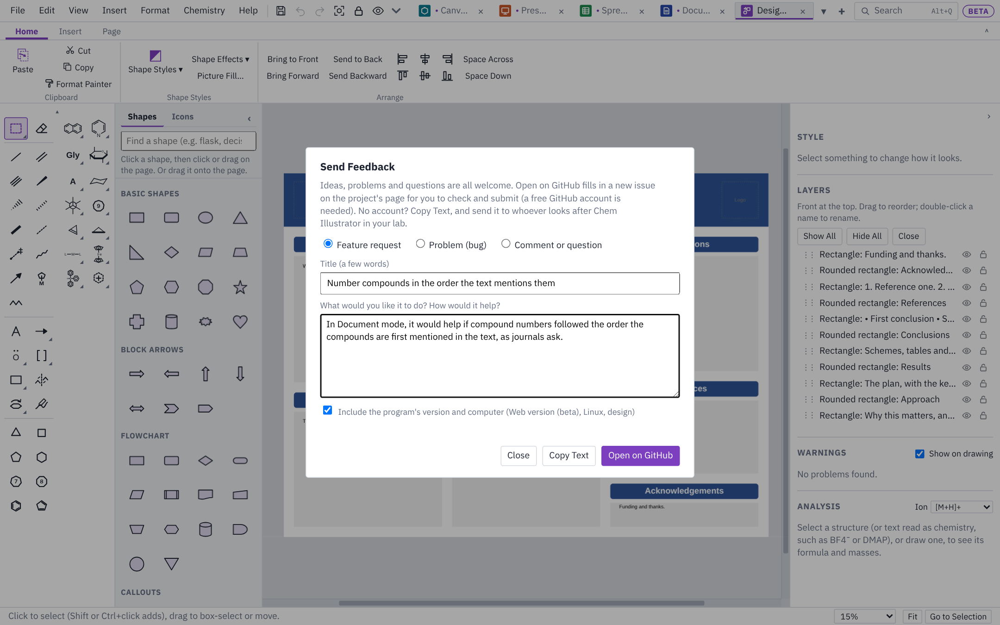

# Feedback, problems and ideas

This page explains how to tell the people who build Chemweave what you think: ideas for new features, things that don't work, and questions.

## From inside the program

Open **Help ▸ Send Feedback…** (or **Help ▸ Report a Problem…** if something is broken).

1. Pick what it is: **Feature request**, **Problem (bug)** or **Comment or question**.
2. Give it a short title, and say what you'd like or what went wrong. For a problem, the steps that make it happen help most: what you opened, what you clicked, and what you saw.
3. Choose **Who can read it**: **Only the Chemweave team** (the default) or **Everyone (public on GitHub)**, which puts it on the project's public issues page so others can follow it and add to it.
4. If you'd like an answer, give an **Email for a reply**. Only the Chemweave team sees it, even on a public report.
5. To show what you mean, check **Attach a picture of the current page** (a preview shows what will be sent), or click **Add a File…** to pick a screenshot or other picture. Pictures are left out unless you check the box, so nothing unpublished goes by accident; on a public report the picture is public too.
6. Leave **Include the program's version and computer** checked, unless you'd rather not share them. It adds the version number, the kind of computer (Windows, macOS or Linux) and which mode you were in. Nothing else about you or your files is included.
7. Click **Send**. No account is needed. The window then shows the report's number (and, for a public report, a link to it). If it can't be sent, for example with no internet connection, your text stays in the window: click **Try Again**, or use one of the other ways below.

Other ways to send it, on the left of the buttons:

- **Open on GitHub** opens a new issue on the project's GitHub page in your web browser, already filled in, to check and submit with your own GitHub account (anyone can read it).
- **Email…** opens your email program with the feedback filled in.
- **Copy Text** copies the same text so you can paste it into an email or a message, for example to whoever looks after Chemweave in your lab.

Nothing leaves your computer until you click **Send** (or submit it yourself on GitHub or in your email). If you close the window by mistake, what you wrote is still there the next time you open it (until you quit the program).

## When something goes wrong

If the program hits an error it didn't expect, a notice at the bottom of the window says so, with a **Report It…** button. That opens **Report a Problem**, already filled in with the error and the few things the program noted just before it. Under **Include the error details the program wrote down**, click **Show them** to read exactly what would be sent, or clear the box to leave them out. Add what you were doing, then send it as above.

If the desktop app closed unexpectedly last time (it crashed, or Windows ended it), the next start says so in a notice at the bottom left, with the same **Report It…** button. The notice stays until you click **Report It…** or **Dismiss**.

The program keeps a small error log **on your computer only**, and never sends it anywhere by itself. File paths in it have your user name replaced with `~`.

- **Help ▸ Copy Diagnostics** copies the version, the computer and the newest part of the log, to paste into a report or message.
- **Help ▸ Open Log Folder** (desktop app) opens the folder that holds the log file, `log.txt`, in the app's data folder.
- **View ▸ Developer Tools** adds an **Error Console** to the side panel, listing this session's errors and warnings (click one for where it happened). On Windows and Linux its **Inspector** button opens the web inspector (Ctrl+Shift+I also opens it). The Mac and iPad apps don't have the inspector, because the App Store doesn't allow it.

## Supporting the project

Chemweave is free. If you'd like to help pay for its development, **Help ▸ Support Chemweave** opens its [GitHub Sponsors page](https://github.com/sponsors/nathanohare) in your browser, where you can give monthly or once. Feedback and good bug reports help just as much.

## Straight on GitHub

You can also go to <https://github.com/nathanohare/Chem-Illustrator/issues> and click **New issue**. Before you do, it's worth searching the open issues in case someone has already asked for the same thing: a thumbs-up on an existing issue helps decide what gets done first.

## What makes a good report

- **One thing per report.** Three small ideas are easier to track as three issues.
- **A picture or file that shows the problem**, if you can share it. Send it as **Only the Chemweave team** if it holds anything unpublished: public reports and issues on GitHub can be read by anyone.
- **What you expected**, not only what happened. "The arrow head should stop at the bond" tells us more than "the arrow looks wrong".
- **For drawings, a picture.** **Attach a picture of the current page** covers most cases. For anything else, take a screenshot (Win+Shift+S on Windows, Cmd+Shift+4 on a Mac) and add it with **Add a File…**.

Next: [Getting started](getting-started.md) · [Canvas](drawing.md) · [Keyboard and mouse](keyboard-and-mouse.md) · [Presentation](slides.md) · [Document](documents.md) · [Spreadsheet](sheets.md) · [Design](design.md) · [Files and sharing](files-and-sharing.md)
