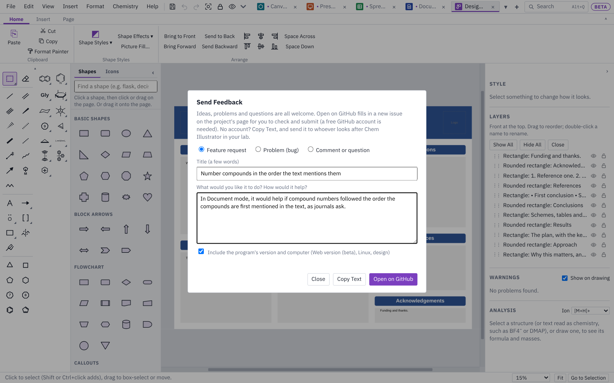

# Feedback, problems and ideas

This page explains how to tell the people who build Chem Illustrator what you think: ideas for new features, things that don't work, and questions.

## From inside the program

Open **Help ▸ Send Feedback…** (or **Help ▸ Report a Problem…** if something is broken).

1. Pick what it is: **Feature request**, **Problem (bug)** or **Comment or question**.
2. Give it a short title, and say what you'd like or what went wrong. For a problem, the steps that make it happen help most: what you opened, what you clicked, and what you saw.
3. Leave **Include the program's version and computer** ticked, unless you'd rather not share them. It adds the version number, the kind of computer (Windows, macOS or Linux) and which mode you were in. Nothing else about you or your files is included.
4. Then choose how to send it:
   - **Open on GitHub** opens a new issue on the project's GitHub page in your web browser, already filled in. Check it, add a screenshot if it helps (drag the picture into the text box), and click **Create** or **Submit new issue**. You need a free GitHub account for this.
   - **Copy Text** copies the same text so you can paste it into an email or a message, for example to whoever looks after Chem Illustrator in your lab.

Nothing is sent by the program itself: you always see the text first, in your browser or wherever you paste it. If you close the window by mistake, what you wrote is still there the next time you open it (until you quit the program).

## When something goes wrong

If the program hits an error it didn't expect, a notice at the bottom of the window says so, with a **Report It…** button. That opens **Report a Problem**, already filled in with the error and the few things the program noted just before it. Under **Include the error details the program wrote down**, click **Show them** to read exactly what would be sent, or untick the box to leave them out. Add what you were doing, then send it as above.

If the desktop app closed unexpectedly last time (it crashed, or Windows ended it), the next start says so, after offering your unsaved work back, with the same **Report It…** button.

The program keeps a small error log **on your computer only**, and never sends it anywhere by itself. File paths in it have your user name replaced with `~`.

- **Help ▸ Copy Diagnostics** copies the version, the computer and the newest part of the log, to paste into a report or message.
- **Help ▸ Open Log Folder** (desktop app) opens the folder that holds the log file, `log.txt`, in the app's data folder.
- **View ▸ Developer Tools** adds an **Error Console** to the side panel, listing this session's errors and warnings (click one for where it happened). On Windows and Linux its **Inspector** button opens the web inspector (Ctrl+Shift+I also opens it). The Mac and iPad apps don't have the inspector, because the App Store doesn't allow it.

## Straight on GitHub

You can also go to <https://github.com/nathanohare/Chem-Illustrator/issues> and click **New issue**. Before you do, it's worth searching the open issues in case someone has already asked for the same thing: a thumbs-up on an existing issue helps decide what gets done first.

## What makes a good report

- **One thing per report.** Three small ideas are easier to track as three issues.
- **A file that shows the problem**, if you can share it. Only attach files you are happy to make public: issues on GitHub can be read by anyone.
- **What you expected**, not only what happened. "The arrow head should stop at the bond" tells us more than "the arrow looks wrong".
- **For drawings, a screenshot.** On Windows, Win+Shift+S takes one; on a Mac, Cmd+Shift+4.

Next: [Getting started](getting-started.md) · [Drawing](drawing.md) · [Keyboard and mouse](keyboard-and-mouse.md) · [Slides](slides.md) · [Documents](documents.md) · [Sheets](sheets.md) · [Design](design.md) · [Files and sharing](files-and-sharing.md)
