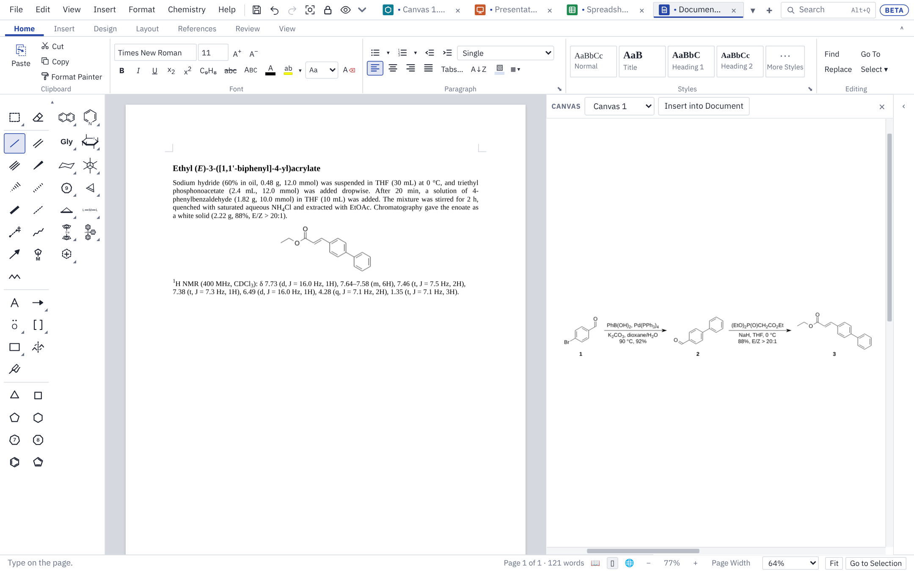

# Files and sharing

This page covers the files Chem Illustrator opens and saves, copying and pasting with ChemDraw and Office, Split View, workspaces, AutoSave and recovery, Version History, shared folders, recent files, printing and fonts.

## File types

Each kind of tab saves to its own file type. **Save** (Ctrl+S) uses the first type in the list; **Save As…** (Ctrl+Shift+S) offers the others.

| Tab | Opens | Saves | Also exports |
|---|---|---|---|
| Drawing | .cdxml, .cdx, .cds | .cdxml (the default), .cdx | Molfile (.mol), PDF, PNG, TIFF, SVG, EMF, EPS |
| Slides | .pptx | .pptx | PDF (one page per slide), PNG, TIFF, SVG, EMF or EPS of the current slide |
| Design | .pptx | .pptx (one slide) | PDF, PNG, TIFF, SVG, EMF, EPS |
| Document | .docx | .docx | PDF |
| Sheet | .xlsx, .xlsm, .xls, .ods, .csv, .tsv, .txt, .sdf | .xlsx, .xlsm, .csv, .sdf | Charts as PNG or SVG |
| Workspace | .ciworkspace | .ciworkspace | |

Open files with **File ▸ Open…** (Ctrl+O), or drop them onto the window. Picture files (PNG, JPEG, GIF, SVG, EMF, BMP, WebP) dropped on a drawing, slide, design or document are placed as pictures.

### ChemDraw files

- **.cdxml** is the default for drawings. When you save a ChemDraw file you opened, only what you changed is rewritten, so the rest stays exactly as ChemDraw wrote it.
- **.cdx** is ChemDraw's binary format. It opens and saves, and it is what ChemDraw reads from the clipboard.
- **.cds** is a ChemDraw style sheet. It opens like a drawing, and the app offers to keep its settings (bond length, line widths, label font) as one of your own drawing styles, so you can pick it in **Drawing Style** in any mode or start new drawings in it. Style sheets open but are never written back to: Save asks for a .cdxml or .cdx file.

### Structures in Office files

- **Word (.docx):** structures show as pictures in Word. Open the file here again and they are editable drawings, even after Word has saved it. ChemDraw drawings embedded in a Word file made elsewhere keep the look they had in Word; double-click one to make it an editable structure.
- **PowerPoint (.pptx):** the same: pictures in PowerPoint, editable drawings when opened here again. A ChemDraw object embedded in a PowerPoint slide comes in as a picture.
- **Excel (.xlsx):** structures are pictures with their SMILES in the cell, and become editable drawings again when opened here.

### Older Excel files, macro-enabled workbooks and OpenDocument

- **.xls** (Excel 97 to 2003) opens with its values, formulas, number formats, bold and italic, alignment, merged cells and column widths. Save it as .xlsx. A password-protected .xls can't be opened; save it without the password in Excel first. Files from Excel 95 and older open with their values only.
- **.xlsm** (macro-enabled) opens like an .xlsx. Its macros are never run here, but they are kept: save it as .xlsm again and Excel finds them exactly as they were. Saving as .xlsx leaves them out, and the app says so.
- **.ods** (LibreOffice Calc and other OpenDocument programs) opens with its values, formulas, styles, merged cells, column widths and row heights. Save it as .xlsx; LibreOffice opens that too.

### Alt text and the accessibility checker

**Alt Text…** (on the right-click menu, the **Review** tab in Slides, Documents and Sheets, and **Insert ▸ Alt Text…**) gives a picture, chart or structure a description for people using a screen reader. It is saved where Word, PowerPoint and Excel keep their own alt text, and in .cdxml files. A structure with no alt text of its own is described by its SMILES in Office files, as before.

**File ▸ Check Accessibility** (or **Review** ▸ **Check Accessibility**) lists what makes the file harder to read: pictures, charts and structures with no alt text, text with too little contrast against its background (WCAG 2.2: 4.5:1, or 3:1 for large text), slides with no title or the same title as another, slide titles that a screen reader would not reach first, skipped heading levels, tables with no heading row, floating pictures, merged cells and unnamed sheets. Click an item to go to it; **Add Alt Text…** fixes a missing description there and then. **Check Again** looks again after changes.

### Other formats

- **SMILES:** **Edit ▸ Copy as SMILES** (Ctrl+Alt+C) copies the selected structures as SMILES; **Edit ▸ Paste SMILES** (Ctrl+Alt+P) draws them. A SMILES string pasted with Ctrl+V is drawn too.
- **Molfile:** **File ▸ Export Molfile…** saves the selected structures (or all of them) as a .mol file; **Edit ▸ Copy as Molfile Text** copies them as text. A molfile pasted with Ctrl+V is drawn.
- **CDXML text:** **Edit ▸ Copy as CDXML Text** copies the drawing as ChemDraw XML.
- **SD files (.sdf):** open in a sheet with one row per structure and its data fields as columns.
- **PDF:** **File ▸ Export PDF…** for drawings, slides, designs and documents. Structures and text stay sharp at any zoom. The fonts go inside the file, so it looks the same everywhere and passes journals' "all fonts embedded" checks. Arial, Helvetica and similar fonts are drawn with Arimo, Times with Tinos and Courier with Cousine: free fonts with exactly the same letter widths. A character none of those has (an arrow such as →) uses the reader's Symbol font.
- **Pictures:** **File ▸ Export Picture…** for a drawing, the current slide or a design page. Pick a white or page-coloured background or a see-through one.
  - **PNG** and **TIFF** are pictures made of dots. Type the dpi (300 for colour, 600 to 1200 for line art). TIFF files are LZW-compressed, the kind many journals ask for.
  - **SVG**, **EMF** and **EPS** keep shapes and text sharp at any size. SVG suits Illustrator, Inkscape and web pages; EMF suits Word and PowerPoint on Windows; EPS suits older journal systems. EPS uses the standard PostScript fonts (Helvetica, Times, Courier and Symbol), and has no see-through colours, so those are mixed with white.

### Opening files from Explorer or Finder (desktop app)

Double-click a file, or right-click it and choose **Open with ▸ Chem Illustrator**, and it opens in a new tab. A file opened while the program is already running goes to the open window rather than starting a second copy.

- **Windows**: the first time it starts, Chem Illustrator adds itself to the **Open with** list of .cdxml, .cdx, .cds, .mol and .sdf files, for you only. **Edit ▸ Settings ▸ File Types** chooses which kinds of file it is offered for, including .docx, .pptx and .xlsx. It never makes itself the program that opens a file on a double-click: Windows keeps that choice for you. **Choose Defaults in Windows Settings…** on that page opens Windows' Default apps page, where you can pick Chem Illustrator for each kind of file. A portable copy leaves the computer's file types alone until you tick them yourself. Uninstalling takes it off the lists again.
- **macOS**: right-click a file and choose **Open With ▸ Chem Illustrator**. To open a kind of file here every time, select one in Finder, choose **File ▸ Get Info**, pick Chem Illustrator under **Open with** and click **Change All**.
- **Linux**: Chem Illustrator is in your file manager's **Open With** list for these files; your desktop's Default Applications settings choose the default.

## Copy and paste

**Edit ▸ Copy** (Ctrl+C) copies the selection, or the whole drawing when nothing is selected.

| Where you paste | What arrives |
|---|---|
| Chem Illustrator | Everything, fully editable |
| ChemDraw (Windows app) | Editable structures, through the CDX format |
| Word, PowerPoint or Excel (Windows app) | A Chem Illustrator drawing object: a sharp picture you can double-click to edit here (see below) |
| Other programs, or from the browser version or on macOS and Linux | A high-resolution picture |

In the Windows app, **Paste** (Ctrl+V) takes drawings copied in ChemDraw as editable structures, and spectra copied in MestReNova as sharp lines and text. **Edit ▸ Show Clipboard Formats** lists what is on the clipboard, which helps when a paste doesn't come out as expected.

### Editing drawings inside Word, PowerPoint and Excel (Windows)

A drawing copied here and pasted into Word, PowerPoint or Excel is a Chem Illustrator object, as ChemDraw's drawings are. Double-click it (or right-click ▸ **Chem Illustrator Object ▸ Edit**) and it opens here in a tab of its own, named after the document. Change it, press **Save** (Ctrl+S) and the drawing in the document changes too; close the tab when you're done. Word's **Insert ▸ Object ▸ Chem Illustrator Drawing** starts a new one.

- The document keeps a picture of the drawing, so it looks right on computers without Chem Illustrator, in PDFs and when printed. Only editing needs the app.
- Copying the object out of Word and pasting it here gives the drawing back, editable.
- AutoSave doesn't save these tabs: Word gets the drawing when you press Save. If you close the Word document first, the drawing stays here as an unsaved drawing.
- The installed app sets this up the first time it starts, for you only (no administrator needed). **Edit ▸ Settings ▸ File Types** turns it off, and then drawings paste as pictures (which still hold the drawing, so copying one back here keeps it editable). A portable copy leaves it off unless you tick it there. Uninstalling removes it.

Tables travel too:

- A table selected on a drawing or slide and copied pastes into Word or Excel as real cells.
- Cells copied from Excel, Word or a sheet here paste onto a drawing or slide as a new table.
- Cells copied from a sheet paste into Excel with their values, and SMILES for structures.

Charts in a sheet have **Copy as Picture** on the **Chart** tab, to paste into Word, PowerPoint, or a document or slide here.

## Split View

Split View puts a drawing beside a document, sheet or slide deck, so you can draw and write at the same time.

1. In a document, sheet or slides tab, choose **View ▸ Split View: Drawing Beside**. A drawing opens on the right: the first drawing tab, or a new one.
2. Click a side to work on it. Beside a document or sheet, both sides stay live; Ctrl+Z and Ctrl+S act on the side you clicked last. Beside slides, the side you aren't working on shows as a picture until you click it.
3. The bar above the drawing picks another open drawing or a new one. **Insert into Document** (or **Cell**, or **Slide**) puts the selected structures, or the whole drawing, in at the caret, the selected cell or the slide.
4. Drag the divider to change the widths. The × closes the split; the drawing stays open in its own tab.

## Workspaces

A workspace saves all your open tabs together, so a project's scheme, slides, SI document and data sheet open in one go. Workspaces are in the desktop app only.

1. **File ▸ Save Workspace**. A window lists any tabs that have never been saved and offers two choices:
   - **Put copies of files kept in other folders into the workspace folder.** On: everything ends up in one folder. Off: the workspace points to the files where they are.
   - **Save changes to tabs already saved as files.**
2. Click **Choose Folder…**, pick or make a folder, and name the workspace.

The folder then holds your files plus a small `.ciworkspace` file listing the tabs, their order, which tab was showing and any Split View. Tabs never saved are saved there under their tab names; a file that would replace another gets "(2)" added instead.

To open it again, use **File ▸ Open Workspace…** or **File ▸ Open**, and pick the `.ciworkspace` file. **Save Workspace** then saves back to the same place, and **Save Workspace As…** saves a new one.

Files inside the workspace folder are listed by name, so you can move or copy the whole folder (to another computer through a cloud drive, say) and it still opens. If a file has been moved or deleted, the rest open and a message names the missing ones.

## AutoSave, recovery and Version History

Every kind of tab (drawings, slides, sheets, documents and designs) is kept safe in three ways. Set them all in **File ▸ AutoSave and Recovery Options…**.

### Recovery copies

While you work, each tab with unsaved changes is copied every 2 minutes (choose 1 to 30 minutes, or never) to the app's own data folder. Closing the app normally deletes the copies. If it stops without closing (a crash, a power cut, Windows restarting for updates), the next start shows **Recover Unsaved Work**: tick the files to reopen and click **Reopen**. Reopened files come back unsaved, under their own names; Save puts a file that had been saved back where it was. **Not Now** keeps the copies for later in **File ▸ Recover Unsaved Work…**, and they are deleted after 7 days (you can change this).

### AutoSave

With AutoSave on, a file that has been saved saves itself a few seconds after your last change (30 seconds unless you change it), and every two minutes or so during long stretches of work. Switch it on for every file in AutoSave and Recovery Options, or for the file showing with **File ▸ AutoSave** (a file never saved is saved first). It is off unless you switch it on.

- AutoSave never writes CSV, TSV or SD files, which keep only one sheet's values.
- If AutoSave can't write a file (a full disk, a network drive gone), a notice says so and AutoSave waits until you save it with Ctrl+S. Your changes are still in the tab and in the recovery copies.
- In a browser, AutoSave works in Chrome and Edge for files opened from or saved to your computer.

### Version History

**File ▸ Version History…** lists earlier versions of the file showing, newest first. A version is kept each time you save, and the file as it was before your first save in each session is kept too, so AutoSave can never lose what was there. While AutoSave is on, it adds a version at most every 10 minutes.

- **Open a Copy** opens a version in a new tab to look at or copy from. The file isn't changed.
- **Restore** puts the version in the tab in place of what it has now. What it had is kept as a version first, so a restore can be undone.
- **Delete** removes a kept version.

Up to 30 versions of each file are kept, for 60 days; both can be changed (0 versions switches Version History off).

### Shared folders and OneDrive (desktop app)

For files kept in OneDrive, SharePoint or a shared lab drive:

- **Changed on disk.** If a file you have open is changed outside Chem Illustrator (by another program, by someone else, or by OneDrive bringing in their changes), a notice offers **Reload**, **Keep Mine** (your next save replaces theirs) or **Open Theirs** (their version in a new tab, to compare). AutoSave waits until you choose. Saving over a changed file asks first. You can choose to reload such files automatically when they have no unsaved changes here, or to ignore changes.
- **Open somewhere else.** While a file is open, a small hidden lock file named `.~lock.<file name>#` sits beside it, in the format LibreOffice uses. When you open a file that someone else has open (in Chem Illustrator, LibreOffice, Word, Excel or PowerPoint), a notice says who and where, and offers **Work on a Copy**. You're told when they close it. The lock file is deleted when you close the file, and can be switched off.
- **OneDrive conflict copies.** When a file changes in two places at once, OneDrive keeps the clashing changes in a copy named with your computer's name (for example `Scheme 1-LAB-PC.cdxml`). A notice offers to open it, so you can copy across what you need.

Recovery copies and versions are kept in a folder named `Kept` in the app's local data folder (on Windows `%LOCALAPPDATA%\io.github.nathanohare.chemillustrator\Kept`), or in the `Chem Illustrator Data` folder of a portable copy. The browser version keeps them in the browser's storage for the page.

## Recent files

In the desktop app, the **File** menu lists the last ten files and workspaces you opened or saved, under **Open…**, newest first. Click one to open it. If it has been moved or deleted, a message says so and it comes off the list. **Clear Recent Files** empties the list.

## Printing

**File ▸ Print…** (Ctrl+P) asks a question or two, then opens your system's Print window, where you pick the printer and copies, or save a PDF.

| Tab | Choices |
|---|---|
| Drawing | Letter or A4; orientation to suit the drawing, portrait or landscape; actual size (smaller only if it wouldn't fit) or as large as fits |
| Slides | Full page slides, or handouts with 2, 3 (with lines for notes), 4, 6 or 9 to a page, optionally framed |
| Design | The page at its own size |
| Document | Every page as laid out on screen |
| Sheet | The whole sheet or the selected cells; portrait or landscape; with or without gridlines |

## Fonts

Every font box (the Document ribbon, the text bar while you type a caption, Slide Master, **File ▸ Drawing Style…**) shows the fonts in groups, each name in its own font:

- **Sans:** Inter, Source Sans 3, IBM Plex Sans, Lato
- **Serif:** Source Serif 4, Merriweather, Libre Baskerville
- **Poster:** Montserrat, Oswald, Bebas Neue, Archivo Black, Barlow Condensed
- **Monospace:** JetBrains Mono, IBM Plex Mono
- **On this computer** (folded away; click the heading to open it): Arial, Calibri, Times New Roman and the rest of your installed fonts.

Type in the box to filter the list, or type the name of any font installed on your computer.

The first fourteen are free fonts (SIL Open Font License) that come with the app. When you use them in a document or slide deck, they are saved inside the .docx or .pptx file, so it looks the same in Word or PowerPoint on a computer that doesn't have them. Only the fonts you used are included. Fonts from your own computer are not embedded, as Word does by default for fonts that may not be shared.

Next: [Getting started](getting-started.md) · [Drawing](drawing.md) · [Keyboard and mouse](keyboard-and-mouse.md) · [Slides](slides.md) · [Documents](documents.md) · [Sheets](sheets.md) · [Design](design.md) · [Feedback](feedback.md)
