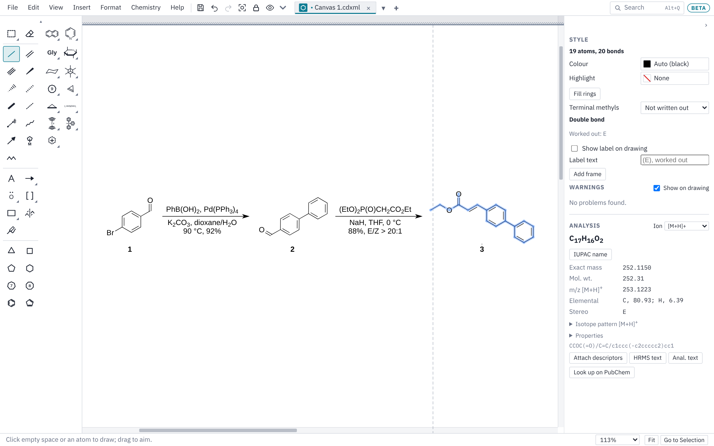

# Getting started

This page covers installing Chem Illustrator, finding your way round the window, opening your first ChemDraw file, saving, and the Settings window.

Chem Illustrator is free. It draws structures the way ChemDraw does (the same hotkeys, the same ACS Document 1996 look) and opens and saves ChemDraw's `.cdxml` and `.cdx` files. Next to drawings it also has slides, sheets, documents and designs, each in its own tab.

A note on keys: this guide writes Ctrl, as on Windows and Linux. On a Mac, use Cmd wherever it says Ctrl, and Option wherever it says Alt.

## Installing

Download the newest installer from the **Releases** page of the project on GitHub: <https://github.com/nathanohare/Chem-Illustrator/releases>. The newest release is at the top. Open its **Assets** list and pick the file for your computer.

### Windows

1. Download the file ending in `x64-setup.exe` and run it.
2. Windows may say **"Windows protected your PC"**. This is Windows SmartScreen: it warns about any program that has not been signed with a paid Windows certificate. Click **More info**, then **Run anyway**.
3. Follow the installer. A newer installer can be run over an older version; you don't need to remove the old one first.

The installer puts the app in your own user folder, so it doesn't need administrator rights. On a computer managed by an IT department, their rules may still block programs that aren't signed; if so, ask them, since neither the installer nor the portable copy below gets round those rules.

### Windows, without installing (portable copy)

A portable copy runs from a flash drive or any folder, with nothing installed, and keeps its settings with it.

1. Download the file ending in `x64-portable.zip`.
2. Right-click it, choose **Extract All…**, and put the **Chem Illustrator** folder wherever you want it: a flash drive, Documents, the desktop.
3. Open the folder and double-click **Chem Illustrator.exe**. The first time, SmartScreen may warn as described above.

The **Chem Illustrator Data** folder next to the app is what makes it portable: your hotkeys, preferences, styles, templates and recent files are saved there instead of on the computer, so the copy behaves the same on every computer you plug it into. Keep the two together, and copy both to move your copy. **Help ▸ Hotkeys and Tips** shows "(portable)" after the version number.

Updates work as in an installed copy, except that **Install and Restart** replaces Chem Illustrator.exe in its folder rather than installing anything. If the drive can't be written to (locked, or read-only), the app says so and keeps its settings on the computer for that session.

The app needs the Microsoft Edge WebView2 Runtime, which Windows 10 and 11 already have. The only thing a portable copy leaves on the computer is WebView2's cache in `%LOCALAPPDATA%\io.github.nathanohare.chemillustrator`, which holds none of your work or settings.

On macOS and Linux, a folder named **Chem Illustrator Data** next to the app (or the AppImage) has the same effect.

### macOS

Works on Apple silicon and Intel Macs, macOS 11 or newer.

1. Download the file ending in `universal.dmg`, open it, and drag **Chem Illustrator** into **Applications**.
2. Open it from **Applications**. The app is signed with an Apple Developer ID and notarised by Apple, so macOS opens it straight away, with no warning.

### iPad

The iPad app is in testing through Apple's TestFlight.

1. Install the free **TestFlight** app from the App Store.
2. On the iPad, open the invitation link, [testflight.apple.com/join/hMdcFJBH](https://testflight.apple.com/join/hMdcFJBH), and tap **Accept**, then **Install**.
3. Open **Chem Illustrator** from the Home Screen. TestFlight offers each new test version as it comes out, and test versions stop working after 90 days unless you update.

Draw with an Apple Pencil or your finger: see [Pen and touch](keyboard-and-mouse.md#pen-and-touch-tablets).

### Linux

Three kinds of file are offered:

- **`.AppImage`**: runs on most distributions. Make it executable (in your file manager's Properties, or `chmod +x` on the file), then double-click it. The AppImage keeps itself up to date.
- **`.deb`** (Ubuntu, Debian) and **`.rpm`** (Fedora): install them like any other package. To update, download and install the newer one.

### Updates

A few seconds after it starts, the desktop app checks whether a newer version has been released. If there is one, a small message says which version is ready and what changed, and offers:

- **Install and Restart**: downloads it, installs it and restarts the app. If any tab has unsaved changes, you are warned first so you can cancel and save.
- **Later**: closes the message for now.
- **Skip This Version**: stops asking about this one version.

Each update is checked against the project's signing key before it installs, so only genuine releases are accepted. You can look for an update at any time with **File ▸ Check for Updates…**, and turn the automatic check off in **Edit ▸ Settings ▸ Online**.

**Edit ▸ Settings ▸ Online ▸ Updates** chooses which versions you are offered:

- **Latest** (the default): every new version, the day it is built. You get new features and fixes first.
- **Stable**: only versions that have been tried out on a real computer and found to work. They come less often and have fewer surprises, which suits people who mainly want to draw.

Switching from Latest to Stable never installs an older version: you keep the one you have until a newer stable version comes out.

### Beta

Chem Illustrator is in **beta**: it is still being built, new features arrive often, and some things may not work as they should yet. The **Beta** mark beside the program's name in the menu bar says so; click it for more. Save your work often, and please tell us about anything that goes wrong with **Help ▸ Report a Problem**.

## A tour of the window

### The menu bar

Along the top are the menus: **File**, **Edit**, **View**, **Insert**, **Format** and **Chemistry**. They are the same in every kind of tab: a command that doesn't work in the tab you are in is greyed out, and the commands for one kind of tab are in its own submenu (such as **Insert ▸ Sheet**). Documents, sheets, slides and designs also have a ribbon of buttons under the menu bar, like Word, Excel and PowerPoint.

To the right of the menus are:

- **Undo**, **Redo** and **Fit** (fit the whole drawing in the window). Undo and Redo are greyed out when there is nothing to take back, and resting the mouse on one names the step it would undo (**Undo Add Ring**); the Edit menu names it too;
- **Locked**, which locks or unlocks all the toolboxes at once so they can be moved (each toolbox also has its own padlock; see [Drawing](drawing.md#toolboxes));
- the **eye button**, which turns the dark page on and off;
- the **Search** box;
- **Help**, with this **User Guide** built in (it works without an internet connection), the hotkeys, and short notes on each part of the program. **F1** opens the guide at the part about the tool or kind of tab in use: with the ring tool, for example, it opens at Rings.

The menus show each command's key beside it, so they are a good way to learn the shortcuts.

### Tabs

Each open file has a tab under the menu bar, with its own icon and colour for its kind (blue for drawings, orange for slides, green for sheets, dark blue for documents, purple for designs). Ctrl+Tab and Ctrl+Shift+Tab move between tabs, and Ctrl+W closes one.

New files are called **Drawing 1**, **Slides 1**, **Sheet 1** and so on, until they are saved with a name of their own. When there are more tabs than fit, **‹** and **›** scroll them (as does the mouse wheel over the tabs), and **▾** lists every open file to pick one. **+** at the end starts something new:

| Choice | Opens | Like |
|---|---|---|
| **Drawing** | A new drawing (Ctrl+N) | ChemDraw |
| **Slides** | A new slide deck | PowerPoint |
| **Sheet** | A new spreadsheet, with chemistry functions | Excel |
| **Document** | A new document with pages, styles and references | Word |
| **Design** | A TOC graphic, graphical abstract, poster or flowchart | a graphics program |

The same commands are in the **File** menu (**New Drawing**, and **New Slides**, **New Sheet**, **New Document** and **New Design…** under **File ▸ New**). To change the tab colours, use **View ▸ Window and Colours ▸ Mode Colours…**.

### The toolbox on the left

In a drawing, the drawing tools run down the left side: select, eraser, bonds, then text, arrows, mechanism symbols, brackets, shapes and mass fragmentation, then rings and templates. A button with a small arrow in its corner holds a set of related tools: click the corner, click the button a second time, or right-click it to see them all. Rest the mouse on any button to see its name and hotkey. [Drawing](drawing.md) explains each tool.

### The side panel on the right

The panel on the right changes with what you are doing. In a drawing it has:

- **Style**: the look of whatever is selected (line widths, colours, fonts, fills, and the settings of a single atom or bond).
- **Warnings**: possible problems in the structures, such as a carbon with five bonds (see [Drawing](drawing.md#warnings)).
- **Analysis**: formula, masses and more for the selected structure (see [Drawing](drawing.md#the-analysis-panel)).

The **›** arrow at the top of the panel folds it away to give the drawing more room (also **View ▸ Fold Side Panel**). Each kind of tab remembers this on its own, so you can keep the panel folded in sheets and open in drawings. In a window narrower than about 1,200 pixels the panel folds by itself so the drawing keeps its room, and opens again when the window is widened; **›** still opens it while the window is narrow.

**View ▸ Focus View** (Ctrl+Shift+F1) hides the toolboxes, the side panel and the ribbon at once, to give the page the whole window on a laptop; the same key brings them back. In Slides, Sheet, Document and Design tabs, **View ▸ Toolboxes ▸ One Column Outside Drawing** shows the toolboxes docked at the side in one narrow column.

### A small window

When the window is too narrow for a ribbon (in documents, slides, sheets and designs), its groups at the right end first show their buttons as icons only (rest the mouse on one to see its name), then fold into one button each, named after the group, that drops the group's buttons down. A slide or design page that was fitted to the window is fitted again when the window changes size.

### The hint line at the bottom

The line along the bottom of the window tells you what the tool you have picked does, and which keys change it. For example, with the select tool it says that Shift or Ctrl+click adds to the selection and Ctrl+drag copies. Look there when you try a tool for the first time.

The **zoom box** at the right end of that line shows how big the drawing is shown. Pick **Fit**, **Actual size** or a size from 25% to 800%. It is there in drawings, slides and designs.

### The welcome card

The first time you open the app, a small card on the empty page lists the tips most people need first: drawing bonds and rings, typing atom labels, pasting SMILES or names, Search and the right-click menu. Close it with **Start drawing**; it doesn't come back.

After that, each time the app opens on an empty drawing, a smaller **start view** offers a new Slides, Sheet, Document or Design tab, a template, Open, and your recent files. Start drawing (or click **Start drawing**) and it goes. Untick **Show at start** to stop it, or turn it back on in **Edit ▸ Settings ▸ General**.

### Search (Alt+Q)

Click **Search** at the top, or press Alt+Q, and type a few letters of what you want to do: `wedge`, `number comp`, `bold`, `dark`. The list shows each matching menu command, ribbon button and drawing tool, where it lives and its key, then the matching pages of Settings and sections of this guide. Press Enter for the top match, or use the arrow keys to pick another. With nothing typed, the commands you used lately come first. **Edit ▸ Search Commands…** opens the same box.

### Format Painter (every mode)

**Format Painter** copies a look from one thing to another, as in Word, PowerPoint and Excel. It is on the **Home** tab in Documents, Slides and Sheets (beside **Paste**), on the Design ribbon, under **Edit ▸ Format Painter** and in the right-click menu.

1. Select what has the look you want (or just put the caret in the text).
2. Click **Format Painter**. The pointer becomes a brush.
3. Click or drag over what should take the look. The brush is then put away.

Double-click **Format Painter** to keep the brush: paint as many things as you like, then press **Esc** or click the button again.

What goes across is only the look, never the content or its meaning:

- **Text:** font, size, colour, bold, italic, underline, sub- and superscript, formula style, highlight, strikethrough, small caps and the character style. A click on a word paints the whole word. When you pick up from just a caret, or from whole paragraphs, the paragraph's look (alignment, spacing, indents, list and paragraph style) goes too, as in Word.
- **Drawings, slides and designs:** a shape's outline, fill, pattern, see-through amount and shadow; an arrow's colour, line and head size; the colour and highlight of atoms and bonds; the text look of a caption or of the text in a shape. A bond's order or wedge, an arrow's kind of head (one or two electrons) and a shape's kind never change. Something of another kind takes just the colour. Click one thing, or drag a box to paint everything in it.
- **Sheets:** the cells' formats (number format, font, fill, borders, alignment). Click one cell to paint a block the size of the one you picked up, or drag over a range to fill it, the pattern repeated across it.

### Insert ▸ Symbol (every mode)

**Insert ▸ Symbol…** (and **Symbol** on the **Insert** tab) opens a small window of characters: Greek letters, arrows, maths, chemistry signs and units (°, ‡, ⦵, Å, ⇌), superscripts and subscripts, fractions, punctuation, accented letters for authors' names, currency, and marks such as ✓.

- Type in the box to find one by name: `degree`, `angstrom`, `equilibrium`, `plus minus`, `arrow right`. A code works too: `U+00B0`, `00B0` or `&#176;`.
- Or pick a group from the list beside the box.
- Click a character to type it where the caret is; the window stays open for the next one. Enter types the first one found.
- The ones you used lately are along the top, newest first, and are kept between sessions.

It types into the text you are editing: a document, a caption or text box, a slide's text, or a cell (it starts typing in the active cell if you weren't already). On a drawing, slide or design with nothing being typed, it starts a new text in the middle of the view. In a drawing, the window warns about the few characters a ChemDraw file may not show.

## Opening your first ChemDraw file

1. Choose **File ▸ Open…** (Ctrl+O).
2. Pick a `.cdxml` or `.cdx` file. It opens in a new tab.

You can also drag a file from your file manager and drop it on the window. The Open window also takes PowerPoint (`.pptx`), Word (`.docx`), Excel (`.xlsx`), CSV and SD files, each in the right kind of tab.

**File ▸ Open Recent** lists the last ten files you opened or saved (in the browser version, only in Chrome and Edge). **Clear Recent Files** at the bottom of the list empties it.

### Copying from ChemDraw

In the Windows app you can copy structures in ChemDraw and paste them here with Ctrl+V, and copy from here and paste into ChemDraw as structures. Ctrl+V also takes a SMILES string or a molfile copied as text.

## Saving

- **File ▸ Save** (Ctrl+S) saves the tab. A drawing is saved as `.cdxml` unless you choose `.cdx`.
- **File ▸ Save As…** (Ctrl+Shift+S) saves a copy under a new name or in the other format.

When you save a ChemDraw file you opened here, only the parts you changed are rewritten. Everything else stays exactly as ChemDraw wrote it, so the file still opens in ChemDraw as before.

Other ways to get a drawing out:

- **File ▸ Export ▸ Export PDF…** saves a PDF.
- **File ▸ Export ▸ Export Picture…** saves a PNG or TIFF at the resolution you choose (300 or 600 dpi for journals), or an SVG, EMF or EPS, on the page colour or see-through.
- **File ▸ Export ▸ Export Molfile…** saves the selected structures (or all of them) as a `.mol` file.
- **File ▸ Print…** (Ctrl+P) prints on Letter or A4, at actual size or as large as fits.
- **Edit ▸ Copy** (Ctrl+C) copies the selection, or the whole drawing when nothing is selected. In the Windows app it pastes into Word and PowerPoint as a sharp picture. **Edit ▸ Copy As ▸ Copy as SMILES** (Ctrl+Alt+C), **Copy as Molfile Text** (Ctrl+Alt+O) and **Copy as CDXML Text** (Ctrl+D) copy text instead.

Slides, sheets, documents and designs save in their own formats; see their pages. To save every open tab together, see **File ▸ Workspace ▸ Save Workspace** in [Files and sharing](files-and-sharing.md).

## Edit ▸ Settings

**Edit ▸ Settings…** (Ctrl+,) holds every setting in one window, with a list of pages on the left and a **Find a setting** box at the top. The menu items for a single page (**Hotkeys…**, **Typing and Spelling…**, **Colour Palettes…**, **Mode Colours…**, **Dark Page Colours…**, **Drawing Style…**, **Scheme Settings…**, **AutoSave and Recovery Options…**) open the Settings window at that page. Each page has its own **Save** (or **Apply**) and **Cancel**; a line of help sits under each setting that needs one.

| Page | What it holds |
|---|---|
| **General** | The start view, what a click on a grouped thing selects, outlining the rest of a group, where linked text goes, asking before a command changes every structure on the page, and your name on tracked changes in documents. |
| **Drawing** | Terminal methyls as Me or CH3; axial chirality as Ra / Sa or P / M (Ra is the same as M, and Sa as P); charges from the + and − keys plain (N+) or circled (⊕, ⊖); text typed beside a bond end becoming an atom; raised R-group numbers; mechanism arrows finding their own way round. |
| **Drawing Style** | Bond length, line widths, fonts and journal styles (see [Drawing](drawing.md#drawing-styles)). |
| **Hotkeys** | Every key, to change, import or export (see [Keyboard and mouse](keyboard-and-mouse.md)). |
| **Text and Spelling** | Chemistry typing (subscripts in formulas), spelling, your dictionary and replacements. |
| **Colour Palettes**, **Mode Colours**, **Dark Page** | Your rows of colours, the colour of each kind of tab, and the dark page's colours. |
| **Schemes** | Gaps round arrows and + signs, text size above and below arrows, and the + boxes on new arrows. |
| **AutoSave and Recovery** | AutoSave, how often unsaved work is copied for recovery, and how many versions are kept. |
| **File Types** | Which kinds of file Chem Illustrator is offered for under **Open with** in Explorer, and a button to Windows' Default apps page (see [Files and sharing](files-and-sharing.md#opening-files-from-explorer-or-finder-desktop-app)). |
| **Online** | Looking up names on PubChem (sends the name typed to PubChem; untick it to keep everything on your computer) and the update check and whether to get Stable or Latest updates (desktop app only). |

Your preferences, hotkeys, own templates, nicknames, palettes and toolbox layout are kept in a small settings file, `settings.json`. **Edit ▸ Hotkeys…** shows where it is on your computer.

### Customize the Ribbon

**View ▸ Ribbon ▸ Customize the Ribbon…** (or right-click a ribbon's tabs or a group's name) rearranges the ribbons of Slides, Documents, Sheets and Designs, with the same jiggling icons as Customize Toolboxes. Pick the ribbon at the top; its tabs show as a row:

- Drag a tab to put the tabs in your order, type a new **Tab** name, or untick **Shown** to hide it.
- Click a tab to see its groups. Drag a group to move it, drop it on another tab to move it there, or drag it out (or click its **×**) to hide it. Hidden groups are listed on the left, to drag back in.
- Click a group to rename it. **New Group** makes a group of your own: drag commands into it from the list on the left (every button of that ribbon, and every menu command), or click **+**.
- **Undo** (Ctrl+Z) takes changes back one at a time; **Reset This Ribbon** puts a ribbon back as it came.

To set up a new install or another computer the same way, use **Edit ▸ Settings File ▸ Export Settings…** to save every setting in one file (hotkeys, toolboxes and what is in them, preferences, your templates, nicknames, drawing styles, colour palettes, slide themes and highlight looks), then **Edit ▸ Settings File ▸ Import Settings…** on the other one. The same two buttons are on the **Import and Export** page of the Settings window. Recent files stay on each computer. A file saved from the Hotkeys window's Export imports too, and changes only the keys.

---

Next: [Drawing](drawing.md) · [Keyboard and mouse](keyboard-and-mouse.md) · [Slides](slides.md) · [Documents](documents.md) · [Sheets](sheets.md) · [Design](design.md) · [Files and sharing](files-and-sharing.md) · [Feedback](feedback.md)
