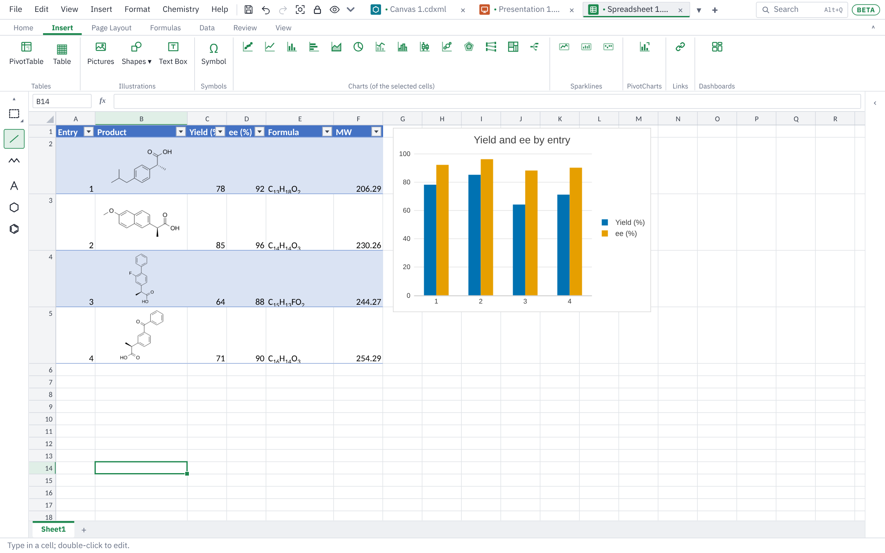

# Sheets

This page covers Sheet mode: cells and formulas, structures in cells, the chemistry functions, formatting, charts and isotope patterns, dashboards, and saving for Excel.

## Starting a sheet

Click **+ Sheet** at the end of the tab strip, or choose **File ▸ New Sheet**. While a sheet is showing, Ctrl+N starts another one.

**File ▸ New from Template…** offers a **Reaction table** (one row per entry: catalyst, loading, solvent, temperature, time, conversion, yield, ee and dr, with the best yield and its entry found for you) and a **Reagent sheet** (the reagent table below, and a Yield sheet that works out the percent yield from the product's structure and its isolated mass).

Sheets open from .xlsx, .xlsm, .xls and .ods files as well as text and SD files; see [File types](files-and-sharing.md#file-types).

The ribbon has **Home** and **Insert** tabs. **Table Design**, **Chart** and **Dashboard** tabs appear when you click in a table, a chart or a dashboard. The **Sheet** menu at the top holds most of the same commands.

## Working with cells

Cells work as in Excel:

- Type, then Enter or Tab. F2 or a double-click edits a cell. The arrow keys, Ctrl+arrow, Ctrl+Z and Ctrl+Y work as you expect.
- Drag column and row borders to resize them. The worksheet tabs at the bottom switch sheets; Shift+F11 adds one.
- Drag the small square at the corner of the selection to fill. Compound numbers count on: drag **2a** down for 2b, 2c…, or **S1** for S2, S3. Hold Ctrl while dragging to copy instead. Ctrl+D and Ctrl+R fill down and right.
- **Home** tab ▸ **Insert** and **Delete** add or remove rows, columns and worksheets.
- **Find…** (Ctrl+F) searches the text in cells.

## The chemistry toolbox

The drawing toolbox shows on the left in Sheet mode too. Pick a drawing tool there and the selected cell's structure opens for editing with that tool; if the cell is empty, a new drawing starts for it. Press **Done** above the drawing to put the structure in the cell.

When the pointer turns into a pointing hand over a cell, that cell holds a structure you can open: double-click it to change the drawing.

## Structures in cells

- **Draw one:** select a cell and click **Home** tab ▸ **Structure** (or **Insert ▸ Structure in Cell**). The drawing tools open; draw, press **Done**, and the structure sits in the cell.
- **From names or SMILES:** type a column of names or SMILES, select them and click **From Name** (Ctrl+Shift+N). Each one is drawn in a new column beside it.
- **Paste:** copy a structure from a drawing tab, or from ChemDraw (Windows app), and paste it into a cell.

### Property columns

Click in your table and choose **Home** tab ▸ **Properties** (or **Insert ▸ Insert Property Columns…**). Tick the columns you want:

Formula, MW, Exact mass, HRMS m/z, cLogP, TPSA, H-bond donors, H-bond acceptors, Rotatable bonds, SMILES, InChIKey and **Duplicate of**.

Each column fills itself in for every row and updates when you change a structure. **Duplicate of** names the first other row with the same compound (same InChIKey), so a compound entered twice shows straight away.

Any calculated value can be typed over, for example with a measured mass. The cell is marked as typed over, and **Reset to Calculated** puts the calculated value back.

### Reagent tables

**Home** tab ▸ **Reagent Table** (or **Insert ▸ New Reagent Table**) adds a worksheet set up for a reaction. Type the limiting reagent's mmol, then for each reagent draw its structure (or type its SMILES or name into the **Structure** column, and it is drawn there) and its equivalents. MW, mmol and mass (mg) work themselves out; type a density (g/mL) or a concentration (M) and the volume (µL) appears. Any number can be typed over, for example the MW of a salt or hydrate, and the rest of the row follows.

## Formulas

Type `=` to start a formula. References with `$`, references to other sheets and **Σ AutoSum** (Alt+=) work as in Excel.

Common functions include `SUM`, `AVERAGE`, `MIN`, `MAX`, `MEDIAN`, `STDEV`, `COUNT`, `COUNTA`, `ROUND`, `IF`, `IFERROR`, `AND`, `OR`, `CONCATENATE`, `LN`, `LOG10`, `EXP`, `SQRT`, and the line-fit functions `SLOPE`, `INTERCEPT`, `RSQ`, `STEYX` and `FORECAST`. These Excel functions work too, with the same results as Excel:

- **Looking things up:** `VLOOKUP`, `HLOOKUP`, `XLOOKUP`, `INDEX`, `MATCH`, `XMATCH`, `CHOOSE`, `OFFSET`, `INDIRECT`, `ROWS`, `COLUMNS`.
- **Conditions:** `SUMIF`, `SUMIFS`, `COUNTIF`, `COUNTIFS`, `AVERAGEIF`, `AVERAGEIFS`, `MAXIFS`, `MINIFS`, `IFS`, `SWITCH`, `IFNA`. Conditions are written as in Excel: `">5"`, `"<>done"`, `"Pd*"` (`*` and `?` are wildcards; `~*` is a real star).
- **Text:** `LEFT`, `RIGHT`, `MID`, `FIND`, `SEARCH`, `SUBSTITUTE`, `REPLACE`, `TEXT`, `VALUE`, `CONCAT`, `TEXTJOIN`, `TEXTSPLIT`.
- **Statistics:** `STDEV.S`, `STDEV.P`, `VAR.S`, `VAR.P` (and the older `VAR`, `VARP`, `STDEVP`), `T.TEST`, `T.INV`, `T.INV.2T`, `T.DIST` (with `.2T` and `.RT`), `CONFIDENCE.NORM`, `CONFIDENCE.T`, `NORM.DIST`, `NORM.INV`, `NORM.S.DIST`, `NORM.S.INV`, `LINEST`, `LOGEST`, `PERCENTILE` (`.INC`, `.EXC`), `QUARTILE` (`.INC`, `.EXC`), `RANK` (`.EQ`, `.AVG`), `LARGE`, `SMALL`.

- **Dates and times:** `TODAY`, `NOW`, `DATE`, `TIME`, `YEAR`, `MONTH`, `DAY`, `HOUR`, `MINUTE`, `SECOND`, `WEEKDAY`, `WEEKNUM`, `ISOWEEKNUM`, `DATEDIF`, `DAYS`, `EDATE`, `EOMONTH`, `NETWORKDAYS`, `WORKDAY` (and their `.INTL` forms), `DATEVALUE`, `TIMEVALUE`. Dates are numbered as in Excel, so they copy both ways. Typing `2026-10-22`, `10/22/2026`, `22-Oct-26` or `13:30` makes a date or time, and the column widens to show it.

### Arrays that spill

A formula that gives several results fills the cells below and to the right of it, as in Excel 365: `=SORT(A2:B20, 2, -1)`, `=FILTER(A2:C40, C2:C40>80)`, `=UNIQUE(B2:B40)`, `=SEQUENCE(10)`, and `VSTACK`, `HSTACK`, `TAKE`, `DROP`, `CHOOSEROWS`, `CHOOSECOLS`, `TOCOL`, `TOROW`, `SORTBY` and `TRANSPOSE`. `LINEST`, `LOGEST` and `TEXTSPLIT` spill their whole result too. A blue outline shows the spilled cells when one is picked; the formula is typed in its first cell only. When something is in the way the formula shows `#SPILL!` until the cells are cleared. `A2#` refers to everything spilled from A2, and `@` takes one value where a block would spill.

`LET` names parts of a formula (`=LET(n, B2/MW(A2), n*1000)`), and `LAMBDA` makes a function of your own. Give a LAMBDA a name in the Name Manager (for example `Mmol` for `=LAMBDA(mg, mw, mg/mw)`) and use it like any function: `=Mmol(C2, D2)`. `MAP`, `REDUCE`, `SCAN`, `BYROW`, `BYCOL` and `MAKEARRAY` take a LAMBDA too.

Not every Excel function is available; one that isn't shows an error in its cell.

### Insert Function and the Formulas tab

**Formulas > Insert Function** (or the **fx** button by the formula bar, or Shift+F3) finds a function by name or by what it does ("working days", "molar mass"). Pick one to get a box for each of its arguments, with a line of help for the one you are in, what each argument works out to, and the formula's result before you press OK. On a cell that already holds one function, fx opens its arguments to change them. The Function Library buttons list the functions by category.

### Names

A name stands for cells, a number or a formula, so `=SUM(Yields)` can replace `=SUM($C$2:$C$40)`.

- **Define Name** names the selected cells (it suggests the column's heading). Typing a new name in the name box, left of the formula bar, does the same; typing an existing name there goes to its cells.
- **Create from Selection** names each column (or row) of the selection by its heading.
- **Name Manager** (Ctrl+F3) lists the names with their values, and adds, changes or deletes them. A name belongs to the workbook or to one sheet. Renaming one changes the formulas that use it.
- **Use in Formula** (or F3 while typing) puts a name into the formula.

Names, spilling formulas and LAMBDAs are saved in .xlsx files the way Excel saves them, and read back from Excel's files.

### Chemistry functions

The first argument is a cell holding a structure, or SMILES in quotes.

| Function | Gives |
|---|---|
| `=FORMULA(B2)` | Molecular formula (Hill order) |
| `=MW(B2)` | Molecular weight, g/mol |
| `=EXACTMASS(B2)` | Monoisotopic mass |
| `=HRMS(B2,"[M+Na]+")` | m/z of an ion ([M+H]+ if you give none) |
| `=CLOGP(B2)`, `=TPSA(B2)` | cLogP and TPSA |
| `=HBD(B2)`, `=HBA(B2)`, `=ROTB(B2)` | H-bond donors, acceptors, rotatable bonds |
| `=SMILES(B2)`, `=INCHIKEY(B2)` | Canonical SMILES, standard InChIKey |
| `=DUPLICATE(B2,B:B)` | Another row with the same compound, or blank |
| `=ISOMZ(B2,"[M+H]+",2)` | m/z of the M+2 peak of that ion |
| `=ISOABUND(B2,"[M+H]+",2)` | Height of that peak, as % of the tallest |

For `ISOMZ` and `ISOABUND`, the compound can also be a formula in quotes (`"C9H8O4"`). The last number is the peak: 0 for M, 1 for M+1 and so on. Past the last peak they give a blank. A charged structure is its own ion, whatever adduct you give.

You can combine them as usual: `=1000*D2/MW(B2)` turns mg into mmol.

## Formatting

- **Home** tab: font size, bold, italic, underline, borders, fill and text colour, alignment, **Wrap**, **Merge**, and the number format with **+.0** and **−.0** for decimal places. **Other…** in the number format list takes your own Excel-style format, such as `0.00 "mg"`.
- **Format Painter** (beside **Paste**) copies the formats of the selected cells to the cells you click or drag over next; double-click it to keep painting until Esc. **Insert** tab ▸ **Symbol** types °, µ, Å and other signs into the cell.
- The **font box** takes any installed font; cells with no font of their own use the theme's body font. **Orientation** (ab↗) turns text up, down or to 45°, or stacks its letters, which suits narrow column headings. **⇤** and **⇥** indent text from the cell's edge.
- **Cell Styles** puts one of Excel's named styles on the selected cells: Good, Bad and Neutral; Input, Output, Calculation, Note and the rest; Title, Heading 1 to 4 and Total; the Accent colours; and the Comma, Currency and Percent number styles. Excel shows them under the same names.
- **Page Layout** tab ▸ **Themes** sets the workbook's colours and fonts together, with **Colours** and **Fonts** to change one part only. The colour menus offer the theme's colours, and cells styled with Heading, Title, Total or Accent styles take the new theme's colours. The themes are Office (Excel's default) and a few of our own, including a colour-blind safe one.
- **C₉H₈** sets formulas with proper subscripts. Formulas typed into text cells (Pd(PPh3)4, CH2Cl2) show this way on their own; click **C₉H₈** on such a cell to show it as typed.
- **Units:** the number format list has a **Units** group for reaction conditions: temperature (°C), catalyst loading (mol%), equivalents, concentration (M), density (g/mL), amount (mmol), mass (mg), volume (mL and µL), time (h and min), pressure (atm) and % ee. The cell keeps the plain number, so it still sorts and works in formulas. Typing "-78 °C" or "5 mol%" into a cell sets the unit for you.

### Conditional formatting

Select some numbers and open **Home** tab ▸ **Conditional Formatting**. Choose a colour scale, data bars, an icon set, or a rule that highlights cells (greater than a value, containing some text, top or bottom values, above or below average, duplicates, empty cells, or your own formula). **Manage Rules…** lists every rule so you can edit, reorder or delete them.

### Table styles

Click in your data and choose **Home** tab ▸ **Format as Table** (or **Insert** tab ▸ **Table**). The **Table Design** tab then offers the table's name, **Header Row**, **Totals Row**, **Banded Rows**, first and last column, banded columns, the **Table Style**, its colours, and **Convert to Range** to make it plain cells again.

### Sparklines

Select a block of numbers, such as yields across five runs, and choose **Insert** tab ▸ **Sparklines** ▸ **Line**, **Column** or **Win/Loss**. Give the cells to put them in (one cell for each row of data), then click OK. Click a sparkline to open the **Sparkline** tab. It changes the type, marks the high, low, first, last or negative points, sets the colours and line width, sets the axis (each sparkline its own, the same for all, or a number you choose), sets how empty cells show, changes the data, and clears them. Sparklines are saved as Excel's own.

## Outlines and subtotals

**Data** tab ▸ **Outline**: **Group** (Shift+Alt+Right) puts the selected rows or columns in a group that folds away, up to seven levels deep, and **Ungroup** (Shift+Alt+Left) takes them out. **Auto Outline** groups rows that a SUM just below adds up. The buttons beside the row numbers fold and open each group (− and +), and **1 2 3** show the outline to a level. **Subtotal…** adds a total row under each change in a column (each catalyst, each solvent) worked out with SUBTOTAL, plus a Grand Total, all grouped. SUBTOTAL leaves out other subtotals and, with function numbers 101 to 111, hidden rows. **Settings…** puts the summary rows above their details instead of below.

## Views

The **View** tab has **Normal**, **Page Break Preview** (what prints, page by page, with the breaks as blue lines you can drag) and **Page Layout** (the cells on sheets of paper with their margins, headers and footers; double-click a header to change it). **Gridlines**, **Headings** and **Formula Bar** show or hide those parts of the screen. **New Window** opens the workbook in a second tab (Book.xlsx:2), with its own sheet and place, and typing in either shows in both. **Custom Views…** saves how you are looking at the workbook under a name (the sheet, the view, and, if you like, hidden rows and columns, the filter and print settings) to go back to it in one step. All of these are saved in the .xlsx file.

## Sort, filter and freeze

- **Sort ↑** and **Sort ↓** sort the table by the current column. Structures move with their rows.
- **Filter** (Ctrl+Shift+L) puts buttons in the header row. Each one sorts, picks values to show, or keeps rows that match a condition such as "less than 500" or "containing Br".
- **By Substructure** opens the drawing tools: draw the part to look for, and only rows whose structure contains it stay.
- **Freeze Header** keeps the header rows in view as you scroll.
- **Data > Custom Sort…** sorts by several levels (add, copy, delete and reorder them), in a custom order such as "Low, Medium, High", case sensitive or not, or left to right.
- **Data > Advanced Filter…** uses a block of criteria typed above the table: tests on one row must all pass, and any row of tests may pass. It filters in place or copies the matching rows elsewhere, and can keep unique rows only. **Clear Filter** shows every row again.
- **View > Freeze Panes ▾** freezes the rows above and the columns left of the selected cell, or just the top row or first column. **View > Split** splits the window into panes that scroll on their own; drag a bar to move it, double-click it to remove it. Both are saved in .xlsx files.

## Finding and changing data

- **Find & Select ▾** (Home tab): **Find** (Ctrl+F) and **Replace** (Ctrl+H) search the selection, the sheet or the whole workbook, in formulas, values or notes, with `?` and `*` wildcards. **Find All** lists every match. **Go To** (Ctrl+G or F5) jumps to a cell or name, and **Go To Special…** selects blanks, constants, formulas, structures, differences, precedents, dependents and more. With blanks selected, type a value and press Ctrl+Enter to fill them all.
- **Fill ▾ > Series…** fills a linear, growth or date series (days, weekdays, months, years), with a step and a stop value. **Flash Fill** (Ctrl+E) learns from one or two examples typed beside a table (initials, a surname, parts joined with punctuation) and fills the rest of the column.
- **Paste ▾ > Paste Special…** (Ctrl+Alt+V) pastes values, formulas, formats, notes, validation or column widths only; adds, subtracts, multiplies or divides into the cells below (multiply a column of mmol by 1000 to get µmol); skips blanks; or transposes rows into columns.
- **Data > Text to Columns…** splits one column by delimiters or fixed widths, with a preview and a format for each new column. **Remove Duplicates…** removes rows whose chosen columns repeat.

## Notes and comments

The **Review** tab has both kinds Excel has:

- **New Note** (Shift+F2) puts a yellow sticky note on the cell, with your name. A red triangle marks the cell, and the note shows when you point at it. **Show/Hide Note** keeps it on screen; **Show All Notes** (also in the View menu) shows every note on the sheet.
- **New Comment** (Ctrl+Alt+M) starts a conversation on the cell, marked with a purple triangle. Point at the cell to see it, then **Reply**, **Resolve**, **Edit** or **Delete**, as for comments in documents and slides. **Convert to Comments** turns a sheet's notes into comments.
- **Previous** and **Next** go through them all; **Delete** removes the ones in the selected cells. Right-click a cell for the same commands.

Notes and comments move with their cells when you sort, insert or delete rows, and cut and paste. They are saved as Excel's own notes and threaded comments, so Excel shows them too.

## Data validation

**Home** tab ▸ **Validation…** (or **Format ▸ Data Validation…**) sets what may be typed in the selected cells, as Excel's Data Validation does:

- **Settings:** allow a whole number, a decimal, a date or time, a text length (each between limits, or greater than, less than…), a **List**, or a **Custom** formula. A limit can be a number or a formula such as `=B1` or `=TODAY()`. A list is items separated by commas (`Pd(OAc)2, PdCl2, Pd(PPh3)4`) or a reference to cells that hold them (`=$H$2:$H$20`, or on another sheet, `=Reagents!$A$2:$A$40`).
- **Input Message:** a title and message shown beside the cell while it is selected.
- **Error Alert:** what happens when something else is typed. **Stop** asks you to type again, **Warning** asks whether to keep it, and **Information** says so and keeps it.

A cell with a list shows a drop-down button beside it while selected; click it or press **Alt+Down** to pick. In any cell, **Pick From Drop-down List…** on the right-click menu (or Alt+Down) lists the entries already above and below it in its column. **Circle Invalid** rings the cells that break their rules in red (pasted values and formulas aren't checked as they go in, as in Excel). The rules are saved as Excel's own, so the drop-downs and alerts work in Excel too.

## Get Data and the Query Editor

**Data** tab ▸ **Get Data** reads data from outside the workbook into a table, as Excel's Power Query does (without its M language):

- **From Text/CSV…**: a CSV, TSV or other text file, split at commas, tabs, semicolons, vertical bars, spaces or another character you give.
- **From JSON…**: a JSON file. Records (a list of objects) become rows; nested objects become columns of their own (`bp.value`, `bp.unit`). When the file has several lists, pick which in the editor.
- **From Web…**: a web page's tables (the **Navigator** previews each one), or a CSV or JSON file at a web address. Only the address is sent. In a browser only sites that allow it can be read; the desktop app reads any page.
- **From Workbook…**: a table or sheet of another Excel (.xlsx, .xlsm, .xls) or OpenDocument (.ods) workbook.

The **Query Editor** then shows a preview of the data. Click a column's header to pick it (Ctrl or Shift for more), then a button adds a step: **Use First Row as Headers**, **Remove Columns**, **Keep Only**, **Rename…**, **Data Type** (text, decimal or whole number, percentage, date, true/false), **Filter…**, **Split Column…** (at each, the left-most or the right-most delimiter), **Replace Values…**, **Trim**, **Sort**, **Remove Duplicates**, **Remove Blank Rows**, **Remove Top Rows…**, **Unpivot Columns** and **Unpivot Other Columns** (columns such as Run 1, Run 2, Run 3 become rows of Attribute and Value). New files start with their headers found and each column's type worked out.

**Applied Steps** lists the steps in order: click one to see the data after it (new steps go in after it), or **×** to take it away. A value that can't take a column's type shows as **Error** and loads as a blank cell. **Change Source…** points the query at another file (one that moved, or the next batch of results) with the same steps.

**Close & Load** puts the results on a new sheet as a table named after the query; **Close & Load To…** puts them at a cell you choose, or nowhere (**Only Create Connection**). **Refresh All** (or **Refresh** on the right-click menu of the table) reads the source again and runs the same steps, growing or shrinking the table; it asks before covering other cells. **Queries & Connections** lists the workbook's queries, with **Edit**, **Refresh**, **Go to** and **Delete**. Queries are saved in the .xlsx file: Excel shows the tables, and the queries come back when the file is opened here again. (In a browser, a query's file is asked for again after the file is reopened.)

### The Compound data type

Type names (aspirin, DMAP, THF, Pd(PPh3)4), or draw structures, down a column, pick them and choose **Data** tab ▸ **Compound**. Each is looked up on PubChem and becomes a compound cell, marked with a small ring, carrying a card of its properties: IUPAC name, formula, molecular weight, exact mass, CAS number, CID, SMILES, InChI and InChIKey, XLogP, TPSA, hydrogen-bond donors and acceptors, rotatable bonds, and (unless you choose **Data Types** ▸ **Compound, without measured properties**) its melting and boiling points, density and GHS hazards. Only the name or SMILES is sent.

Click a compound to see its card in the side panel. **+** beside a field, or **Insert Data**, adds a column of that field beside the compounds, as formulas such as `=FIELDVALUE(A2,"Molecular weight")` (FIELDVALUE takes a field's name in several forms: `"MW"`, `"CAS"`, `"Density"`). **Refresh Compound Data** looks the cards up again; **Convert to Text** keeps the names without their cards. Typing over a compound makes it plain text again. In a saved .xlsx file Excel sees the names and the values of the FIELDVALUE columns; the cards come back when it is opened here.

## Analysis: PivotTables, What-If and the Analysis ToolPak

The **Data** tab has Excel's analysis tools. Their windows float at the right of the sheet without blocking it, so you can click or drag over cells to fill the box that last had the cursor (cells on another sheet carry the sheet's name). Drag a window by its title.

### PivotTables

Click in a table of records with a header row (one row per run: catalyst, solvent, temperature, yield…) and choose **Insert** tab ▸ **PivotTable**. Pick the records and where the report goes (a new sheet, or a cell on this one). The **PivotTable Fields** window then builds it:

- Tick a field to add it: numbers go to **Values** (summed), anything else to **Rows**. Or drag fields into **Filters**, **Columns**, **Rows** and **Values**, and between them.
- Click a field in an area for its menu: move it, **Filter Items…** (untick items to leave out), **Sort A to Z** or **Z to A**, **Value Field Settings…** (Sum, Count, Average, Max, Min, Product, StdDev, Var…; show as % of the grand total, of the row or of the column; its name and number format), or **Remove Field**.
- **Layout**: Compact, Outline or Tabular form; subtotals; grand totals for rows and columns; Σ Values down the rows; text for empty cells; the PivotTable's name.

Click in a report to show the **PivotTable** tab: **Field List**, **Refresh** (after the records change), **Refresh All**, **Change Data Source…**, **Report Layout**, **Subtotals**, **Grand Totals**, **PivotChart**, **Show Details** (the records behind the number in the active cell, on a new sheet), **Select** and **Clear**. The right-click menu on a report has the same, with **Summarize Values By** and **Show Values As**.

A **PivotChart** (Insert tab, or the PivotTable tab) charts the report and changes with it. PivotTables are saved as Excel's own, set to refresh when Excel opens the file.

### What-If Analysis

- **Goal Seek…**: the value of one cell that makes a formula give a target (the catalyst loading for 95% predicted conversion). The sheet shows the answer while the status window is open; **Cancel** puts the cell back.
- **Data Table…**: select a table with the values to try down its left column (or along its top row) and formulas along the top (or down the left), or a grid of values with one formula in its top-left corner, then give the input cell(s). The results are worked out again whenever the sheet changes, and are saved as Excel's own TABLE() data table.

### Solver

**Solver** makes the objective cell as large or small as it can be, or equal to a value, by changing the variable cells, subject to constraints (`<=`, `=`, `>=`, whole number, binary, all different). **Simplex LP** solves linear models exactly, **GRG Nonlinear** smooth ones (curve fitting to a rate law), and **Evolutionary** models with jumps (IF, LOOKUP, rounding; it needs limits on every variable). The results window keeps the solution or restores the original values, and can write an **Answer Report** sheet. The model is saved with the sheet as Excel's Solver saves it, so Excel's Solver opens it too.

### Data Analysis (the Analysis ToolPak)

**Data Analysis** lists Excel's nineteen tools: Anova (single factor, two-factor with and without replication), Correlation, Covariance, Descriptive Statistics, Exponential Smoothing, F-Test, Fourier Analysis, Histogram (with Pareto order, cumulative percentages and a chart), Moving Average, Random Number Generation, Rank and Percentile, Regression (with residuals, standardized residuals and normal probability), Sampling, the three t-Tests and the z-Test. Each writes its results as Excel does, to a range or a new sheet. New functions for these: F.DIST, F.DIST.RT, F.INV, F.INV.RT, F.TEST, SKEW, KURT, MODE.SNGL, COVARIANCE.P/S, PERCENTRANK.INC/EXC, SUMXMY2, SUMX2MY2 and SUMX2PY2.

## Charts

Select a block of cells and choose **Insert** tab ▸ **Scatter**, **Line**, **Column**, **Bar**, **Area** or **Pie**. Click a chart to open the **Chart** tab; double-click it, or click **All Settings**, for every setting in the panel on the right.

- **Change Type** and **Add Series…** change what is plotted.
- **Titles…**, **Legend**, **Colours**, **Axes…** (limits, log scale, grid lines, number format) and **Data Labels**. Titles take subscripts and superscripts: `k_{obs}` and `s^{-1}`.
- **Error Bars**.
- **Fit Line**: straight line, polynomial (x² or x³), exponential, logarithmic or power. The equation and R² appear in an empty corner of the chart, and you can drag the label. In the panel, **Put in cells…** writes the slope, intercept, R² and standard error to the sheet as live formulas.
- **Copy as Picture** to paste the chart into Word, PowerPoint or a document or slide here; **Save as Picture…** for a PNG or SVG; **Delete Chart**.

### Stick spectra

The Insert tab also has **Combo**, **Histogram**, **Box**, **Bubble** and **Radar**:

- **Combo** draws columns and lines together. The first series is columns and the rest are lines on a second axis on the right (yield beside turnover number, say). In the panel, each series has **Drawn as** and **Second axis**, and the second axis has its own title, limits and number format.
- **Histogram** counts the numbers of one column in bins of equal width. Set **Bin width** or the number of bins in the panel, plus an **Overflow** and **Underflow** bin if you want the tails lumped together. Left on automatic, the width follows Scott's rule, as Excel's does.
- **Box** (box and whisker) shows the median, quartiles and spread of repeat runs. Put a label in the first column (the catalyst, say) and each different label gets its own box. Whiskers reach the furthest points within 1.5 × the box's height, and points beyond that are drawn as outliers. In the panel you can show or hide the mean (×), a line joining the means, the outliers and all the other points, and choose exclusive or inclusive quartiles (QUARTILE.EXC, Excel's default, or QUARTILE.INC).
- **Bubble** takes x, y and then a column of bubble sizes. Each bubble's area goes with its number.
- **Radar** draws one spoke for each row label and one shape for each column of numbers. Tick **Filled** in the panel for filled shapes.

All five are saved as Excel's own chart types. Histograms and box charts use the newer chart format of Excel 2016 and later, so older versions of Excel show a note in their place.

### Sankey charts

**Sankey** on the Insert tab shows rows flowing from one column of categories to the next: aromatic or not, then ring size, then heterocycle class, say. Select the block of cells: the last column of numbers says how much each row carries (leave it out and each row counts once), and every other column is a level, left to right. Each category is a node as tall as all the rows through it, and the bands between nodes are as wide as the rows they carry. A blank cell ends a row's flow at that level. In the panel, each level's **Categories** can be changed, or a level removed. Excel has no Sankey chart, so it gets a bar chart of the same cells; open the file here again and it is a Sankey once more.

### Treemaps and decomposition trees

**Treemap** and **Decomp. tree** on the Insert tab break the same kind of block of cells down: the last column of numbers says how much each row carries (leave it out and each row counts once), and every other column is a level, from the first to the last. A blank cell ends a row there: it counts in the categories before it, and in none after.

- **Treemap:** a box for each category of the first level, as big as the rows in it, holding a box for each of its categories at the next level, in shades of its colour. Pick the chart, then click a box to **drill into** it: the chart shows just what is under that category, with a trail over it (**All › Aromatic**) to click back up.
- **Decomposition tree:** the total, then the first level's categories as bars, each as long as its share. Pick the chart, then click a node to **expand** it: its rows are split by the next level in a new column, with lines from it to its parts. Click an expanded node to close it up again, or the total to close everything.

The chart's panel says what it is drilled into or expanded to, with a button to go back to the whole. Excel has no decomposition tree, and its treemap can't be drilled into, so both get a bar chart of the same cells; open the file here again and they are as they were, drilled and expanded the same.

In the chart panel, each series of a scatter chart has **Sticks** (peaks drawn up or down from zero, as in a mass spectrum) and **Show x (m/z)** to label each peak with its value. You can use these for any spectrum you put in a sheet.

## Isotope patterns

To compare a measured HRMS isotope pattern with the calculated one:

1. Put the compound in a cell: draw a structure, or type SMILES or a formula such as `C14H12BrNO`.
2. With that cell selected, choose **Home** tab ▸ **Isotopes** (or **Insert ▸ Isotope Pattern…**, or the right-click menu).
3. Fill in the window:
   - **Compound:** the cell you are on, or a formula typed in.
   - **Ion:** [M+H]+ to start; pick another or type any adduct ([M+Na]+, [M−H]−, [M+2H]2+…).
   - **List peaks down to:** 0.5% of the tallest peak; lower it to list more small peaks.
   - **Columns for the peaks found, with the error in ppm.**
   - **Chart:** found above and calculated below (a mirror plot), found and calculated together, calculated only, or no chart.
4. Click **Insert**. A table appears beside your data, with one row per peak (M, M+1, M+2…) and its calculated m/z and height.
5. Type the m/z and heights from your spectrum into **Found m/z** and **Found (%)**. **Error (ppm)** fills itself in, and the chart's found peaks appear as you type.

The **Ion** cell in the table can be changed (to `[M+Na]+`, say), and the calculated columns and chart follow. Change the structure and the table follows too.

## Dashboards

A dashboard is a page of tiles that summarise a table: useful for a catalyst screen or a substrate scope. Add one with **Insert** tab ▸ **Dashboard**, or right-click a sheet tab ▸ **Insert Dashboard**. The **Dashboard** tab then adds tiles:

| Tile | What it shows |
|---|---|
| **Chart** | A chart of a table's columns. **Same labels** combines rows with the same label (average, sum, count…), for one bar per ligand rather than one per reaction. A **Sankey** chart, **treemap** or **decomposition tree** asks which columns are its levels and which says how much each row carries |
| **Number** | One headline number (KPI): average, sum, median, smallest, largest, standard deviation, or a count; or any formula. A **Target** colours it green or red, and you choose whether higher is better |
| **Table** | Chosen columns, sortable by clicking a heading; structures are drawn |
| **Slicer** | A button for each value of a column (catalyst, solvent…). Clicking buttons filters every tile fed by the same table |
| **Gallery** | A card for each drawn structure in a table, with values such as the ID and yield under it |
| **Text** | A heading or a note |

Each new tile asks which table or block of cells to read. For a gallery, the structures need to be in a table made with **Format as Table**.

- **Move and resize:** drag a tile, or drag its bottom-right corner. Tiles snap to a grid. With a tile picked, the arrow keys move it, Shift+arrows resize it and Delete removes it.
- **Settings:** click a tile for its settings in the right-hand panel; click an empty spot, or **Dashboard Settings**, for the dashboard's columns, row height, gap and background.
- **Slicers:** click more buttons to pick several, and click a picked one again to drop it. Several slicers apply together. The ✕ on a slicer, or **Clear Filters**, shows everything again.
- **Clicking a chart:** click a bar, a pie slice, a Sankey node or band, or a treemap's box, and every other tile fed by the same table shows only the rows it stands for, as a slicer would (a band stands for the rows running between its two nodes). The chart clicked shows what was picked, with the rest faded. Click it again, or click the chart away from its bars, to show everything again; **Clear Chart Filter** (right-click) and **Clear Filters** do too. The panel lists what each chart is filtering by.
- **Treemaps and decomposition trees:** double-click a treemap's box to drill into it, and click the trail over it to go back up. Click a decomposition tree's node to expand it: it also filters the other tiles by that node, as PowerBI's does. Click it again to close it up.

## Links

- **Insert ▸ Link…** (Ctrl+K, also on the **Insert** tab) links the selected cells to a web page or DOI, a file, an e-mail address, or a cell in this workbook (pick the sheet and type the cell). The cell's text turns blue and underlined and keeps its value.
- **Ctrl+click** a linked cell to follow it; pointing at it shows where it goes. Right-click for **Edit Link…**, **Open Link**, **Copy Link** and **Remove Link**.
- Excel's `=HYPERLINK("https://…", "shown text")` works too.
- Excel files keep cell links as Excel's own, both ways.

## Pictures, shapes and text boxes

**Insert > Pictures** puts a picture from a file (PNG, JPEG, GIF, SVG and others) over the cells: a TLC plate, a photo of a reaction, a spectrum. **Shapes** adds lines, arrows, rectangles, ovals, stars and block arrows, and **Text Box** a box of notes. Drag one to move it and its handles to size it (a picture keeps its shape from a corner; hold Shift for a shape to do the same). Arrow keys nudge it, Delete removes it. Type while a shape is picked, or double-click it, to put text in it. Right-click for **Format Shape** (fill, line, text look, size, rotation, and whether it moves and sizes with the cells), **Alt Text**, **Bring to Front**, **Send to Back** and **Duplicate**. They are saved in .xlsx files as Excel's own pictures and shapes, and pictures and shapes drawn in Excel open here.

## Printing

The **Page Layout** tab sets how a sheet prints, as in Excel: **Margins**, **Orientation**, paper **Size**, the **Print Area** (Set, Add another block on pages of its own, or Clear), **Breaks** (Insert Page Break starts a new page above and to the left of the active cell), **Print Titles** (rows repeated at the top of every page, columns at the left), **Header & Footer** (left, centre and right parts; type &[Page], &[Pages], &[Date], &[Time], &[File] or &[Tab]), and **Scale to Fit** (a percentage, or so many pages wide and tall; fitting ignores breaks put in by hand, as Excel does). **Print Gridlines** and **Print Headings** print them; **Page Breaks** shows where pages end on the grid (dashed for automatic breaks, solid for your own). **Page Setup…** has everything in one window, with centring and page order too. **Print Preview** shows each page before printing, and **File > Print** prints the print area, the whole sheet or the selected cells. All of it is saved in .xlsx files as Excel's own page setup, so the sheet prints the same from Excel.

## Saving and sharing

- **Save** (Ctrl+S) writes an Excel workbook (.xlsx). In Excel, structures are pictures with their SMILES in the cell, properties are plain numbers, and charts, trendlines, conditional formatting, tables, notes, comments and data validation are Excel's own. Stick spectra show as sticks in Excel too.
- Excel has no dashboards, so it gets a plain version: each chart tile becomes a real Excel chart showing what the tile shows, and numbers, tables and text become cells.
- Excel has no `ISOMZ`, `ISOABUND` or other chemistry functions, so the saved file keeps their values.
- Open the .xlsx here again and the structures, chemistry formulas and full dashboard come back, even after Excel has saved the file.
- **Save As** also writes a CSV file or an SD file (.sdf). These keep only the values of the sheet showing.
- **File ▸ Open** reads .xlsx, .csv and SD files. An SD file gives one row per structure, with its data fields as columns.
- Copy cells here and paste into Excel to get the values, with SMILES for structures. Cells copied in Excel paste here.
- **File ▸ Print…** (Ctrl+P) prints the whole sheet or the selected cells, portrait or landscape, with or without gridlines. Structures print as pictures.

Next: [Getting started](getting-started.md) · [Drawing](drawing.md) · [Keyboard and mouse](keyboard-and-mouse.md) · [Slides](slides.md) · [Documents](documents.md) · [Design](design.md) · [Files and sharing](files-and-sharing.md) · [Feedback](feedback.md)
