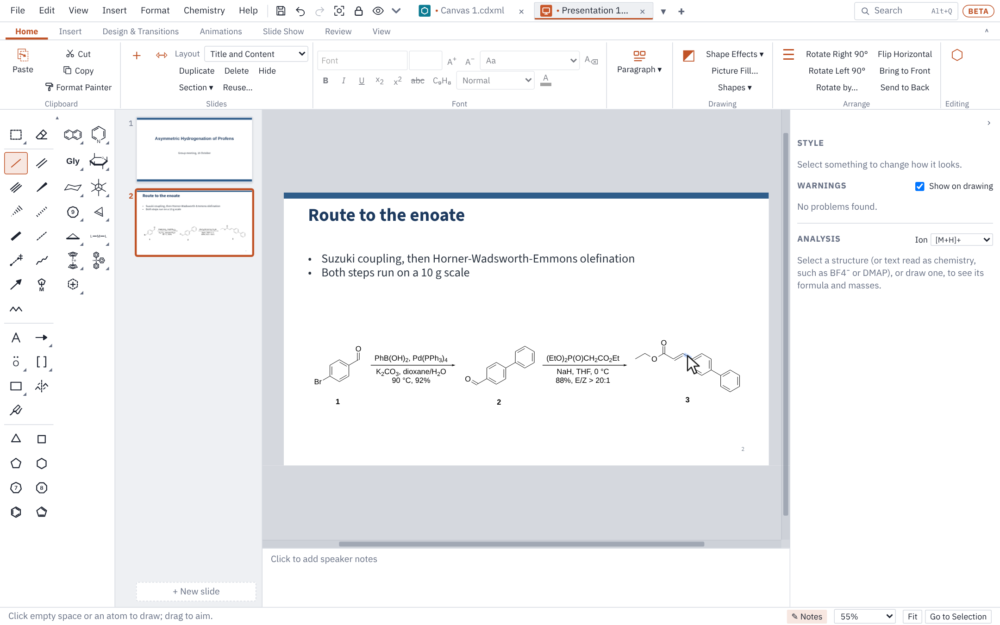

# Presentation (slideshow)

This page covers Presentation mode: building a deck, the slide master and templates, chemistry on slides, pictures, transitions and animations, presenting, printing handouts and saving for PowerPoint.

## Starting a deck

Click **+** at the end of the tab strip and pick **Presentation (slideshow)**, or choose **File ▸ New ▸ Presentation**. While a deck is showing, Ctrl+N starts another one. Each open file has its own tab: Ctrl+Tab moves between tabs and Ctrl+W closes one.

The Presentation ribbon has PowerPoint's tabs: **Home** (slides, sections, font, paragraph), **Insert** (pictures, text boxes, tables, shapes), **Design & Transitions** (size, templates, slide master, layouts, drawing style, format background, and the transitions between slides), **Animations**, **Slide Show**, **Review** and **View** (Normal, Slide Sorter, Slide Master, Edit Layouts, Themes). The **Presentation** submenus of the **Edit**, **View**, **Insert** and **Format** menus hold the same commands.

## Slides and layouts

- **New slide:** Ctrl+M, **Home** tab ▸ **New Slide**, or **+ New slide** under the slide list. The new slide goes after the current one.
- **Layout:** pick one from **Layout** on the **Home** tab or **Format ▸ Presentation ▸ Slide Layout**: Title Slide, Title and Content, Two Content, Title Only, Blank, or a layout of your own (see [Layouts](#layouts)).
- **Text:** click "Click to add title" (or any placeholder) and type. Lists and the chemistry typing helpers work as in any text box, so CH2Cl2 gets its subscripts.
- **Slide size:** **Design & Transitions** tab ▸ **Size**, or **Format ▸ Presentation ▸ Slide Size ▸ Widescreen (16:9)** / **Standard (4:3)** / **Custom Slide Size…** (see [Slide size](#slide-size)).
- **Speaker notes:** type them in the box under the slide. A slide with notes shows a small mark in the slide list. **View** tab ▸ **Notes** (or **✎ Notes** in the status bar) hides or shows the box.
- **Pane sizes:** drag the slide list's right edge to make it wider or narrower (the pictures grow with it), and drag the top edge of the notes box to make it taller or shorter. Double-click an edge for the usual size. The sizes are remembered.

### The slide list

The list down the left shows every slide.

| To do this | Do this |
|---|---|
| Move a slide | Drag it up or down |
| Pick several | Ctrl+click or Shift+click |
| Delete the picked slides | Delete, or **Home** tab ▸ **Delete** |
| Duplicate the picked slides | Ctrl+D, or **Home** tab ▸ **Duplicate** |
| Copy, cut or paste whole slides | Ctrl+C, Ctrl+X, Ctrl+V in the list, or **Edit ▸ Presentation ▸ Copy Slides** / **Paste Slides** |
| Hide a slide from the show | **Home** tab ▸ **Hide**, **Slide Show** tab ▸ **Hide Slide**, or right-click ▸ **Hide Slide** |
| See every slide command | Right-click in the list |
| Go to the next or previous slide | Page Down / Page Up |

### Sections

Sections split a long deck into named parts, as in PowerPoint. Pick a slide and choose **Home** tab ▸ **Section ▾** ▸ **Add Section** (or right-click in the slide list ▸ **Add Section**, or **Format ▸ Presentation ▸ Sections**): a new section starts at that slide and you name it. The slides before the first section go in a **Default Section**.

- **Fold a section:** click the arrow on its heading. **View** tab ▸ **Collapse All** / **Expand All** fold or open them all. Folding is for the screen only.
- **Move a section with all its slides:** drag its heading up or down, or right-click it ▸ **Move Section Up** / **Move Section Down**.
- **Move slides into a section:** drag them after a slide in it, or onto its heading (they go at its start).
- **Rename:** double-click the section's name, or right-click ▸ **Rename Section…**.
- **Pick all of a section's slides:** click its heading.
- **Remove Section** keeps its slides (they join the section before); **Remove Section & Slides** deletes them too; **Remove All Sections** keeps every slide.

New slides go in the section of the slide before them. Sections are saved as PowerPoint's own, so PowerPoint shows them, and sections made in PowerPoint come in here.

### Slide Sorter

**View** tab ▸ **Slide Sorter** (or **View ▸ Presentation ▸ Slide Sorter**) shows every slide in rows of larger pictures, under their section headings. Drag slides (or whole sections) to reorder them, pick several with Ctrl or Shift, and use the same keys and right-click commands as in the slide list. Double-click a slide, or press Enter, to open it in **Normal** view.

### Copying slides between decks

Pick slides in one deck's list and press Ctrl+C, then click in the list of another deck (or the same one) and press Ctrl+V: the copies go in after the slide picked. They take the look of the deck they go into, as PowerPoint's *Use Destination Theme* does. When that changes how they look, a **Keep source formatting** button appears for a few seconds to paste them again with their own background, fonts and colours; **Edit ▸ Presentation ▸ Paste Slides (Keep Source Formatting)** (or right-click ▸ **Paste (Keep Source Formatting)**) does that straight away. Structures drawn in another drawing style are redrawn in this deck's, or keep their look when you keep the source formatting. Slides from a deck of another size stay centred, with their titles and text boxes moved to this deck's places.

### Reusing slides from another file

**Home** tab ▸ **Reuse…** (or **Insert ▸ Presentation ▸ Reuse Slides…**) opens a PowerPoint file and shows its slides. Click the ones you want (Shift+click picks a run of them), tick **Keep source formatting** if they should keep their own look, and choose **Insert Slide** or **Insert All**. Double-click a slide to put just that one in.

### Comparing two versions of a deck

**Review** tab ▸ **Compare…** picks another version of the deck you are on (an open deck, or **A PowerPoint file…**), such as a copy a co-worker edited. Slides are matched by their titles, then by their place, and each difference is listed: slides inserted or deleted in the other version, and slides that changed, with what changed (title, text, formatting, structures, pictures, charts, tables, shapes, arrows, layout, things moved, speaker notes). Each item shows this deck's slide beside the other version's. **Accept** takes the other version's slide into this deck; **Reject** leaves this deck as it is. **Accept All** and **Reject All** do every item left, and **End Review** closes the list. Each Accept is one step to undo.

### Hidden slides

**Hide Slide** keeps a slide in the deck but leaves it out of the slide show: its picture in the list is greyed and its number struck through. The show skips it going forwards and back, and starting from the beginning starts at the first slide that isn't hidden. **From This Slide** on a hidden slide still shows it, and typing its number then Enter jumps to it, as in PowerPoint. Hidden slides stay hidden in the PowerPoint file. Click **Hide Slide** again to show it.

### Canvas slides

A canvas slide has no edge. Draw a whole route across it once, then show it a step or two at a time, so a big intermediate never has to be redrawn on the next slide. **Home** tab ▸ **Canvas Slide** (or **Insert ▸ Presentation ▸ New Canvas Slide**) adds one after the slide you are on. A canvas slide can sit between normal slides, or a whole talk can be one canvas.

The slide show steps through the canvas's **keyframes**. A keyframe is a slide-shaped window on the canvas, drawn as a numbered outline; the one picked is orange.

- **Add Keyframe** puts a new one after the one picked, half a slide along to the right and level with it.
- **From Window** makes a keyframe of what is in the window now; **Fit to Selection** makes the picked keyframe show what is selected.
- Drag a keyframe's number (or its outline) to move it. It lines up with the keyframes before and after it; hold Alt to place it anywhere.
- Drag a corner to zoom it out (an overview of the route) or in. Keyframes zoom in at most 2×.
- In the slide list, the arrow beside a canvas slide opens a picture of each keyframe. Click one to go to it, drag one to play it at another place, and press Delete or right-click to take it away. Right-click a keyframe on the canvas for the same commands.

**Fit** shows the keyframe picked.

**Moving between keyframes.** Each keyframe after the first has a move in the **Animation Pane**, named "Keyframe 2 (Pan)" and so on, in among the slide's other animations. Drag it up or down like any animation: an arrow can wipe in **With Previous** as the view arrives, a product can fade in on the click after. Pick a move to set, in the **Animations** tab:

- **Move**: **Pan** glides straight there, zooming as it goes; **Fly-over** pulls back on the way so the audience sees where it is going (good for long jumps); **Fade** fades the next keyframe in over this one; **Cut** goes straight there.
- **By distance** (on to start with): the move takes 0.6 s for a short step and up to 1.5 s for a long jump. Typing a **Duration** sets your own time.
- **Start** and **Delay** work as they do for any animation.

A move comes and goes with its keyframe, so it can't be removed on its own: delete the keyframe, or set the move to Cut. Picking a move in the pane shows its keyframe. Presenter View counts keyframes and shows the keyframe the next click moves to.

**Design.** A canvas slide has no edge, so nothing with a hard edge scrolls past in the show:

- **The screen layer.** The template's bars, the logo, slide number and footer stay fixed to the screen, so a canvas slide looks like the slides round it. Give a keyframe a **Title** (Home tab, Keyframes group, or right-click a keyframe) and it shows where a slide's title goes. The next keyframes you add take the same title. When the title changes, the show cross-fades it; when it stays the same, it stays still.
- **Canvas Background…** (Design & Transitions tab, or right-click a keyframe): a **route gradient**, two or three colours running from the first keyframe to the last, so the colour shifts as the talk moves along the route; a faint **pattern** (dots, grid or hexagons) that moves with the canvas; and **parallax**, the background moving slower than the drawing for a sense of depth (50% is half as fast).
- **Zone…** gives a keyframe a soft tint that fades out over about half a slide. Give the keyframes of one part of the route the same colour to make one zone (one per fragment, say).
- **Heading** puts a large, faint label in the middle of the window, such as "Fragment A" or "Endgame", to mark a part of the route. It is ordinary text.

**In the show.** The Keyframes group on the Home tab (and right-click on a keyframe) has more for the show:

- **Spotlight** keeps what is selected bright while the show is at the keyframe picked, and dims the rest of it with a soft edge. Nothing selected, Spotlight takes it away (or right-click ▸ **Remove Spotlight**). The spotlight shows as a green dotted box on the canvas.
- **Detour** marks the keyframe picked as a side trip off the route: a side reaction, a failed attempt, a mechanism. After a detour (or a run of detours one after another) the show glides back to the keyframe it left from. The return is a move in the Animation Pane, "Back to keyframe 3 (Pan)", which can be set like any move. Detour again puts the keyframe back on the route.
- **Show Options…** (also on the Slide Show tab): **Dim what is outside the keyframe**, so what is off the route fades back as the show moves; a **mini-map** of the whole canvas in the corner of the show, or in Presenter View only, where a click on a keyframe flies the show there; and **compound numbers as links**, on to start with: in the show, a click on a compound number (2, 7a, (±)-12) flies back to the first keyframe that has it, and the next click flies back to where you were.

Presenter View lists a canvas slide's keyframes by number and title; a click flies the show there and it goes on from that keyframe. The audience's window follows.

**PowerPoint and PDF.** Saved as a PowerPoint file, a canvas slide becomes an ordinary slide for each keyframe: what is in the keyframe's window, cut off at the slide's edge (a structure half in view stays whole), with the keyframe's title as the slide's title and the canvas's background cut to the window. Pans become **Morph** transitions, so PowerPoint 2019 and 365 glide from one to the next (older versions fade); a fly-over goes through an extra zoomed-out slide that moves on by itself. Each slide carries the animations played while the show is at its keyframe; things that came in earlier are already there, and things not in yet are left off. A detour's return is a slide of the keyframe it goes back to. Compound numbers link to the slide where the compound was first shown, so a click on one in PowerPoint's show goes back there. A PDF, a printout or a picture of the slide has a page for each keyframe in the same way.

Opened here again, the slides come back as the canvas slide. If they were changed in PowerPoint since, you are asked whether to keep the canvas (PowerPoint's changes to them are left out) or PowerPoint's slides as normal slides.

## The slide master

**Design & Transitions** tab ▸ **Slide Master…** (or **Format ▸ Presentation ▸ Slide Master…**) sets the look of every slide at once:

- **Background:** colour, the template's shapes and its accent colours.
- **Title slides:** their own background and text colours, if you want them different.
- **Titles** and **Text:** font, size, colour and bold; a separate size for subtitles.
- **Logo:** a picture in any corner, at the width you choose.
- **Slide numbers and footer:** on or off, also on title slides if you like, with the footer's size and colour.
- **Structures:** the bond length structures are drawn at, and whether pasted structures are resized to it.

Click **Apply to all slides**. Text you formatted by hand keeps its own formatting. Ctrl+Z puts the old settings back in one step.

### Layouts

**View** tab ▸ **Edit Layouts** (or **Design & Transitions** tab ▸ **Edit Layouts…**, or **Format ▸ Presentation ▸ Slide Layout ▸ Edit Layouts…**) shows the deck's layouts, as PowerPoint's Slide Master view does. Pick one on the left to see it on the slide.

- **Move or size a placeholder:** drag it, or drag one of its corners. The arrow keys nudge the one picked (Shift for bigger steps); X, Y, W and H set its place and size in per cent of the slide.
- **Add a placeholder:** **+ Title**, **+ Text** or **+ Subtitle**. A layout has one title. **Delete Placeholder** (or Delete) takes the one picked off.
- **Line up the text** in the placeholder picked: Left, Centre or Right.
- **Rename** a layout by typing in **Name**. **Title slide colours and background** gives slides with the layout the title slide's own colours (set in Slide Master).
- **New Layout** makes a layout with a title and a text box; **Duplicate** copies the one picked, to change. **Delete** removes a layout you made (its slides get Title and Content). The five built-in layouts can be changed and **Reset**, not deleted.

Click **Apply**: slides with a changed layout move their placeholders to its places, keeping their text. Undo puts it all back. Layouts are saved as PowerPoint's own (your layouts as its custom layouts, with their names), so they show in PowerPoint's Layout menu, and PowerPoint's custom layouts come in here. Slides pasted from another deck bring their own layouts with them.

## Slide backgrounds

**Design & Transitions** tab ▸ **Format Background** (or **Format ▸ Presentation ▸ Format Background…**, or right-click an empty part of the slide) gives the slide a background of its own:

- **Solid colour**, as see-through as you like (see-through backgrounds show white behind them).
- **Gradient:** linear, radial or rectangular, in any direction or angle, with as many colour stops as you want, each with its own place and transparency. **Preset** offers ten ready-made ones to start from.
- **Picture or texture:** a picture stretched to the slide, filling it (keeping its proportions and cutting the edges that stick out), fitting in it whole, or tiled as a texture (with its scale, where the tiles start, and mirrored tiles). Stretched pictures can be moved in from the edges or past them. Pictures can be see-through too, so text stays easy to read over a photo.
- **Pattern:** PowerPoint's 54 patterns (dots, lines, grids, checks, bricks, diamonds and more), in the two colours you pick.

**Hide background graphics** leaves the template's shapes and the logo off the slide, as in PowerPoint. The preview at the top shows the slide as it will look.

**Apply to this slide** changes the slides picked in the slide list (Shift or Ctrl+click to pick several). **Apply to All** gives every slide the background, title slides too, through the slide master, so new slides get it as well. **Reset Background** gives the picked slides the master's background again. Each is one step for Undo.

Backgrounds are saved as PowerPoint's own, so PowerPoint (and LibreOffice) shows them and Format Background there can change them. Gradients, pictures and patterns from PowerPoint files come in as they were, including the background styles built into PowerPoint's themes and backgrounds set on a layout.

## Design templates

**Design & Transitions** tab ▸ **Templates…** (or **Format ▸ Presentation ▸ Slide Templates…**) offers 21 ready-made looks in three groups: **Light**, **Dark title slide** and **Bright**. Picking one changes the fonts, colours, background and the shapes behind every slide. Your text, structures and pictures stay where they are, and Undo puts the old look back.

Tick **Also start new presentations with the template I pick** to make it the starting look for new decks. You can change any part of a template afterwards with **Slide Master…**.

### Themes of your own

In the Templates window, **New Theme…** starts a theme of your own from the Plain template, **New Theme from This Deck…** from the deck's own look, and **Copy** (on any ready-made template, shown when you point at it) from that template. The theme window sets its name, the title and text fonts (and bold titles), the background, title, text and footer colours, the shapes behind every slide and their two accent colours, and a title slide with its own dark colours. **Start from** fills it all in from another template. The previews show the title slide and a content slide as you change them; click **Save Theme**.

Your themes appear under **Your themes** at the top of the window, ready to pick for any deck (and for new decks). Point at one for **Edit** and **Delete**; deleting a theme leaves decks that use it as they are. Themes are kept in your settings, and the PowerPoint theme in each saved file is named after the theme used.

## Slide size

**Design & Transitions** tab ▸ **Size** ▸ **Custom Slide Size…** (or **Format ▸ Presentation ▸ Slide Size ▸ Custom Slide Size…**) sets any size: pick one of the usual ones (Widescreen, Standard, 16:10, Letter, A4, A3, B4, 35 mm slides, Overhead, Banner, posters) or type the width and height in inches or centimetres, from 1 to 56 inches, and turn it to portrait. Choose how what is on the slides fits the new size:

- **Ensure Fit** makes everything as big as fits on the new slide.
- **Maximize** makes it as big as the slide allows, which can run off the edges.
- **Don't scale** keeps everything its size, centred.

Titles and text boxes always move to their layouts' places. Structures scale with their bond lengths and labels. The size is saved in the PowerPoint file.

## Text

Click a placeholder or a text box to type in it. **Insert** tab ▸ **Text Box** makes a new one: click to type, or drag to make a box that wraps.

The **Font** and **Paragraph** groups on the **Home** tab work as in PowerPoint. While you are typing they change the selected words (or what you type next); with a text box or a shape picked, they change all of its text at once.

- **Font:** font, size, **A+** and **A−** (bigger and smaller in PowerPoint's steps), bold, italic, underline, subscript, superscript, formula style (CH₂Cl₂ with the numbers lowered) and colour.
- **Paragraph:** bullets, numbering, list level (or indent), line spacing, and lining up left, centre, right or both edges.

The small bar that appears above text while you type has the same buttons, plus Greek letters and symbols and the paragraph spacing. **Insert** tab ▸ **Symbol** has many more, found by name.

**Format Painter** (Home tab, beside **Copy**) copies the look of the selected text, text box, shape or arrow to the next one you click; double-click it to keep painting until Esc. See [Getting started](getting-started.md#format-painter-every-mode).

## Shapes

**Insert** tab ▸ **Shapes** opens the shape library: basic shapes, block arrows, flowchart shapes, callouts, action buttons and lab glassware. Type in its box to find one (for example "flask"). Click a shape, then click on the slide to place it at its usual size, or drag to draw it the size you want. Double-click a shape to type in it. Its fill, outline and text are in the **Style** panel, and shapes save to PowerPoint as PowerPoint's own shapes where it has a matching one.

**Insert** tab ▸ **Diagram** draws a list, process, cycle, hierarchy, Venn diagram, matrix or pyramid from lines of text, like PowerPoint's SmartArt, saved to PowerPoint as a group of shapes. See [Design: Diagrams](design.md#diagrams).

**Insert** tab ▸ **Icons** opens the same library on its **Icons** tab: about 7,000 icons, with a **Lab and science** group first (glassware, molecules, lab equipment, hazard and safety signs). Search by name or by what it means ("hazard", "rbf"). An icon is placed like a shape, filled in one colour; change its colour in the **Style** panel. See [Design: Icons](design.md#icons).

## Structures on slides

Every drawing tool in the toolbox works on a slide: draw structures, use the ChemDraw-style hotkeys, add reaction arrows, run Clean Up, and see R/S labels and warnings as you would on a canvas. You can also:

- copy a scheme from a canvas tab (or from ChemDraw, in the Windows app) and paste it onto a slide, or the other way round. It lands in the middle of the space below the title, and a scheme too wide or tall for that space is made smaller to fit;
- choose how structures look on every slide with **Design & Transitions** tab ▸ **Drawing Style…** (a journal's style, or your own). New decks start in **Slides (ACS 1996 × 2)**, the ACS style at twice the size so structures read from the back of a room. To start new decks in another style, pick it in **Drawing Style…** and tick **Use this style for new slide decks**;
- click **Home** tab ▸ **Lock Structures** so clicks pass through structures, which makes text and pictures near them easier to pick. Click it again to edit structures.

To put a canvas beside your slides while you work, see Split View in [Files and sharing](files-and-sharing.md).

## Pictures

- **Add a picture:** **Insert** tab ▸ **Picture**, paste one, or drag a file onto the slide.
- **Resize:** drag a corner. The **Style** panel on the right takes an exact width and height, with **Keep proportions** and **Original size**.
- **Crop:** **Insert** tab ▸ **Crop**, then drag the black handles and press Esc. The panel also takes exact crop amounts for each side, and **Uncrop** shows the whole picture again.
- **Spectra:** in the Windows app, a spectrum copied from MestReNova pastes as lines and text, so it stays sharp when you zoom. A spectrum saved as an .emf file works the same way with **Picture** or by dropping the file.

### Videos

An animated reaction can go on a slide as a video: in Presentation mode, open **Chemistry ▸ Animate ▸ Animate Reaction…** and click **Put on Slide** (see [Animating a reaction](drawing.md#animating-a-reaction)). The video shows a play mark while you edit, plays on its own and loops in the slide show, and is saved into the .pptx as a PowerPoint video that starts by itself. On slides that have their own animations, PowerPoint plays it when clicked.

### Frames, rounded corners and shadows

Select a picture, then use the **Style** panel: **Frame style**, frame line and colour, **Rounded corners (%)** and **Shadow** (None, Soft or Hard). For a ready-made look, right-click the picture and choose **Picture Style**. These looks are kept when you save to PowerPoint.

### Picture Format

Select a picture and click **Picture Format** (**Insert** tab, the **Style** panel, or right-click). The window shows the picture as it will look while you change it:

- **Corrections:** brightness, contrast, and sharpen (above 0) or soften (below 0).
- **Colour:** recolour as greyscale, sepia, washout, black and white (with where black stops), or two colours of your own running dark to light. **See-through colour** makes one colour clear: click **Pick in the picture**, then click the colour in the preview. **Transparency** makes the whole picture see-through.
- **Remove background:** takes out the background joined to the picture's edges. **How near counts** says how close a colour must be to go. If the subject loses parts, click **Mark to keep** and click them in the preview; if background is left, **Mark to remove** and click it.
- **Crop:** **Crop to shape** cuts the picture to an oval, triangle, star, heart and other shapes (a frame and shadow follow the shape). **Crop to proportions** crops to 1:1, 4:3, 16:9 and others, centred.

The picture itself is never changed, so **Reset Picture** (or setting a value back to 0) takes any of it off again. Saved as PowerPoint's own picture settings, so PowerPoint can change them too.

## Tables

**Insert** tab ▸ **Table** (or **Insert ▸ Table…**) puts an ACS-style table on the slide. Double-click a cell to type; Tab moves to the next cell. The **Style** panel adds and removes rows and columns, sets heading rows, lines, column widths, a title and footnotes. Cells copied from Excel, Word or a sheet paste as a new table.

## Charts

**Insert** tab ▸ **Chart** (or **Insert ▸ Chart…**) opens the chart window, as PowerPoint's Insert Chart does. The chart keeps its own data, shown in a grid under the chart: type over the sample numbers, or paste a block from Excel or a sheet. Rows and columns typed next to the data join the chart; **Chart All the Data** charts the whole table again. The buttons along the top change the kind of chart (scatter, line, column, bar, area, pie, combo with a second axis, histogram, box and whisker, bubble, radar), and the panel on the right has every setting Spreadsheet mode's charts have: titles, axes, log scales, colours, markers, error bars and fitted lines with their equation and R².

Double-click a chart (or right-click ▸ **Edit Chart…**) to change it. Dragging its corners lays it out again at the new size rather than stretching it. Charts are saved in PowerPoint files as PowerPoint charts with their data inside, so **Edit Data** works in PowerPoint, and charts made in PowerPoint open here as charts.

## Equations

**Insert** tab ▸ **Equation** (Alt+=, or **Insert ▸ Equation…**) opens the equation window Document mode uses: type LaTeX (`x^2`, `k_{obs}`, `\frac{a}{b}`, `\alpha`) or start from an equation chemists use often (Arrhenius, Eyring, rate laws, Henderson–Hasselbalch). The equation goes in the middle of the slide in the master's body font, size and text colour. Drag a corner to make it larger or smaller, double-click it to change it, and set its colour in the **Style** panel. PowerPoint files keep it as a PowerPoint equation, which PowerPoint can edit; equations made in PowerPoint open here as equations too.

## References

A presentation keeps its own reference list, saved inside its PowerPoint file, as a Word document keeps its list.

1. **Insert ▸ Reference Manager…** (or the **Reference Manager** button on the Insert tab) opens the references of every open file, each file in its own group, the one showing first. Add references to the presentation with **Add by DOI…**, **Add by Hand…**, **Import BibTeX / RIS…** or **Paste BibTeX / RIS…**, or copy them from another open file: pick them and choose the presentation in **Copy to…**, drag them onto the presentation's name, or press Ctrl+C and then Ctrl+V on its group. Each file keeps its own copy; a reference a file has already (the same DOI, or the same title and year) isn't added twice.
2. **Insert ▸ Presentation ▸ References on Slide** ticks which references a slide shows. The app writes the lines at the foot of the slide, above the slide number and footer, and keeps them up to date when a reference is edited, as it does with slide numbers and footers. Pick several slides in the slide list first to tick the same references on all of them. The slide's right-click menu has it too.
3. In the same window choose how the lines look:
   - **Write each as**: journal, year, volume and first page (*Organometallics* **2010**, *29*, 2176.), the first author in front of that, or the full reference. The italics and bold follow the citation style picked in the Reference Manager (ACS until you pick another).
   - **Numbers**: none, 1, 2, 3 on each slide, or numbered through the presentation so they match the References slide.
   - **Place**: bottom left, centre or right, or top right. **Size** and an **Own colour** (the footer's colour otherwise). Lines that would take too much of the slide get smaller.
   - **Apply** gives the slides picked this look; **Apply to All** uses it on every slide.
4. **Insert ▸ Presentation ▸ References Slide** adds a slide at the end, titled References, listing the references shown on the slides in the order they first appear (or every reference in the presentation), in full. It keeps itself up to date.

In PowerPoint the lines and the References slide's list are ordinary text boxes, so the slides look the same. When the file comes back here they are made again from the references. Slides copied into another presentation bring the references they show with them.

To put a reference anywhere on a slide as text you can edit, use **Insert ▸ Formatted Reference…**.

## Transitions

Open the **Design & Transitions** tab.

1. Pick **Fade**, **Push**, **Wipe**, **Cover** or **Morph**.
2. **Effect** sets the direction.
3. **Speed** sets how fast, or type any **Duration** in seconds.
4. **After … s** moves on to the next slide by itself after that time (once the slide's animations have played).
5. **Apply To All** gives every slide this slide's transition, speed and timing.
6. **Preview** plays the slide coming in.

## Animations

Open the **Animations** tab, select something on the slide (a structure, picture, text box, shape or table), then pick an effect:

- **Coming in:** Appear, Fade, Wipe or Fly In.
- **Going out:** Disappear, Fade Out, Wipe Out or Fly Out.

The same effects are on the right-click menu under **Animation**. Each animation has its own settings on the ribbon:

| Setting | What it does |
|---|---|
| **Start** | On Click, With Previous or After Previous |
| **Speed** or **Duration** | How long it takes |
| **Delay** | Seconds to wait before it starts |
| **Effect** | The side it comes from or goes to (Wipe and Fly) |
| **▲ Earlier** / **▼ Later** | Change its place in the order |
| **Remove** | Take it off |

A reagent written over an arrow animates with its whole scheme, because the scheme is a single picture in PowerPoint.

A highlight can animate on its own, like a shape in PowerPoint, so it can fade in over a structure that is already there. Click a highlighted atom or bond (or choose **Select Highlight** on the right-click menu or **Chemistry ▸ Highlight and Fill**), or pick the highlight under **Highlights** in the Animation pane, then pick an effect. Each run of highlight of one colour and look is one object. In PowerPoint the highlight is a picture of its own under its structure, and the animation stays on the highlight when the file comes back.

### The Animation pane

**Animations** tab ▸ **Animation Pane** (or **View ▸ Presentation ▸ Animation Pane**) lists the slide's animations in the right-hand panel. The numbers are clicks, and small numbered tags beside the objects on the slide show which click brings each one in.

- Click a row to select its object.
- Drag rows, or use ▲ and ▼, to change the order.
- × removes an animation.

**Preview** on the Animations tab (or **View ▸ Presentation ▸ Slide Show ▸ Preview Slide**) plays the slide's transition and animations. Undo and redo work for every change.

## Comments

**Review** tab ▸ **New Comment** (Ctrl+Alt+M, **Insert ▸ New Comment**, or right-click ▸ **New Comment**) pins a note to the slide, beside what is selected or in the slide's top corner. The **Comments** pane opens in the right-hand panel with a card to type in; press Enter to save it.

- Each comment shows on the slide as a small marker with the writer's initials and its number. Drag a marker to move it; click it to see its card.
- On a card: **Reply**, **Resolve** (greyed until deleted; **Reopen** brings it back), **Edit** and **Delete**.
- **◀ Previous** and **Next ▶** step through every comment in the deck, going to each one's slide. **Delete All on Slide** clears the slide being edited.
- **Show Comments** hides or shows the markers and the pane. Markers are only on screen: they are never shown in the slide show, in pictures or in print.

Undo works for every change. Comments are saved in the .pptx as PowerPoint comments, with their replies, so PowerPoint, Keynote and Google Slides show them. Comments added in PowerPoint (old or new style) open here too.

## Giving the show

| To do this | Press |
|---|---|
| Start from the first slide | F5, or **Slide Show** tab ▸ **From Beginning** |
| Start from this slide | Shift+F5, or **Slide Show** tab ▸ **From This Slide** |
| Next click or slide | Click, →, Space or Enter |
| Back one click | ← or Backspace |
| Jump to a slide | Type its number, then Enter |
| Black or white screen | B or W (B or W again, or the next or back key, brings the slide back) |
| End the show | Esc |

Each click plays the next animation, then moves on to the next slide with its transition. A click while something is moving finishes it at once.

### Presenter View

**View ▸ Presentation ▸ Slide Show ▸ Presenter View**, **Slide Show** tab ▸ **Presenter View**, or Alt+F5.

With a second screen or projector set to extend the desktop, the slides fill the second screen. Your own screen shows:

- the slide on show and the next slide;
- your speaker notes (**A−** and **A+** change their size);
- a timer (**Pause** and **Reset**) and the clock;
- **Back** and **Next**, **Black Screen**, **Audience Window** and **End Show**.

Animations play on both screens. B and W blank the audience's screen. Esc or **End Show** closes the audience's window and takes you back to editing on the slide you ended on.

With only one screen, the audience's slides open in a window of their own. Drag it to a projector when one is plugged in, or close it to rehearse; **Audience Window** opens it again. In a web browser, press F in that window to fill the screen.

## Printing handouts

**File ▸ Print…** (Ctrl+P) asks for a layout:

- **Full page slides**, one to a page;
- **Handouts** with 2, 3, 4, 6 or 9 slides a page. Three a page leaves lines beside each slide for notes.

For handouts you can also pick the paper and **Frame the slides**. The printer and copies are picked next (in the system's Print window, or in the Windows app its own Print window), which can also save a PDF.

## Links

- **Insert ▸ Link…** (Ctrl+K in slides, as in PowerPoint; Scale… stays on the Format menu) links the selected text to a web page or DOI, a file, an e-mail address, another **slide in this deck**, or the first, last, next or previous slide of the show.
- **Ctrl+click** a link while editing; in the slide show a click on a link follows it (slides jump within the show, web pages and files open outside it).
- A link to a slide keeps going to that slide when slides are moved. PowerPoint files keep links as PowerPoint's own, both ways.

## Saving and sharing

- **Save** (Ctrl+S) writes a PowerPoint file (.pptx).
- In PowerPoint, titles, text boxes and lists are ordinary PowerPoint text, tables are PowerPoint tables, and transitions and animations are PowerPoint's own. Structures show as sharp pictures.
- Open the same .pptx here again (Ctrl+O) and the structures are editable drawings again, even after PowerPoint has saved the file.
- The free fonts that come with the app are saved inside the file when you use them, so the deck looks the same on a computer that doesn't have them.
- **File ▸ Export ▸ Export PDF…** makes a PDF with one page per slide.
- **File ▸ Export ▸ Export Picture…** saves the current slide as a PNG or TIFF at the dpi you choose, or as an SVG, EMF or EPS.

Opening a deck made in PowerPoint works too. A ChemDraw object embedded in a PowerPoint slide comes in as a picture, not an editable structure. More on file types in [Files and sharing](files-and-sharing.md).

Next: [Getting started](getting-started.md) · [Canvas](drawing.md) · [Keyboard and mouse](keyboard-and-mouse.md) · [Document](documents.md) · [Spreadsheet](sheets.md) · [Design](design.md) · [Files and sharing](files-and-sharing.md) · [Feedback](feedback.md)
